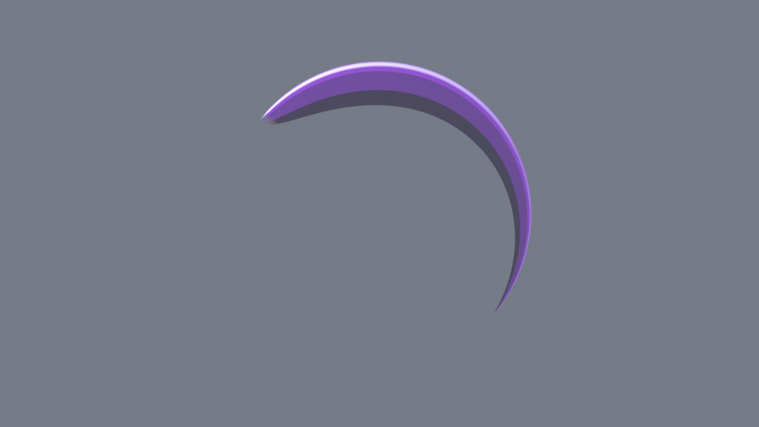
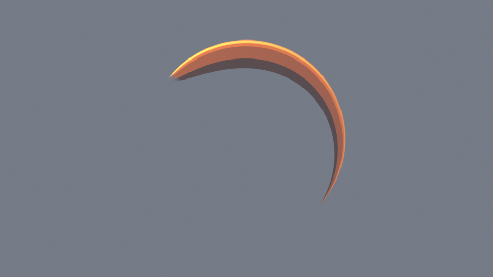
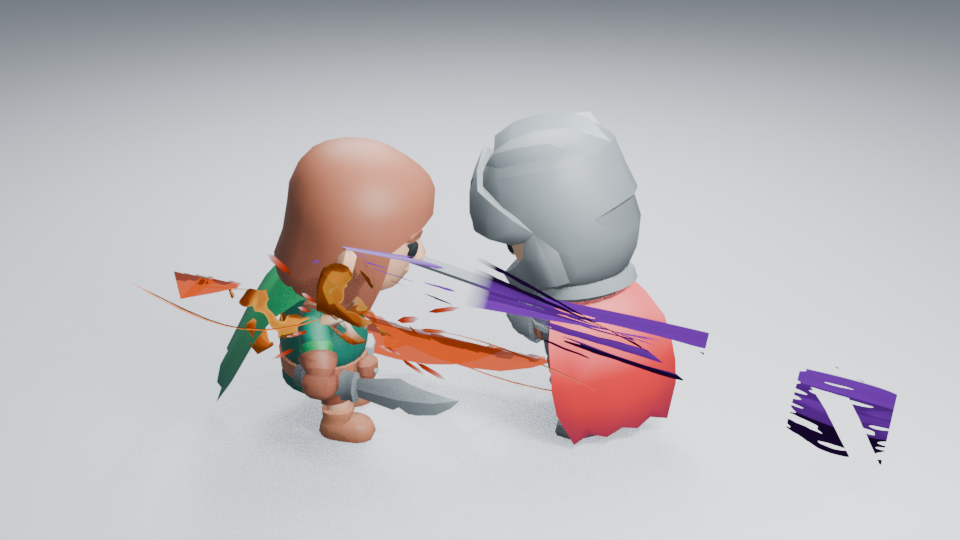
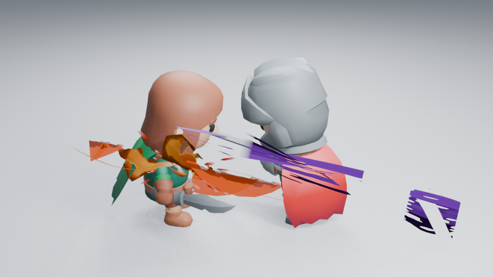

# 艺术控制与编辑流程审查

2026-10-28 更新。范围是当前八套完整效果，优先解决控制无效、无法恢复基础形态和换色困难，再处理角色镜头中的造型问题。[#161](https://github.com/mumu-lhl/blender-vfx-studio/issues/161) 跟踪实施；整体艺术品质仍由 [#89](https://github.com/mumu-lhl/blender-vfx-studio/issues/89) 跟踪。

## 优先判断

| 效果 | 核对结果与处理顺序 |
| --- | --- |
| Arc Slash | Bank=0 已能恢复平面，但固定材质裁切仍留下小缺口，锋刃颜色固定。先补全关闭裁切和独立锋刃配色，再用同一生成器提供 Clean / Stylized。Hook 与 Inner Notches 分别控制前端钩形和几何内缘，Contour 保留总强度；材质 Surface Cuts 单独调整。 |
| Energy Charge | 侧栏 Core Focus 集中内部蓄满大小、压缩和释放拉伸，直接编辑现有节点；初始大小与收腰留 Advanced Shape。[#166](https://github.com/mumu-lhl/blender-vfx-studio/issues/166) 已完成卷曲内核与进流权重；远景细亮带仍弱，见 [充能焦点检查](CHARGE_HIERARCHY_REVIEW.md)。 |
| Impact Burst | 实际侧栏已经隐藏特制主体不使用的 Count / Shape / Gravity / Spread。复用原生数值入口集中卷曲、细喷射宽度与压力弧高度，初期断裂和辅助明度留高级设置；不改默认图。侧面实体感仍待处理。 |
| Lightning Strike | 侧栏 Bolt Shape 提供已有长度与分支伸展。放电时序保留原演出，远景细枝与接触火花仍偏弱。 |
| Stylized Fire | RGB 是暖色色带的乘色，不能方便变成蓝火。提供原生五色配色与直接色带编辑；集中 Height / Flow / Curl。持续阶段大火面仍未解决。 |
| Dust Impact | 主体体积保留；集中 Rise / Roll / Density。辅助 Ground Veil 的 Fade 原先没有驱动材质，现接入透明消散；隐藏该层仅作终点开关的 Dissolve，避免把它呈现为连续侵蚀。 |
| Character Dash Echoes | Echo Count 直接控制数量，任意首尾跨度均匀采样，必要时求值子帧；见 [采样检查](DASH_SAMPLING_REVIEW.md)。浅背景旧影偏淡、重新捕获和统一尾部编辑仍有改进空间。 |
| Magic Circle | 集中实际生效的 Spin / Lift；Seal / Runes 上未驱动的 Lift 不显示。图案变体不是当前阻塞。 |

## 本批真实行为

侧栏用小型静态分组组织 Shape / Motion / Color / Material / Dissolve，其他项收在 Advanced；只显示相应层实际支持的控制。颜色选择器写回已有 RGB 属性，旁边的菱形给这三个原生通道插入关键帧，播放不依赖新增界面属性。

刀光的 Surface Cuts 关闭固定内缘裁切与残弧分段；Fragment Release=0 将退场改为连续透明淡出。Breakup 与 Dissolve 均为 0 时不再保留固定噪声侵蚀。Clean / Stylized 只设置当前节点的参数，保留配色、尺寸、时间和手动节点。当前格式参数预设缺少新增艺术字段时补安全默认值，不修改输入字典；完整效果载入仍保留其原生节点，不自动改造手工材质。

火焰 Orange / Blue / Green 只改主焰五个热色色点，并把 Heat Tint 设为白色；不改色点位置、几何、链接或其他节点。手工增加色点的色带继续直接编辑，不套用五色预设。余烬为独立层，仍可单独调色。私有造型与色带必须保存 Complete Effect，JSON 参数不包含它们。

核心和闪电新增入口直接显示现有常量节点的数值，不添加一层控制器驱动，也不重建图。若艺术家给该数值写了驱动或断开节点，不再显示为普通可编辑入口。节点动画、颜色和私有形状仍用 Complete Effect 保存。侧栏对特制层按实际驱动引用筛选参数，不为缺少控制的手工图补写节点。保存入口明确标为 Save Parameters (JSON)，用户库标为 Parameter Library (JSON)，与完整 .blend 分开。

## 已实际读取的画面

- 刀光：960×540 Eevee，出现 2、峰值 5、衰减 11；读取连续形态、暖色锋刃及灰背景对照。固定小缺口可关闭，尾部保持连续淡出。默认 Stylized 第 5／13 帧与保存的修改前原生基线解码像素相同，保留不规则风格。Hook 与几何内缘已独立，峰值 5 和衰减 11 的三组隔离对照已读取；内缘变化比前钩更细微，不称为整体造型升级。
- 火焰：960×540 Eevee 浅色角色镜头，Blue 的明暗背景与 Green 的浅背景第 20、36、60 帧均已读取。冷色外焰、深边与浅色热芯生效；余烬保留独立暖色。持续阶段仍是较大的完整火面，绿焰浅背景末段细边较弱；配色改进不能代表造型验收。
- 烟尘：重新清空场景后读取 Fade=0/1 的辅助薄雾对照。差异较弱，符合其辅助权重；不称为主体画质提升。最初带默认 Cube 遮挡的对照作废。64×64 Cycles CPU 透明渲染回归确认 Fade 实际改变透明度。

这些是实图和阶段对照，**没有观看实时播放**。后台面板绘制已逐层检查八套资产的字段；Linux 默认缩放下还实际检查了折叠组、颜色弹窗和 RGB 插帧、火焰色带、核心数值与五残影捕获窗口，见 [GUI 记录](GUI_CHECKS.md)。其他缩放与平台窗口未验收。现有角色战斗与完整施法证据仍有效；新配色、连续刀光在完整战斗中的速度感和遮挡尚未补验。

## 核心与闪电控制对照

已实际读取 18 张 960×540 Eevee 角色图：Charge 默认／修改的第 18、36、46 帧浅背景与第 36 帧暗背景；Lightning 默认／修改的第 2、3、12 帧浅背景、第 3 帧暗背景和远景。修改值为内核积蓄 1.9→2.8、压缩 0.6→0.8、释放拉伸 1.4→2.0；闪电高度 3.6→4.8、分支伸展 1.0→1.4。均直接编辑侧栏对应的原生数值，不改相机、曝光或合成来制造同组差异。

Charge 第 18 帧基本不变，符合积蓄尚未开始的节点时序；36 帧中心变大，46 帧释放拉伸明显。更大内核也增加了实体感，因此不更改默认值，不称为整体画质提升。Lightning 高度与分支确实变化；4.8 的近景高度超出构图，远景可看全，细枝仍偏弱。它仍保留默认三次放电，不声称已提供节奏编辑。

`tools/native_shape_preview.py --effect charge` 或 `--effect lightning` 可重建同组前后图，支持 `--dark / --far / --frames`。实际图像摘要与生成源记录见 [原生形状样本](NATIVE_SHAPE_SAMPLES.json)。这轮验证可编辑性和当前限制，没有观看实时播放，也没有验收完整镜头的速度感。

## 实图示例

同一生成器的 Clean 峰值，采用灰背景：



只改变主体与锋刃配色后的暖色版本，机位与曝光保持一致：



两图为 [CI 40595259739](https://github.com/mumu-lhl/blender-vfx-studio/actions/runs/40595259739) 的原始 PNG，无裁切、调色或后期辉光；原图摘要见 [图片记录](images/art-controls-gallery.json)。已核对三组 Clean 记录的生成源摘要，CI 的第 2／5／11 帧无插件图像也与原图解码像素一致。

## 复现与必要检查

```sh
blender -b --factory-startup --disable-autoexec --python-exit-code 1 --python tools/slash_preview.py -- --engine BLENDER_EEVEE --style CLEAN
blender -b --factory-startup --disable-autoexec --python-exit-code 1 --python tools/slash_preview.py -- --engine BLENDER_EEVEE --style CLEAN --light --body-color 1 .2 .015 --blade-color 1 .75 .08
blender -b --factory-startup --disable-autoexec --python-exit-code 1 --python tools/fire_preview.py -- --palette BLUE --frames 20 36 60
```

`--light` / `--dark` 切换上述各工具支持的背景；输出设置记录源文件摘要。CI 生成 Clean、暖色刀光和蓝／绿火焰的阶段图，保存为原有 visual-review 附件，不增加散落的发布附件。

功能检查覆盖风格切换不重建节点、独立 Hook／内缘、原生 RGB 动画、现有参数预设、手工完整资产、火焰色带保护、烟尘实际透明渲染。新增控制检查 11 项，加上刀光 10 项与残影 8 项回归均通过。手工嵌套几何组的核心值可编辑，完整 .blend 保存／载入和无插件重开保持几何；测试分组保留原接口标识，重开无无效修改器驱动警告。刀光颜色动画与蓝焰均已保存并在不导入插件的新进程跳帧重开；Clean 第 2／5／11 帧和蓝焰第 20／36／60 帧的高清重渲染均与原图解码像素一致，并正常退出。当前源码完整后台套件、ZIP 构建、安装／启用／卸载与八套后台面板绘制通过。小型界面与配色改动不重复所有无关电影渲染；最终提交的检查范围另记于 PR。

PR #165 的功能提交 `0ad5dbf8833e681301566d2d9c43d3687fb08e13` 已由 [CI 40607385631](https://github.com/mumu-lhl/blender-vfx-studio/actions/runs/40607385631) 完成全部 12 项检查，均成功。该结果覆盖上一轮控制与界面改动，不作为本轮充能造型的视觉验收。

## Impact 的集中入口

[#168](https://github.com/mumu-lhl/blender-vfx-studio/issues/168)／[PR #169](https://github.com/mumu-lhl/blender-vfx-studio/pull/169) 复用现有节点值，不新增控制器属性或造型图。侧栏显示 Body Curl、Fine Jet Width 与 Wave Height；高级设置提供 Early Body Breakup、Support Tone。几何值优先于同名材质值，节点受驱动或已断开时不显示。

14 项艺术控制与无插件重开通过：宽度只改细喷射，翻卷只改压力体，波峰只改高度；两项材质控制通过实际像素确认，断裂改变覆盖，辅助明度只改颜色。完整效果载入的节点可独立调整，另一个实例保持原值。修改后的原生材质数值和跳帧几何在无插件进程中保持。

`tools/native_shape_preview.py --effect impact` 生成角色命中 49／53／58 帧的默认／修改对照，也支持 `--dark`、`--far`。已实际读取 10 张 960×540 Eevee 图：浅背景 49／53／58 帧的默认／修改对照，以及 53 帧暗背景和远景的两组对照。参数确实改变压力体、细喷射和弧高；第 49 帧主要由短闪主导，修改差异很小，符合各层职责。修改组合的低翻卷、低破碎让主体更像硬片，未采用为默认值。默认生成器与材质未改，不以这次入口整理宣称整体画质提升。

默认主体与参数对照，第 53 帧：





已保存修改场景，在无插件进程按 58／53／49 重渲染，三个阶段解码像素与原图相同，96 帧清空，正常退出；对应 [样本与来源](images/impact-control-samples.json)。复现重开用 `tests/native_shape_visual_reopen.py`，默认打开 `edited.blend`；它检查生成器保持原生播放，不加载侧栏或注册属性。

观图还发现命中起帧的短闪会随绑定旋转变暗，已创建 [#170](https://github.com/mumu-lhl/blender-vfx-studio/issues/170) 单独处理。其世界法线阈值导致亮面不一定朝向镜头；不通过加亮全层解决。
