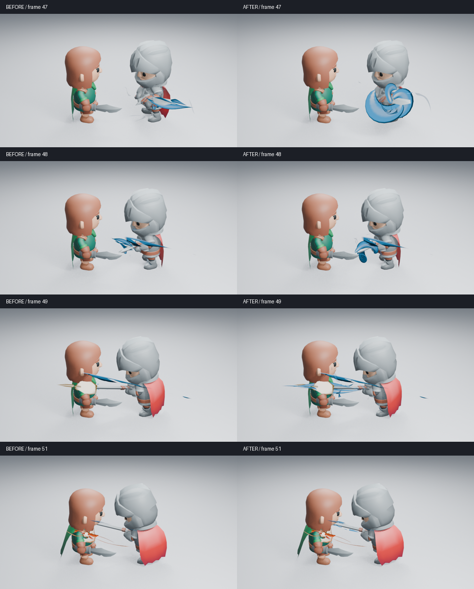
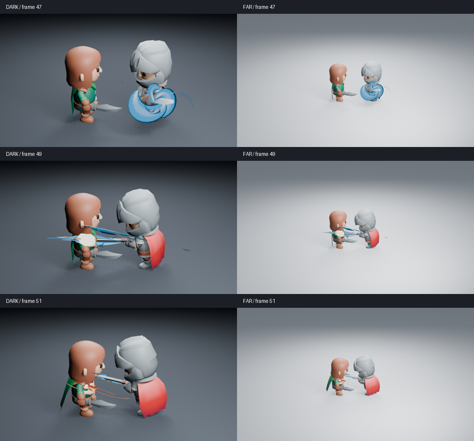

# 充能释放与真实刀刃接触

完整角色抽帧暴露了一个时序错误：第 47 帧仍在回摆，充能却已拉成长针，尖端伸向攻击者身后；剑刃实际接触发生在第 49 帧。本轮只修正这个可编辑镜头实例的时间与方向，不包含压力核草稿，也不替换独立充能资产。



原始高清图：[47 前](images/release-contact-before-47.png) · [47 后](images/release-contact-after-47.png) · [49 前](images/release-contact-before-49.png) · [49 后](images/release-contact-after-49.png)。排列图只缩小图片并标注帧号，没有调色、重绘或改变合成。

## 原因与改动

充能 Geometry Nodes 的 `Release Pinch Begins` 在周期进度 0.84–0.88 之间完成收束，随后短暂保持最大释放。固定 Duration=52 让第 47 帧进度已达 0.8846；到真实接触时，进度为 0.9231，材质中的能量剩余量已经下降。

镜头现在从刚生成的原生节点读取最大释放阶段，用接触帧、Start 和 Speed 计算该实例的 Duration，当前为约 54.545 帧。第 47 帧进度为 0.8433，第 49 帧进入 0.88 的最大释放阶段。控制器仍是普通原生参数，用户可以继续调整；没有 Python 逐帧处理或自动重定时系统。

转剑阶段补齐第 41–51 帧的普通四元数旋转关键帧，避免第 48 帧快速转向时依靠间隔两帧的近似插值。角色动作、剑刃轨迹、接触检测、刀光和命中生成器、相机、灯光、发光强度保持原值。时间记录保存在镜头 JSON 中，便于核对。

## 实际画面判断

已实际读取修复前第 47／48／49／51 帧，以及修复后浅背景第 45／47／48／49／51／55／80 帧、暗背景和远景各第 47／49／51 帧，共 17 张 960×540 Eevee 图。Blender 5.2.2、16 samples、AgX，无额外辉光。

回摆时先保留卷曲积蓄，第 48 帧向刀刃方向收束，第 49 帧的蓝色释放到达白热命中处，第 51 帧收成细尾，第 55 帧交给橙色压力体和余烬，第 80 帧恢复干净。这比先向身后释放、接触时已衰减的顺序更连贯。接触白核没有被蓝色大面盖住，远景也能分辨它与积蓄阶段。



**取舍与未解决问题：** 第 47 帧保留的宽卷片比原先长针更遮挡手部；原充能仍像较实的弯片。第 49 帧的释放尖端伸出受击者外侧，蓝色细线也增加了局部重叠。远景细尾和次级碎片偏弱，命中主体的体积表现仍不足。这次改善只限于能量传递的时机和方向，不能宣布整体艺术品质通过。尚未查看这份修复的完整动作隔帧或实时视频。

## 功能验证与复现

新增回归先在 main 复现提前释放，再验证修复。检查 Geometry Nodes 与 Shader Nodes 在接触时进入同一释放阶段，接触前尚未完成释放，第 47–51 帧释放轴与真实剑刃一致，角色轨迹未被改动。保存场景在新进程关闭自动执行、未加载插件时，阶段、方向和第 96 帧清场检查通过，正常退出。Ruff 0.14.1 全库 lint 与格式检查通过。高清原生像素复现及 CI 尚在执行，不计作已完成。

```sh
LP_NUM_THREADS=2 MESA_SHADER_CACHE_DISABLE=true blender -b -t 2 --factory-startup --disable-autoexec --python-exit-code 1 --python tools/character_combat.py -- --frames 45 47 48 49 51 55 80
```

加 `--dark` 或 `--far` 检查对应条件。修改前基线为 `7cce589`，修复功能源码为 `d1695f7`；每批源码摘要、实际帧号和图片摘要见[检查清单](images/release-contact-samples.json)。这项镜头安排不增加几何或材质，但不同阶段的求值与渲染成本仍会变化；没有以节点数量或单张耗时证明实时性能。
