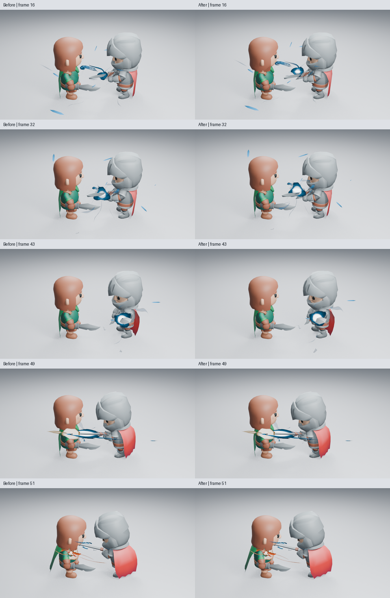
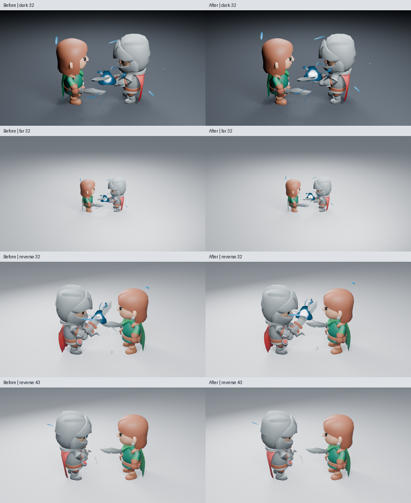
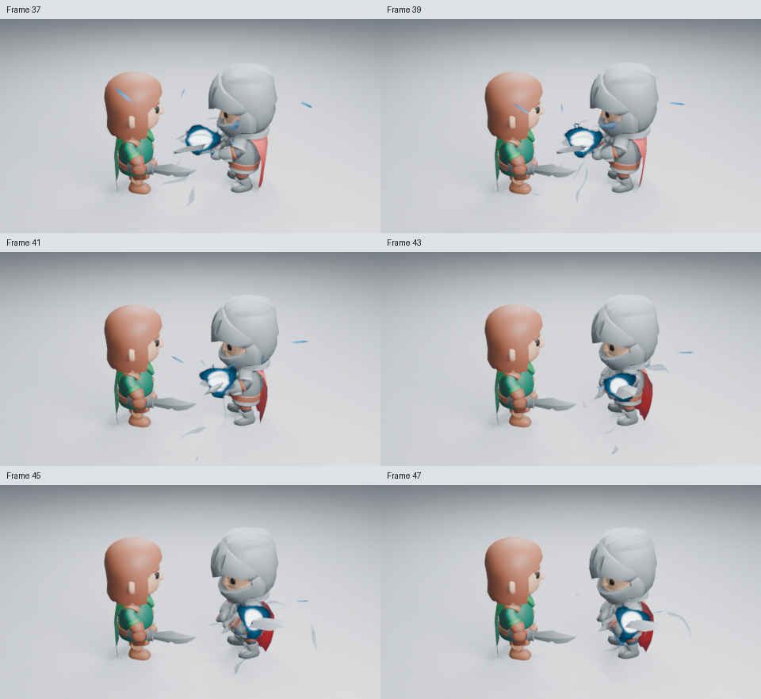
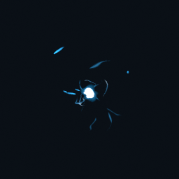

# 让热芯可见，并把汇流带回剑刃

这轮针对角色蓄力前段：中心被剑身遮住，外围进流比焦点更醒目。真实生成器改为更早形成小热芯，并让主进流以移动头部、较弱连尾传递能量。角色镜头用原生绑定位置关键帧，让充能组合先略离刀面，释放前回到剑刃。没有改相机、角色攻击动画或命中位置。

原始高清：[早段焦点](images/charge-fronts-after-16.png) · [积蓄](images/charge-fronts-after-32.png)。比较页只缩小排列原始 PNG 并标帧号，没有调色或重绘。

## 画面与节点原因

主进流已有移动亮纹，但管体大部分持续不透明，容易读成静态硬质带。材质现在让原有的向内移动能量包承担主要覆盖，保留 0.08 的低权重连尾。原生 **Intake Body Retention** 可修改这层连接，设为 1 让连尾与头部使用相同透明权重，原有的侵蚀仍有效；没有修改几何或增加侧栏参数。

内核在起势时形成小白芯，再扩大储热区域。初始尺寸为 0.78，蓄满尺寸保留。白芯遮罩提前生长，早段局部辐射也通过原有热量公式提前升高；整体 Strength 和峰值辐射上限不变。向内压缩、后续拉伸、颜色和消散仍沿用原控制。保持较小的初始几何，让蓄满时的形态变化仍可辨。

分项试验的早段射线核对确认，通向实际焦点的视线先与剑身相交。充能组合通过原生 Copy Location 的位置偏移，在第 1–37 帧保持世界 Z 方向 0.12 的离刃距离，随后线性回落，第 47 帧回到剑上，第 49 帧仍按实际接触释放。移动整套充能让进流继续接向同一焦点，没有让效果穿透武器或角色。

## 已查看的画面与限制

正式源码已实际读取浅背景第 7／16／32／43／47／49／51 帧，暗背景与远景第 16／32 帧，背侧第 16／32／43 帧，均为 960×540、Eevee 16 samples、AgX。早段热芯从剑后露出，随后积蓄和回刃的关系更清楚；独立资产第 13／31／43／46 帧也已实际读取，变化存在于完整效果本身。

**这是焦点与汇聚主次的改善，整体艺术品质尚未通过。** 外围有较长的碎片抢眼，部分进流仍像硬质带；角色身体蓄势不足。背侧第 32 帧进流横过面部，第 43 帧中心被头盔挡住，未记为背侧可读性通过。尚未观看实时播放。

24 项完整资产测试、接触与回刃轨迹、无插件时序、八套原生资产回放通过。正式场景在未加载插件的新进程按 49→16→32 重渲染，三张高清 PNG 逐通道相同，第 96 帧清场。完整 Energy Charge 和 256×256 预览已重建并实际查看；原生集合载入后的 37→13→37 回放及第 49 帧清场通过。

## 隔帧与实际成本

从正式场景原生渲染第 1–55 帧的全部奇数帧，共 28 张，480×270、16 samples，五页均已实际读取：[1–11](images/charge-fronts-motion-01.png) · [13–23](images/charge-fronts-motion-02.png) · [25–35](images/charge-fronts-motion-03.png) · [37–47](images/charge-fronts-motion-04.png) · [49–55](images/charge-fronts-motion-05.png)。相邻样本间隔 1/12 秒，回刃、接触与交接的先后关系保持；未验收 24 fps 实时速度感。

Blender 5.2.2、两核配额、两线程、Mesa 25.0.7 llvmpipe。在同一保存场景仅开关特效集合，第 32 帧求值各预热三次、再测九次；渲染先作两次预热，再作一组同帧配对。

| 第 32 帧 | 无特效 | 有特效 |
| --- | ---: | ---: |
| 场景求值中位数 | 0.48 ms | 7.63 ms |
| 预热后同帧渲染 | 11.25 s | 22.25 s |

渲染为 960×540、Eevee 16 samples。这不是视口 FPS，也没有相同设备上的修改前后性能对照；一组渲染不足以计算可靠的分布或 p95。原始样本、源码与图像摘要见[检查清单](images/charge-fronts-samples.json)。

功能源码 `5c3d17b`，后续 `248c15f` 仅合入已验证的横带说明与实图，运行时代码相同。CI [41189505385](https://github.com/mumu-lhl/blender-vfx-studio/actions/runs/41189505385) 仍在运行。工作由 [#137](https://github.com/mumu-lhl/blender-vfx-studio/issues/137) 跟踪，PR 为 [#197](https://github.com/mumu-lhl/blender-vfx-studio/pull/197)，整体艺术问题保持未完成。
