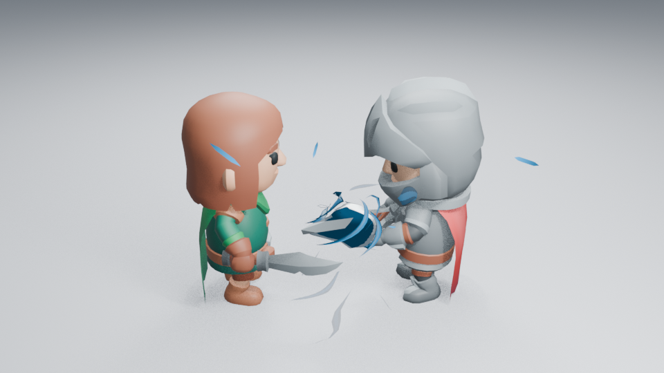

# 角色充能焦点：压力核实验

**当前不合入 main。** 新方案的亮暗焦点更清楚，但近景仍像包住手部的刚性护罩，尚未达到预期的战斗特效表现。本文区分已完成的功能检查与尚未通过的艺术判断。



## 画面原因与实际生成器

原内核主要是三片薄卷曲面。仅让它们变大或压缩，不会产生中心实体；加入实体后，宽卷片又遮住了中心。隔离与分色渲染确认了遮挡位置。实体直接使用原先的白面材质时，则像灰白色实物。

实验在原来的同一网格层内加入原创三瓣压力形，继承已有的积蓄、压缩和沿武器释放的控制。原生 **Nucleus Shell Width** 调整三片卷曲外壳，设为 0 可以收起外壳，中心和进流保持原位置；设为 1 可以展开原来的宽卷片。没有新增对象层、粒子或侧栏框架。

材质把实体与卷片的白面遮罩分开。此前取较大值的混合会使旧白面覆盖新分面明暗；像素回归先复现错误，修正后白面控制可独立归零。当前试用深色内区、流动亮缘和很窄的外轮廓，亮度随积蓄增强、交接时减弱，只作用于中心压力形。角色、动作、镜头和灯光保持一致。

## 已查看的图像与判断

当前已实际读取九张 960×540、Eevee 16 samples、AgX 图：浅背景第 36／45 帧，暗背景与远景同帧，以及出现第 16 帧、命中第 49 帧和恢复第 80 帧。没有额外辉光。

[36 前](images/charge-heart-before-36.png) · [36 当前](images/charge-heart-light-36.png) · [45 当前](images/charge-heart-light-45.png) · [此前不理想的实体 45](images/charge-heart-opaque-45.png) · [暗背景 36](images/charge-heart-dark-36.png) · [远景 36](images/charge-heart-far-36.png)。这些是原始渲染 PNG，没有裁切、调色或重绘。

浅背景和远景中，深色内区比空的卷片更容易辨认，初期到蓄满也出现了体量差异。第 45 帧仍有较实的表面和手部遮挡，形态与动作的力量联系尚不充分。命中与恢复保留，不能据此把充能本身宣布为艺术验收通过。动作抽帧和实测成本正在补齐；未观看实时视频。

参考作品的实际查看范围与作者技术说明见 [参考区分](LIBRARY_REFERENCE_STUDY.md)。参考 GIF、贴图和模型不进入效果或仓库资产。

## 功能检查与复现

25 项完整资产检查与 14 项艺术控制通过。新增行为覆盖压力核真实体积和积蓄增长、外壳归零不改变中心及进流、白面可独立关闭，以及已有的复制、保存、时间和释放控制。八套完整资产的无插件回放通过。高清原生重开曾被执行会话中断，不计为成功，正在重新执行；功能通过不代替艺术判断。

```sh
LP_NUM_THREADS=2 blender -b -t 2 --factory-startup --disable-autoexec --python-exit-code 1 --python tools/character_combat.py -- --frames 16 36 45 49 80
```

加 `--dark` 或 `--far` 生成对照。源码、已查看阶段与图片摘要见 [检查清单](images/charge-heart-samples.json)。工作继续由 [#137](https://github.com/mumu-lhl/blender-vfx-studio/issues/137) 跟踪，不关闭整体艺术问题 [#89](https://github.com/mumu-lhl/blender-vfx-studio/issues/89)。
