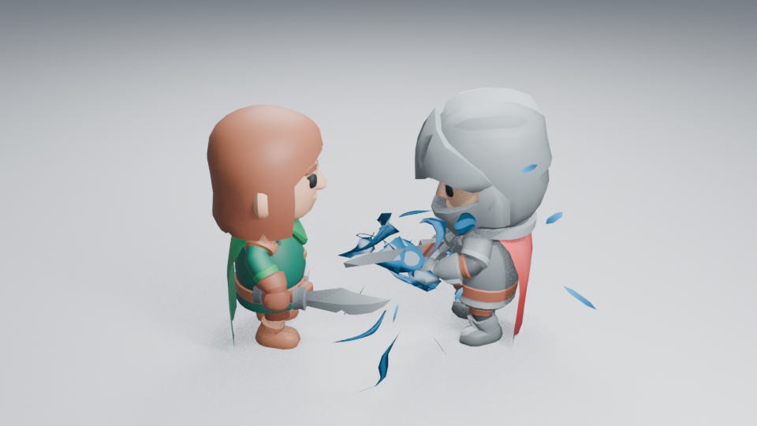
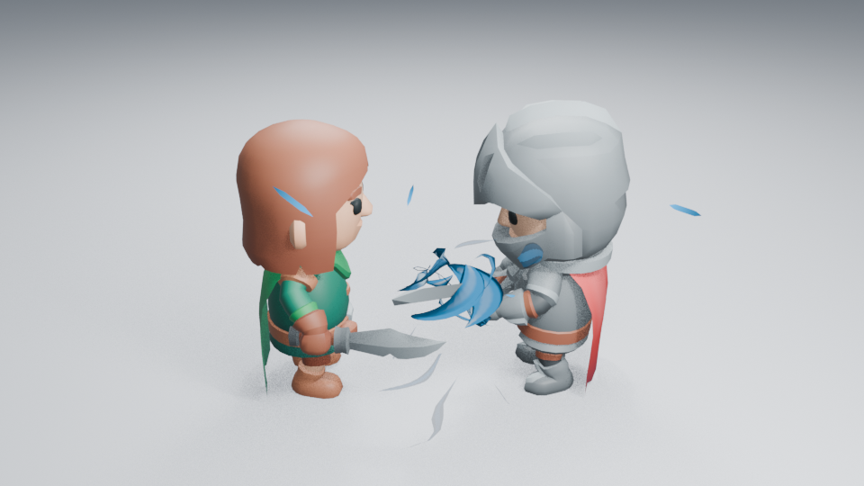
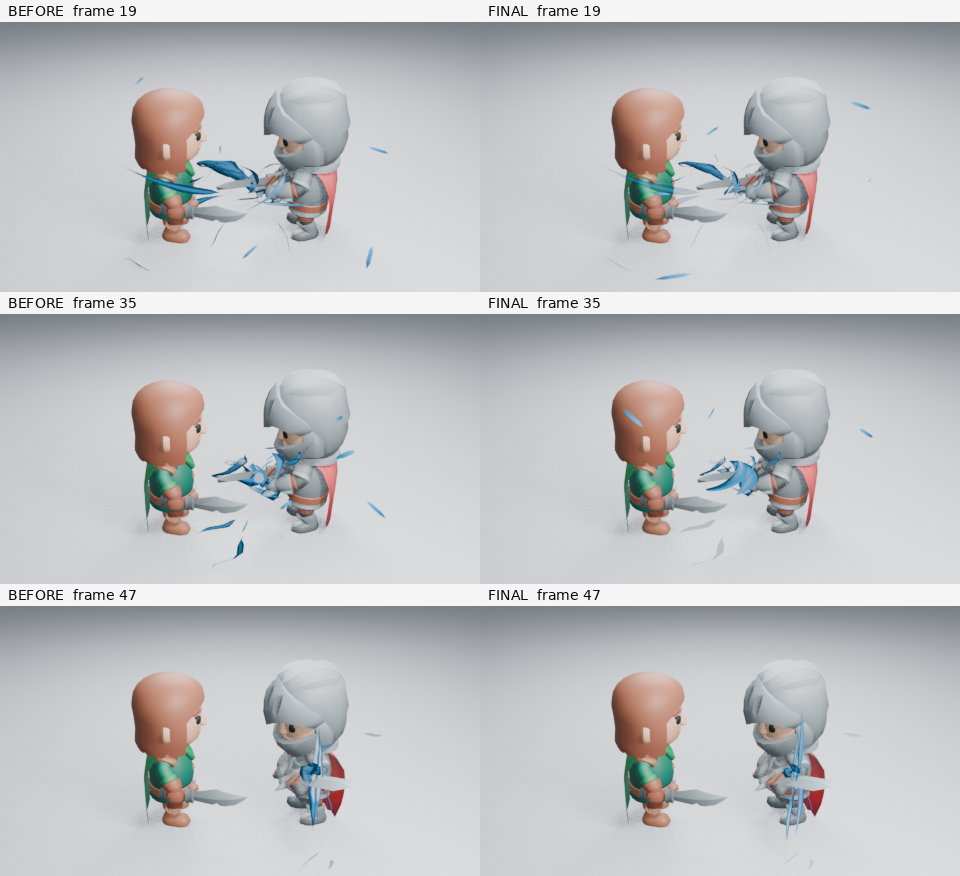

# 充能焦点与进流层次检查

2026-10-28，跟踪 [#166](https://github.com/mumu-lhl/blender-vfx-studio/issues/166)。本轮改动真实 Energy Charge 生成器，沿用角色镜头的相机、灯光、曝光与合成设置，不靠预览美化制造差异。

## 画面问题与原因

修改前的浅背景角色图中，中心像带白斑的实体叶片，外围束流与碎片争夺焦点。核心网格的三瓣仅有六个纵向采样、三角截面；它们在压缩后重叠，难以读出汇聚的方向。材质主要按表面朝向和高度画白区，不随能量沿瓣运动。积蓄形变从归一化进度 0.45 才开始，前段主要由外围碎片表达。

这不是把尺寸设大能解决的问题。上一轮 Core Focus 对照中，更大的内核只是更明显的实心叶片。

## 实际实现

- 三片不等大的卷曲能量片围出真实空隙。每片沿弯曲路线采样 19 次，使用有厚度的透镜截面；侧面仍有体积，不依靠一张朝向相机的卡片。
- 原生材质用沿形体的坐标与加速时间控制窄亮带，保留蓝色中间调、深色边缘和可编辑白色阈值；窄的连续纹理亮线连接错开前沿，避免每片只有一块固定白斑。亮度没有整体加码。
- 积蓄形变从进度 0.30 开始。大小、压缩、释放收腰和拉伸仍是原来的原生节点值；只改变内核的控制继续不影响进流路径。
- 核心层 Intake Weight 控制进流截面，外层及地面进流各自控制透明权重。所有值保存在 Geometry Nodes，经命名属性传到 Shader Nodes，无 Python 每帧回调。
- 辅助束头宽度收敛，汇聚粒子发射率从每秒 14 降至 9；没有用增加粒子数量填补造型。

第一轮实图发现：把核心进流也直接乘 0.6 透明度会让 Eevee 的 Dithered 材质出现明显颗粒。该方案作废，核心改为调整截面，仅在权重为 0 时完全隐藏；内核始终独立于这个控制。

## 验证记录

已实际读取 **17 张 960×540 Eevee 对照图**：修改前的浅背景 18／36／46、暗背景 36／46、浅背景远景 36；最终生成器的浅背景 18／30／36／43／46、暗背景 18／36／46、远景 36／46，以及反向机位 36。修改前为 main `cf4a54b`，最终源码为 `e43402b`；逐文件核对渲染记录的生成源摘要与提交内容一致，见 [样本清单](images/charge-hierarchy-samples.json)。

峰值中心从碎片结变成可辨认的卷曲组合，远景焦点更集中；外围薄流退为辅助。暗背景下蓝色中间调、窄亮带和深边可分开，反向仍有间隙。第 43 帧是较宽的压缩形态，46 帧收束为细长释放轮廓。不过部分机位仍读成蓝色弯片，远景细亮带偏弱，不能据此宣布整套特效已达到成熟游戏品质。

修改前浅背景峰值：



最终生成器，同机位同设置：



无插件新进程按 46／18／36 跳帧重渲染，三个高清阶段与原图解码像素完全一致，角色姿态变化和第 96 帧清空检查通过，进程正常退出。测试使用局部 `MESA_SHADER_CACHE_DISABLE=true`，没有忽略退出错误。

已实际读取修改前后各 **30 张原生动画样本**：第 1–53 帧隔一帧取一帧，另看 57／61／65，共 60 张。为控制本机软件渲染时间，这部分以 **480×270、16 samples** 检查连续变化，细节与明暗远景判断使用上述 17 张高清图；两类检查分别记录，不把低分辨率样本说成高清验收。

19–35 帧之间，新版中心逐渐形成卷曲焦点，外围进流的覆盖减少；37–45 帧压缩形态持续可读，47 帧收成窄释放，49 帧接上刀光与命中。局部没有观察到中心突然消失或凭空换位。不过近景 51／53 帧的长刀尾超出画面右侧，这个机位不能完整验收整条刀光；Impact 的角色控制对照继续补看远景。**没有观看实时播放。**

下图保留原始采样帧，左右分别是修改前／后；仅在图外加帧号，没有裁切或调色：



已有 21 项入门库与 11 项艺术控制检查通过；完整资产保存／载入、独立实例和原生控制仍受这些检查覆盖。入门库无插件跳帧重开通过。固定 900 顶点上限已改为跳帧不累积几何的检查；拓扑数量不代表实际速度。

## 可用设备实测

Blender 5.2.2，CPU 配额 2 核、Blender／llvmpipe 各 2 线程，Mesa 25.0.7 软件 Eevee；960×540、16 samples。使用同一已保存角色场景，只切换 VFX 集合。

第 36 帧九次有效后台求值的中位数：无特效 **0.82 ms**，有特效 **11.98 ms**；p95 为 0.84／12.40 ms。渲染排除两次预热后，同帧一组对照为无特效 **16.12 s**、有特效 **34.03 s**。首个有特效预热需 83.71 s，包含无磁盘缓存下的着色器编译，不隐去首次等待成本。

这里只测量该镜头这一帧，不是所有资产的平均成本，也不是视口帧率或显卡结果；一组渲染对不足以计算可靠的渲染 p95。硬件、分辨率、透明叠加和材质都会影响成本。几何数量仅说明复杂度，没有作为性能门槛。

## 复现

```sh
LP_NUM_THREADS=2 blender -b -t 2 --factory-startup --python-exit-code 1 --python tools/character_combat.py -- --frames 18 30 36 43 46 --output work/charge-review/light
```

加 `--dark` 或 `--far` 检查其他背景与距离；输出目录中的设置记录包含实际源码摘要与渲染耗时。查看图像后再判断艺术品质，不能只读取脚本的成功标记。

采样也可使用 Blender 原生命令，不需要加载插件。先生成并保存角色场景，再对该文件的 1–53 帧每隔一帧渲染；50% 分辨率对应本镜头的 480×270。`-o` 请使用自己的绝对输出目录，命令不会保存覆盖原 `.blend`。

```sh
LP_NUM_THREADS=2 blender -b -t 2 --factory-startup work/charge-review/light/character.blend --python-expr 'import bpy; bpy.context.scene.render.resolution_percentage = 50' -o /absolute/output/motion-#### -s 1 -e 53 -j 2 -a
```

功能提交 `e43402bfbcb32033cac69a88831611c50c4c27f9` 的 [CI 40693445113](https://github.com/mumu-lhl/blender-vfx-studio/actions/runs/40693445113) 已完成三平台功能／安装检查，以及 Charge Handoff、Combat、Lightning、Fire 等视觉任务；其余长镜头仍在运行。此前 PR #165 的全部 12 项检查已成功。本轮不发布新版本。

CI 的实际 `blender-vfx-studio-extension` 附件（artifact 12820016523）已下载检查：包含插件与 18 个示例的两个 ZIP。打包 UI 与功能提交源码一致；原生打开导出的 Energy Charge，确认 256×256 自定义缩略图、726 顶点核心以及 0.6 进流权重、0.35 白色阈值均已保存。资产 SHA256 为 `44a9450f2539041bfdb596af92126ce18799783c5941d1bf7eaac85bfeeef3f8`。这不是发布新版本。
