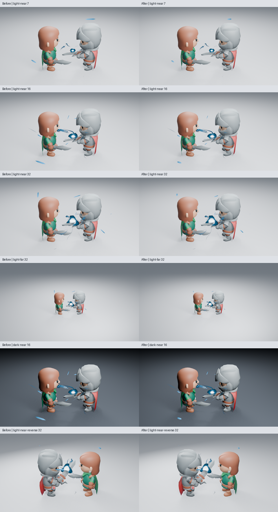
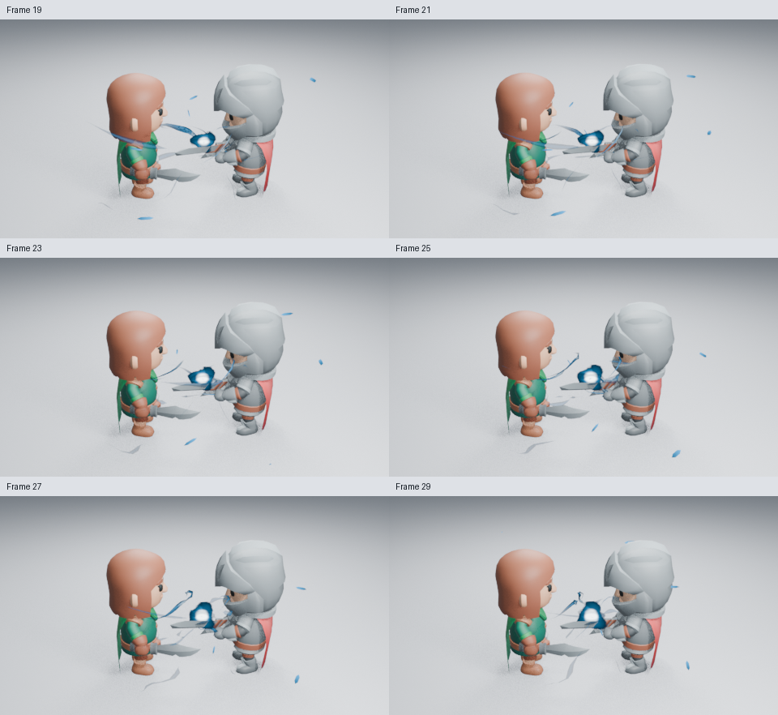
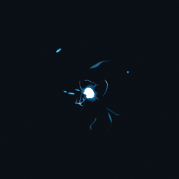

# 汇聚粒子的出生与拉长

Energy Charge 的外围粒子原先一出生就使用较长形态，早段热芯还小时容易抢眼。真实生成器现在按已走过的汇聚比例，让粒子从短点缀逐渐拉长；该比例也决定径向加速。数量、颜色、轨迹和 Size 控制保持原值，寿命缩放与淡出仍生效，没有添加侧栏参数。

第 7 帧原始高清：[修改前](images/charge-motes-before-7.png) · [修改后](images/charge-motes-after-7.png)。排列页只缩小原始 PNG 并标注，没有调色或重绘。

几何节点将长轴系数从 1.2 逐渐提高到 3.8，再与原有寿命尺寸相乘。因此，实际可见长度也受寿命影响；3.8 是接近中心时的系数；实际可见长度由它与寿命尺寸共同决定。所有运动与形变均存入原生节点，不需要插件逐帧运行。

已实际读取七张 960×540、Eevee 16 samples、AgX 图：浅背景第 7／16／32 帧，远景第 7／32 帧，暗背景第 16 帧，背侧第 32 帧。起势时较长的外围片变成较短点缀，热芯更突出；后段差异较小。远景仍能找到热芯，但不能仅凭静态图判断每个粒子的方向感。

**这是点缀层主次的局部改善。** 部分进流仍像硬质带，背侧第 32 帧的主进流仍横过面部，身体蓄势没有改动。未观看实时播放，整体艺术验收保持未完成。

25 项完整资产测试与原生回放通过。新增回归在相同寿命年龄读取单粒子的实际求值网格，改变向内速度，确认长度随运动变化且可复现；沿用轨迹、方向与 Size 的原测试。保存场景按 32→7→16 原生重渲染，三张高清 PNG 逐通道一致，第 96 帧清场。

18 张 480×270 原生样本已全部实际读取：第 7–35 帧全部奇数帧，以及 47／49／51。三页为 [7–17](images/charge-motes-motion-01.png)、[19–29](images/charge-motes-motion-02.png)、[31–35 与 47／49／51](images/charge-motes-motion-03.png)。最后一页包含较大的时间间隔，不能当作连续实时播放。

完整资产与 256×256 预览已重新生成并实际查看；未加载插件的集合载入确认新拉长节点、37→13→37 可复现与第 49 帧清场。

在两核配额、两线程的同一角色场景，第 16 帧只开关特效集合，求值各预热三次、再测九次，中位数有／无特效为 10.17／0.57 ms。本轮只测 CPU 场景求值，没有新的渲染成本或修改前后性能对照，不是视口 FPS。原始数据、图像与源码摘要见[检查清单](images/charge-motes-samples.json)。功能源码为 `fa6ae62`，含测试的源码为 `9037bbf`。跟踪 [#137](https://github.com/mumu-lhl/blender-vfx-studio/issues/137)，PR 为 [#200](https://github.com/mumu-lhl/blender-vfx-studio/pull/200)。
