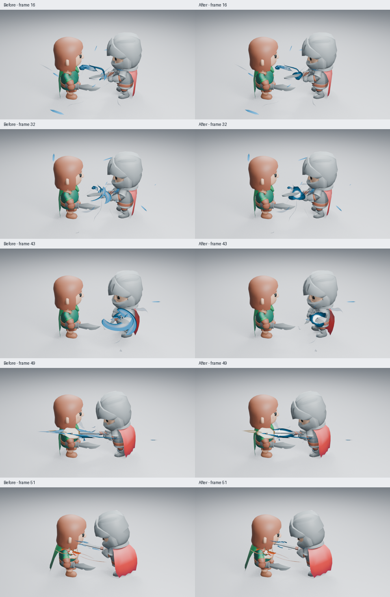
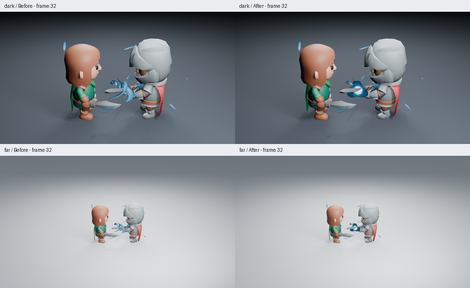
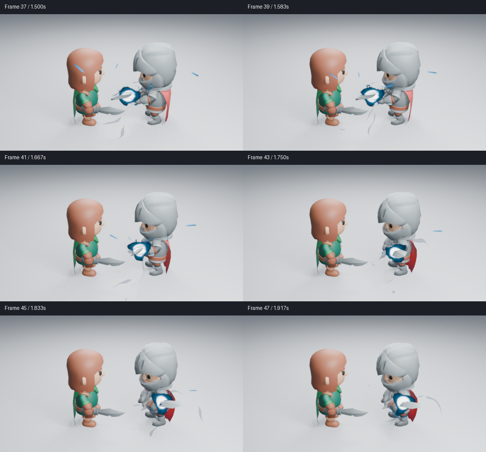
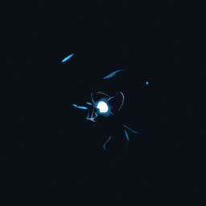

# 充能焦点与向内流动的能量场

跟踪 [#137](https://github.com/mumu-lhl/blender-vfx-studio/issues/137)。本轮修改真实 Energy Charge 生成器：把转剑时的大块卷片改为较集中的能量场，让积蓄和释放围绕白热焦点组织。角色动作、绑定、相机、灯光与合成沿用刀光空间修复后的镜头，没有为这一轮重新摆拍。



原始高清：[积蓄前](images/charge-plasma-before-32.png) · [积蓄后](images/charge-plasma-after-32.png) · [转剑前](images/charge-plasma-before-43.png) · [转剑后](images/charge-plasma-after-43.png)。排列图仅缩小 PNG 并加帧号，没有调色或重绘。

## 造型、材质与运动

原内核由三片弯曲网格承担主要轮廓。材质用法线与窄亮带区分明暗，大部分内核保持不透明；转剑后几片曲面重叠，像包在腰侧和手部的护甲。原压缩还会压低形体、撑开横向截面，积蓄越强，大弯片越抢眼。

现在三张可编辑交叉网格承载程序化透明遮罩。点属性记录二维坐标，材质按到中心的距离、角度、三条螺旋波和四维噪声产生流动边缘；侧向网格按视线夹角减弱。白热区随储能扩大，蓝色明暗流带向内移动，外围保留较暗的边缘。Eevee 使用混合透明，避免柔边在常用采样数下产生明显颗粒。

几何节点负责增长、三轴收紧、释放时收腰与沿本地 +Z 前送；材质负责积蓄时的亮区和释放时的热量退出。热芯的辐射强度随白热区提高，外围进流保持原发光参数。Fade 同时控制释放消散，Opacity、Dissolve 和 Strength 仍有效。所有计算存入原生节点与简单驱动器，跳帧不积累状态，无播放回调、外部贴图或新的侧栏框架。

参考采用[已观图的充能拆解](REFERENCE_VISUAL_STUDY.md)中“集中焦点、辅助流有主次、释放迅速交接”的原则，没有复用原作贴图或源码。

## 实际图像判断

新版已实际读取 16 张 960×540 Eevee 图：浅背景和暗背景各第 16／32／43／49／51 帧，远景第 32／43／49／51 帧，背侧第 32／43 帧。另用保存的刀光修复场景原生补渲染浅背景第 16／32／43 帧，以及暗背景、远景第 32 帧，逐张对照。全部为 Blender 5.2.2、16 samples、AgX，无额外辉光。

第 32 帧的白热区比细卷片更容易找到；第 43 帧从遮住前臂和腰侧的大弯片收为手边焦点；第 49 帧沿剑刃形成较连贯的白热释放，第 51 帧主要交给橙色压力体与余烬。暗背景和远景也能分辨中心，不靠相机或后期提高对比。



**这些是局部焦点改善，不代表整体艺术品质已经通过。** 第 16 帧中心仍偏弱，外围进流抢眼；外圈局部厚暗，释放仍有蓝线重叠，角色前半段缺少足够的身体张力。背侧第 43 帧中心被角色遮挡，未记为可读性通过。原生射线核对显示，通往中心的视线先与头盔和头部相交；没有让效果穿透角色来制造可见性。

[背侧第 43 帧原图](images/charge-plasma-reverse-43.png)。未观看实时视频；本轮充能周期的 28 张原生隔帧已全部实际读取。

## 原生编辑与功能验证

沿用 Stored Core Size、Compression、Release Stretch、Intake Weight、颜色及溶解控制。Compression=0 关闭向内收紧；内核的变化不改变进流路径。私有节点与材质用 **Save Complete Effect** 保存，参数 JSON 仍只保存参数值。

22 项入门资产检查通过，包括独立实例、时间与速度、参数响应、完整资产保存载入及非累积跳帧。保存文件在未加载插件的新进程通过重开；高清角色场景按 51→32→49 倒序重渲染，三张 PNG 的全部 RGBA 像素一致，角色动画与第 96 帧清场通过，正常退出。Ruff 0.14.1 全库 lint 与格式检查通过。这些功能检查不代替上述画面判断。

## 当前设备上的成本

同一保存场景第 32 帧，仅切换 VFX 集合。2 核 CPU 配额，Blender／llvmpipe 各 2 线程，Mesa 25.0.7 软件 Eevee，960×540、16 samples。

| 测量 | 无特效 | 有特效 |
| --- | ---: | ---: |
| 九次有效场景求值中位数 | 0.59 ms | 10.27 ms |
| 场景求值 p95 | 0.67 ms | 10.57 ms |
| 一组预热后匹配渲染 | 12.43 s | 28.32 s |

两次渲染预热保留在记录中，首次有特效为 53.37 s。这不是视口帧率，也不是新旧效果的同帧性能比较；一组渲染不足以估计渲染 p95。没有用网格或节点数量证明性能。

## 复现与进度

```sh
LP_NUM_THREADS=2 MESA_SHADER_CACHE_DISABLE=true blender -b -t 2 --factory-startup --disable-autoexec --python-exit-code 1 --python tools/character_combat.py -- --frames 16 32 43 49 51
```

加 `--dark`、`--far` 或 `--reverse` 检查对应条件。基线功能源码为 `639edfc`，新能量场功能源码为 `9264a02`，对应草稿 PR #194。本地动画、缩略图和原生检查已完成，CI 仍在运行；整体艺术问题继续由 #137／#89 跟踪。


## 充能周期隔帧与完整资产

未加载插件，从保存场景直接渲染第 1–55 帧的全部奇数帧，28 张为 480×270、16 samples，相邻样本间隔 1/12 秒。五页均已实际读取：

[1–11](images/charge-plasma-motion-01.png) · [13–23](images/charge-plasma-motion-02.png) · [25–35](images/charge-plasma-motion-03.png) · [37–47](images/charge-plasma-motion-04.png) · [49–55](images/charge-plasma-motion-05.png)。



前段中心仍弱；第 27–35 帧逐渐形成白热焦点，第 37–47 帧保持在手边，第 49 帧沿剑刃释放，第 51–55 帧交给命中层。相较硬卷片，中心与释放的关系更连贯，但没有用隔帧代替实时速度感验收。完整动作的基线与恢复阶段见[刀光空间记录](SLASH_PLANE_REVIEW.md)；本轮第 96 帧另由原生检查确认清场。



完整资产已重新生成并嵌入这张自定义预览。新进程未加载插件，确认预览为 256×256、没有导出相机或灯光，材质保存为混合透明；37→13→37 跳帧后几何可复现。预览仅帮助辨认资产，艺术判断仍以上述高清角色图为主。

源码摘要、已查看帧、原生复现、完整资产与成本原始数据见[检查清单](images/charge-plasma-samples.json)。

已下载 CI `41080052069` 的实际安装附件 `12989689658` 并验证 SHA256，内含插件与 18 个完整示例的两个 ZIP。插件的 32 个 Python 文件与源码一致；直接打开 ZIP 内的 Energy Charge，在未加载插件的进程核对新能量场节点、混合透明、0.6 压缩值、37→13→37 原生跳帧，以及嵌入的 256×256 自定义预览；导出预览后已实际读取，进程正常退出。该资产 SHA256 为 `bd47b6646821727fb68a770b032fb2d48a13665d424103b93ff5d087913f4b47`。这不是发布新版本。
