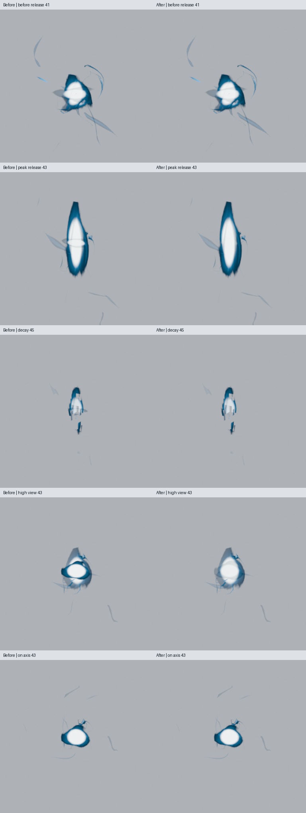
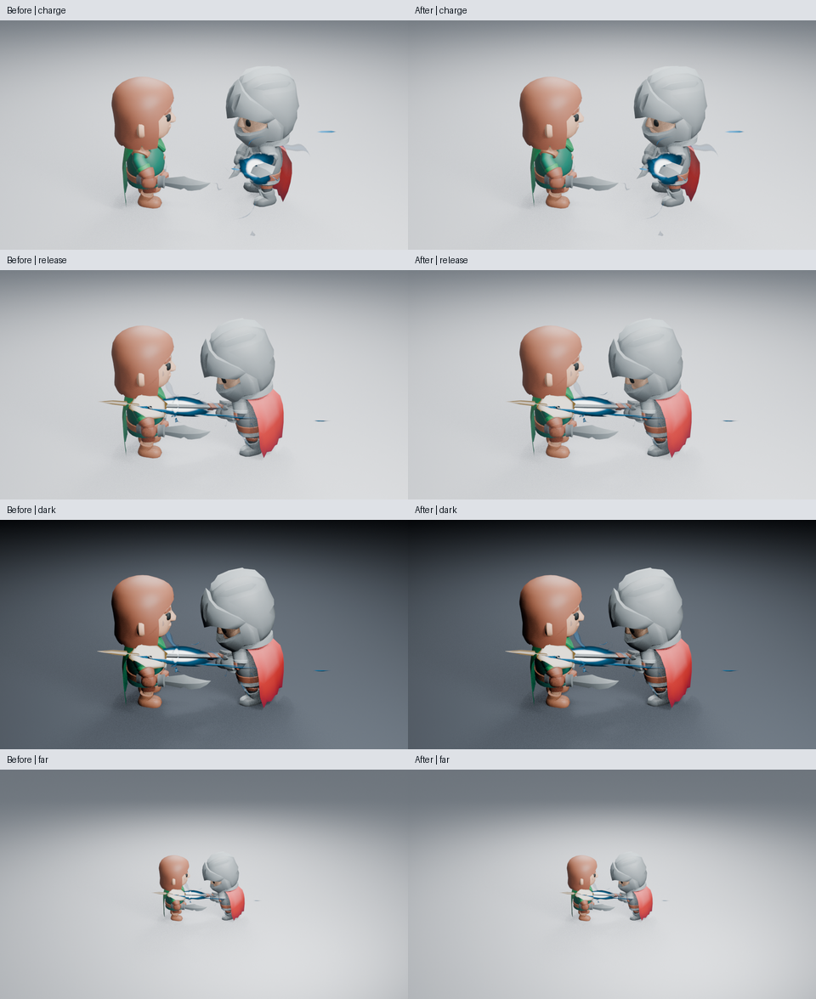
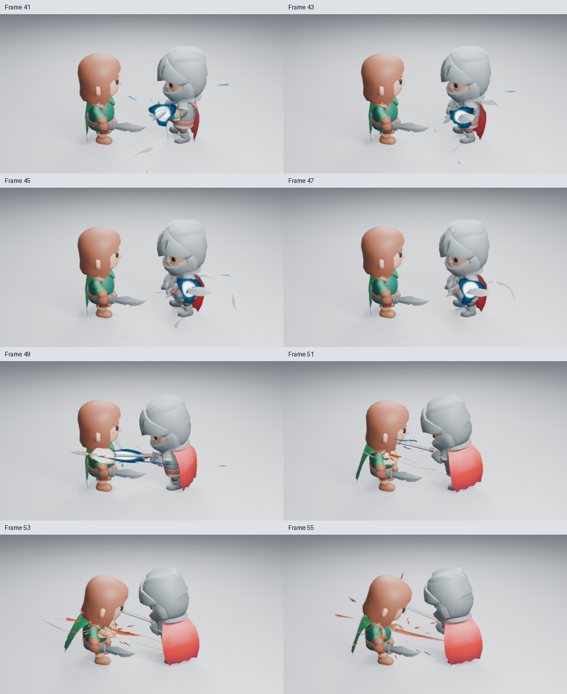
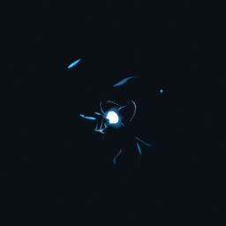

# 释放焦点的横向白带

Energy Charge 用三张相交的网格承载程序化能量场。释放时，两张纵向面被拉长，横向面仍横穿白热区，独立预览中出现一条截断纵向轮廓的白带。先从保存场景移除横向面的 64 个面并重渲染，确认了这个来源。

真实生成器现在只在释放阶段按视线夹角减弱横向面。斜视时它让出纵向焦点；正对释放轴时仍承担热芯轮廓，避免直接删面造成顶部空洞。使用原生材质节点，没有相机引用、播放回调、新参数或几何重建。

比较页每格取原始 960×540 图的中央 256×256 区域并放大至 384×384，便于辨认交叉痕迹，没有调色或重绘。峰值原图：[修改前](images/charge-release-cap-before-43.png) · [修改后](images/charge-release-cap-after-43.png)。

已实际读取独立资产第 41／43／45 帧、高视角与正轴第 43 帧的比较页，以及修改后的高清图。第 43 帧横带明显减弱，正轴保留热芯；高视角较柔和。第 31 帧高清 RGBA 与主线完全一致，第 41 帧仍保留积蓄时的交叉形态。衰减的碎片轮廓没有在本轮重新设计。

23 项完整资产测试通过，并在未加载插件、关闭脚本自动执行的新进程重开通过。新增像素回归验证积蓄帧不变、释放时交叠处改变，以及斜视和轴向的焦点保留。总透明面积不适合判断白带：纵向面仍覆盖中心，修复目标是重叠的明暗痕迹，而不是在焦点挖洞。

已实际读取角色浅背景第 43／47／49／51 帧，暗背景与远景第 49 帧。剑身仍遮挡一部分中心，画面收益小于独立预览；第 43 帧与主线全图 RGB 相同。未加载插件的新进程按 51→43→49 重渲染，高清 RGBA 均与生成时完全一致，骨架仍有动画，第 96 帧清场。

保存场景的第 41–55 帧全部奇数帧共八张，480×270、16 samples，已全部实际读取。第 49 帧释放后交给命中主体和余烬，没有发现新增断帧；尚未观看实时播放。

完整 Energy Charge 资产和 256×256 预览已重建并实际查看。新进程仅用原生 bpy 把资产集合链接到场景，确认混合透明、释放视角节点、37→13→37 可复现及第 49 帧清场，没有导出相机或灯光。没有新增性能或视口帧率结论。

源码、图像摘要和原生检查见[记录](images/charge-release-cap-samples.json)。功能源码 `f4a6867`，含测试的源码 `61a6186`；CI 仍在运行。不以这项局部修复宣称整体艺术验收通过。早段主次和身体蓄势继续由 [#137](https://github.com/mumu-lhl/blender-vfx-studio/issues/137) 跟踪。
