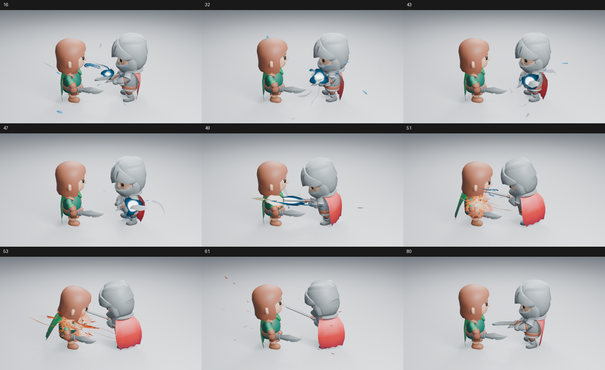
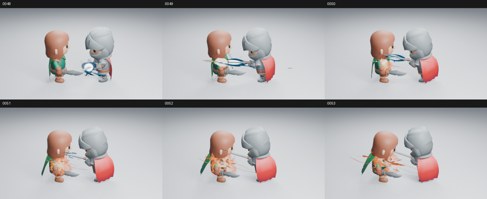

# 预备动作、出刀与命中热气的整镜头检查

本次把 [角色预备 #202](https://github.com/mumu-lhl/blender-vfx-studio/pull/202)、[命中热气 #206](https://github.com/mumu-lhl/blender-vfx-studio/pull/206) 和软件渲染环境改动放在同一个检查分支。源码组合为 `ef55e3f`，不是把几个效果的独立预览拼在一起。原生慢速收剑接回原有快速挥斩，接触帧保持 49，新增热气承接命中短闪。

九个阶段均渲染为 960×540、Eevee 16 samples、AgX，无额外辉光。上图只缩放排列；另直接读取了 [早段 16](images/combat-combined-16.png)、[出刀前 47](images/combat-combined-47.png) 与 [命中后 51](images/combat-combined-51.png) 的高清原图。

## 实际画面判断

热芯从剑上方形成，收剑时跟随持剑侧，再随快速转剑进入接触。短闪之后的暖色热气撑住接触中心，随后分离，细线和余烬继续外扩；角色恢复时核心没有再次出现。

**交接完整不等于力量感合格。** 身体蓄势仍偏轻，外围长片仍抢眼，释放前的白色核心显得硬而完整。命中正面的中心改善，但这组检查没有解决反向躯干遮挡，也没有重新验收所有视角。

## 有序动作样本

未加载插件、关闭自动执行，从保存场景重新渲染 47 张 480×270 样本，并实际读取全部八页：第 1–81 帧的所有奇数帧，另补第 48、50、52、54、56 和 96 帧。大部分间隔为 1/12 秒，接触段第 47–57 帧连续，没有略过其中帧。

[1–11](images/combat-combined-motion-01.png) · [13–23](images/combat-combined-motion-02.png) · [25–35](images/combat-combined-motion-03.png) · [37–47](images/combat-combined-motion-04.png) · [48–53](images/combat-combined-motion-05.png) · [54–61](images/combat-combined-motion-06.png) · [63–73](images/combat-combined-motion-07.png) · [75–96](images/combat-combined-motion-08.png)

预备中没有出现先下落再重新后摆的重复动作，接触后的热气在压力层退场前让出躯干，恢复阶段清空。这些判断来自有序静态 PNG；**没有观看实时 24 fps 视频，不声称速度感或整套艺术品质验收通过**。

## 功能与范围

三项轨迹／接触检查及无插件时序检查通过，涵盖原挥斩保留、接触释放对齐和闪电镜头平移。组合场景按 32→49→53 倒序高清重渲染，与本分支保存前 PNG 的 RGBA 完全一致，第 96 帧效果清场。全部进程正常退出，Ruff lint 与 format 检查通过。

本批次只验证浅背景近景的整合，没有重新测量性能。明暗、远景、反向及成本见 [热气检查](IMPACT_BURNING_REVIEW.md)，预备动作的其他背景见 [预备检查](https://github.com/mumu-lhl/blender-vfx-studio/blob/f4be62aa73d7b7bf8a6bdce76904fbdc9d84bdee/docs/experiments/SLICE_PREPARATION.md)。这些分项记录各自标明源码，不把旧图记成本批次新渲染。

图像摘要、实际帧位、源码与原生检查见 [清单](images/combat-combined-samples.json)。整合分支已推送至 GitHub；独立 PR 的 CI 仍按各自结果判定，不以本地整合代替远端检查。
