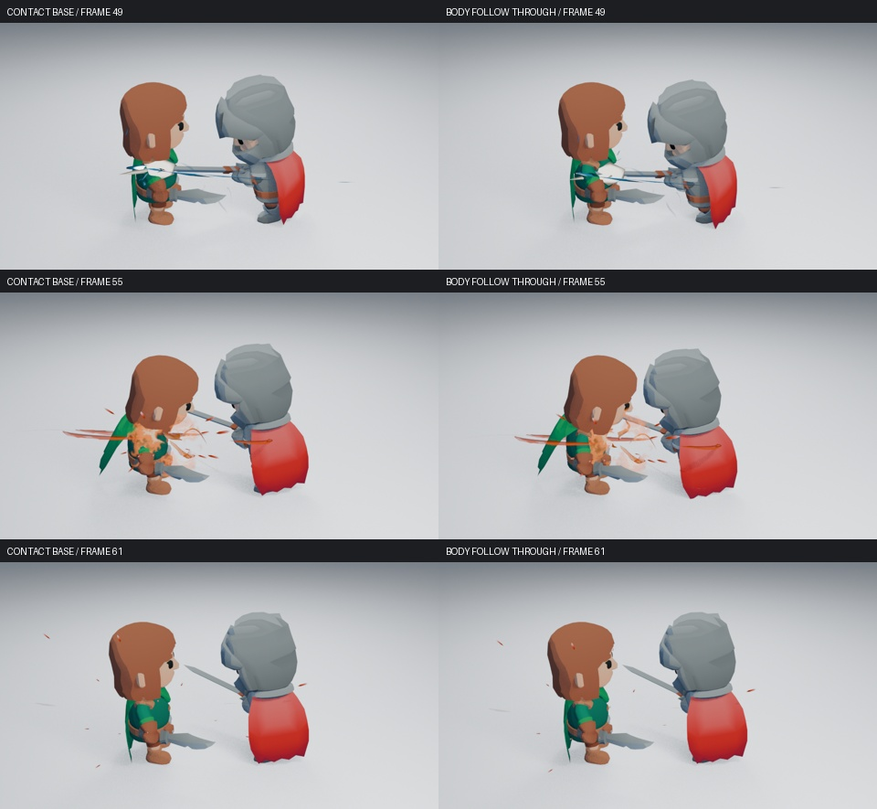

# 四秒角色战斗镜头检查

当前候选把 96 帧／24 FPS 镜头作为一段动作编排：背摆承重、蓄满保持、能量回刃、实际接触、命中停顿、身体跟随和恢复。沿用原 Slice 动作和八套已有资产，不增加插件 UI、艺术参数或通用角色系统。运行源码为 `10266b4831ba47c91cf65647943b4e751eff9d55`。

## 视频与实际画面

[打开完整动作对照](media/combat-direction/index.html)。下载同目录的 HTML 和 MP4 后，可在浏览器中观看原动作与当前候选；附加视频保留身体跟随调整前的编排。各段均为 **96 帧、24 FPS、4 秒**。

视频是 **480×270、8 samples 的动作预览**，阶段图另用 **960×540、16 samples 的 Eevee** 渲染。当前工具不能直接观看正常速度播放，**动态艺术验收未完成**。编码成功、抽帧和功能测试都不代替正常速度观感。

| 帧段 | 动作与视觉重点 |
| --- | --- |
| 1–28 | 持剑姿态进入后摆，核心逐渐聚集，重心后移下沉 |
| 28–39 | 保持收剑姿态并承重，核心成为主要焦点 |
| 40–48 | 起身接入挥斩，核心收缩并沿剑身向接触段移动 |
| 49–51 | 双方保持实际接触姿态，紧凑的白热焦点覆盖停顿 |
| 52–61 | 身体继续前送再回正，压力、热气和余烬接续展开 |
| 62–96 | 受击与挥斩完成收招，回到持剑状态，特效退场 |

已实际读取当前视频的 48 张隔帧解码图，并补看第 48、50、52、54 帧；检查了 13 张主机位高清阶段图，以及暗背景、远景、反向机位各第 49、51、53 帧。原动作及前一接触候选的完整抽帧也已检查，分别记录来源。



图中接触后身体更靠近目标，第 61 帧恢复原有姿态。蓄满核心集中，外围碎片权重降低，第 43–48 帧能量沿剑身移向接触段。第 49–51 帧接触焦点保持，第 52 帧开始交给后续压力和热气，头部与主要轮廓仍可区分。


这些变化还不足以宣布整段满意。主机位刀光接近侧视细线，白热形状仍偏平，橙色余热的视觉权重仍较大；大头占位角色的躯干动作也较难辨认。身体下压和近身前送是否显得自然、停顿是否有力、蓄满保持是否过长，都需要正常速度观看判断。


暗背景和远景可辨认接触保持与橙色余热。反向机位只能看到部分白缘，主体仍明显遮挡，**反向可读性未通过**。没有通过更换机位或关闭深度遮挡来掩盖问题。其他阶段见[预备与回刃](media/combat-direction/prepare.jpg)、[恢复与退场](media/combat-direction/recover.jpg)，完整原动作对照见[阶段拼图](media/combat-direction/comparison.jpg)。

## 动作、节点与原生编辑

动作使用 Blender 原生动作轨道（NLA）：原 Slice 较早进入背摆，在蓄满阶段保持，再快速接入实际剑刃接触。第 49–51 帧双方姿态相同，随后继续受击和挥斩。接触在受击姿态生效后重新测量，仍为第 49 帧。

承重使用原生双骨骼 IK，即由脚部目标求解两段腿骨的弯曲。脚部目标保存原动作的世界位置和方向，髋部控制器负责后移、下沉和前送。第 49–51 帧向目标前送 8 厘米并下沉 6.5 厘米，第 55 帧前送至 12 厘米，第 61 帧回正并关闭约束。

首次前送试验只下沉 2.5 厘米，一只脚因超出腿部可达范围而偏移约 2 厘米，未采用。补足承重后再验证脚位与地面接触，没有采用 #189 中穿地的腿部叠加或重复预备的下劈替换。胸口倾斜和两种小幅机位变化也未证明整体收益，未采用。

这些控制只用于这段固定布置的镜头。脚部目标使用世界坐标，重新布置动作时需一起调整目标；它不是通用骨架或重定向系统。原有中性镜头和默认动作仍可生成。

充能修改已有核心节点、剑身挂点和外围层权重。接触短闪的四帧生命周期中，原生数值映射节点 **Contact Hold Then Compression** 先保持形状，再迅速压缩，交给后续压力与热气。它读取效果层进度，组合的开始帧和时长改变时也会同步重定时。

短闪的初始尺寸、亮度和其他层造型保持不变。此前角色停在第 49–51 帧，短闪却在第 51 帧消失；本轮补齐的是这段接续。[接触曲线单独对照](media/combat-direction/contact-comparison.jpg) 保存了接触候选 `32a7a30` 与此前场景的同机位、同设备高清比较。

骨骼、约束、对象、节点和关键帧均为原生数据，播放不使用 Python 帧回调。三段明暗 Cel Shading 用离散色块代替连续受光，只修改复制的角色材质，保留原有 CC0 配色与特效材质。**角色仍是 KayKit 占位模型，不能冒充正式二次元角色验收。** Cel 场景使用 Eevee 的 Shader to RGB，不用于 Cycles 验收；特效原有兼容范围不因此改变。

## 功能验证与成本

六项 Blender 定向检查通过，覆盖双方命中保持、脚位与恢复、承重前送、回刃与刀光平面、完整充能的节点动画及手动编辑、接触焦点的生命周期与组合重定时。完整充能另在新进程中无插件追加并跳帧验证。

下沉和跟随阶段的脚位误差检查界限为 1 毫米，方向为 0.001 弧度。1–75 帧新旧角色最低点均约 −1.22 毫米，没有增加穿地；第 80 帧恢复原有武器姿态。

当前场景在关闭自动执行、未加载插件的新进程中，按 **51 → 32 → 55** 帧高清重渲染，像素完全一致；第 96 帧正常退场。生成源码、场景、视频与读取范围见[证据记录](media/combat-direction/evidence.json)和[视频记录](media/combat-direction/videos.json)。校验值用于追溯来源，不是艺术品质评分。

同一保存场景仅切换特效集合，测得接触保持第 51 帧的成本如下。设备为双核 CPU 配额、两线程、Blender 5.2.2、Mesa 25.0.7 的 llvmpipe 软件 Eevee，960×540、16 samples：

| 第 51 帧 | 关闭特效 | 启用特效 |
| --- | ---: | ---: |
| 预热后的渲染 | 13.15 秒 | 23.96 秒 |
| 场景求值中位数 | 0.93 毫秒 | 8.86 毫秒 |

求值每组保留 9 个预热后样本。渲染只有一个阶段的配对，不能推断耗时分布，也不能换算为交互视口帧率或独立显卡表现。原始样本见[身体跟随成本](media/combat-direction/body-performance.json)。早前的[三阶段测量](media/combat-direction/performance.json)与[接触候选测量](media/combat-direction/contact-performance.json)分别标记源码，不能当作当前版本的重复测量或直接性能对照。

首轮源码 `3df7105` 和接触候选 `32a7a30` 分别完成全部 12 项必要 CI。两个实际高清战斗产物均已下载并校验源码与视频，接触候选还核对了第 53、16、32、51 帧的原生像素。来源见[首轮 CI](media/combat-direction/ci-3df.json)与[接触 CI](media/combat-direction/ci-32.json)。

身体跟随源码 `10266b4` 已接入同一 [草稿 PR #216](https://github.com/mumu-lhl/blender-vfx-studio/pull/216)，自己的 [CI 41472320663](https://github.com/mumu-lhl/blender-vfx-studio/actions/runs/41472320663) 尚未结束。前两轮成功不代替这轮结果，功能验证也不代替正常速度动态艺术验收。

[#215](https://github.com/mumu-lhl/blender-vfx-studio/issues/215) 继续统一跟进完整镜头，关联 #189、#137、#178、#89。当前保留侧视刀光、反向遮挡、角色比例及整体力度的限制，不据此关闭艺术目标。

## 从源码生成

```sh
export LP_NUM_THREADS=2 MESA_SHADER_CACHE_DISABLE=true
blender -b --factory-startup -t 2 --disable-autoexec --python-exit-code 1 --python tools/character_combat.py -- --cel --directed --sequence --output work/character-combat/light-near
```

去掉 `--directed` 可生成同 Cel 材质下的原动作；去掉 `--cel` 使用中性材质。`--dark`、`--far`、`--reverse` 检查背景、距离和反向机位。`--preview` 使用 480×270、8 samples，最终高清检查仍使用默认 960×540、16 samples。

完整高清序列生成后，检查无插件像素复现和有／无特效成本，再生成检查页面：

```sh
blender -b work/character-combat/light-near/character.blend -t 2 --disable-autoexec --python-exit-code 1 --python tests/character_visual_reopen.py -- --frames 53 16 32 51
blender -b work/character-combat/light-near/character.blend -t 2 --disable-autoexec --python-exit-code 1 --python tools/character_performance.py -- --frames 32 51 53
python tools/character_review.py work/character-combat
```

命令执行成功不自动批准艺术品质。
