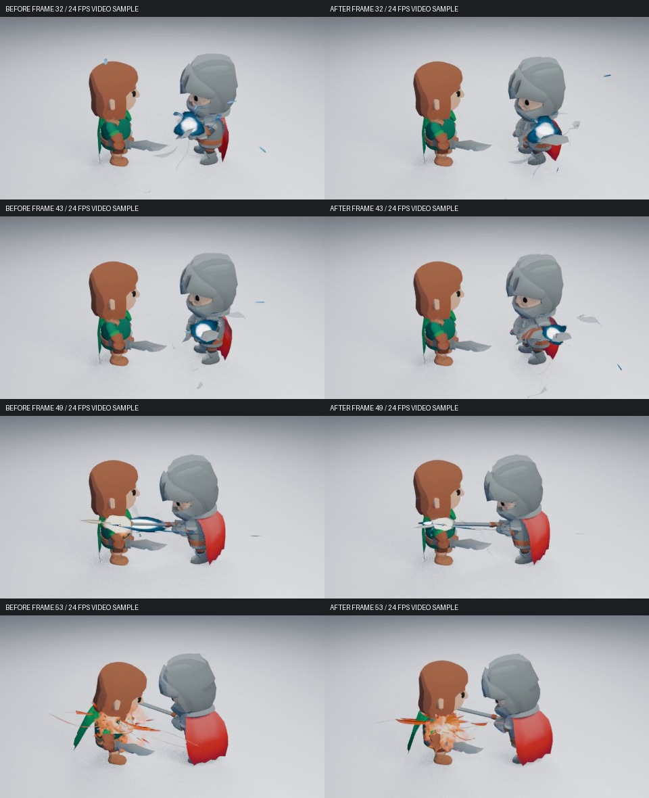
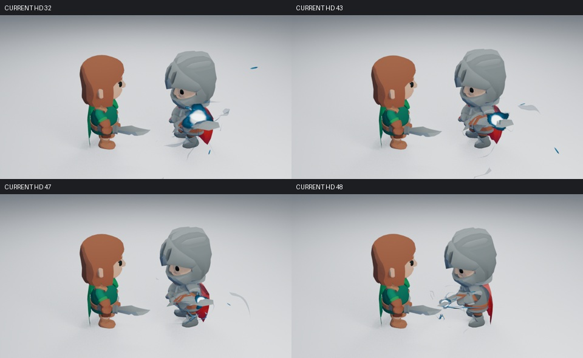
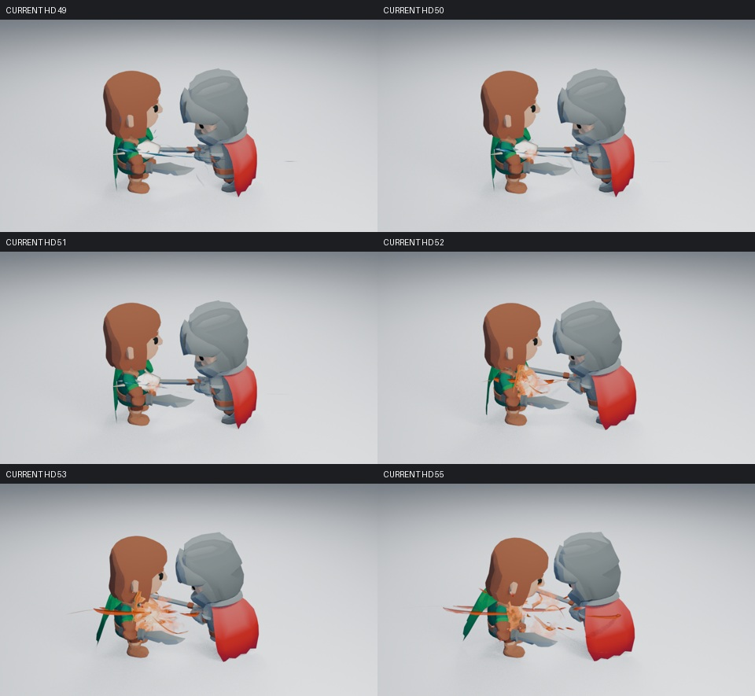
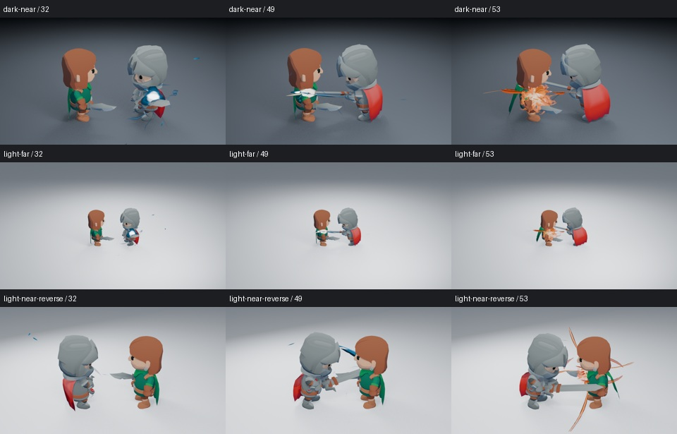

# 四秒战斗镜头：完整动作候选

当前候选把现有 96 帧／24 FPS 角色镜头作为一个整体编排，不增加资产种类、插件 UI 或艺术参数。沿用 Slice 动作，较早进入收剑姿态，在蓄满阶段保持并逐渐下沉、向后承重，再快速接入真实剑刃接触；命中插入两帧停顿，随后完成受击与恢复。没有采用 #189 中重复预备的下劈替换或造成穿地的腿部叠加。

充能用已有原生节点和控制器动画：核心在蓄满阶段集中，释放前沿真实剑刃移向接触段，外围流和粒子的视觉权重降低。刀光依据重新测量的剑轨迹定位，短闪、热气、压力弧和余烬错开出现，避免整套爆发同时争夺注意力。这些是保存进场景的 Blender 原生动作轨道（NLA）、节点和关键帧，不依靠 Python 播放回调。

新场景可选三段明暗 Cel Shading，即用离散的明暗色块代替连续受光。材质保留已有 CC0 角色的颜色，特效材质不变。它是独立于中性功能镜头的风格对照，**仍使用 KayKit 占位角色，不能冒充正式二次元角色的最终验收**。原有中性镜头和默认动作仍可生成。Cel 场景使用 Eevee 的 Shader to RGB，不用于 Cycles 验收；原有特效材质的兼容范围不因此改变。

| 帧段 | 动作与视觉重点 |
| --- | --- |
| 1–28 | 原有持剑姿态进入后摆，核心逐渐聚集，重心开始后移下沉 |
| 28–39 | 保持已收好的剑，继续承重；核心成为主要焦点 |
| 40–48 | 起身接入挥斩，核心收缩并沿剑身向接触段移动 |
| 49–51 | 双方姿态保持在实际接触处；短闪先于后续压力与热气 |
| 52–71 | 受击与挥斩继续，热气、喷流、压力弧和余烬分层消散 |
| 72–96 | 收招回到持剑状态，特效完全退场 |

## 完整画面的判断

[前后视频](media/combat-direction/index.html) 使用相同 Cel 材质、机位和 24 FPS，各为 96 帧、4 秒。它们是 **480×270、8 samples 的动作预览**；下面的阶段图另外由 **960×540、16 samples** 的 Eevee 渲染生成。下载同目录的 HTML 和两个 MP4，可在浏览器中从头同步播放。当前工具只能读取图像，**没有实际观看正常速度播放，动态艺术验收未完成**。



实际读取了前后视频各 48 张隔帧解码图，并补看候选第 48、50、52、54 帧，检查接触附近容易漏掉的变化。候选较早进入收剑姿态，蓄满阶段核心更集中，外围碎片减少；第 43–48 帧核心缩小并沿剑身向接触段转移。第 49 帧的白色焦点集中在接触处，后续橙色压力体和热气再展开，角色头部与主要轮廓保持可见。

这些收益还不足以宣布整段满意。主机位的刀光接近侧视细线，运动方向虽然与剑一致，刀光形状仍不够有表现力；第 50–51 帧反馈偏弱。身体下沉可以看见，但大头占位角色的躯干变化较难辨认。第 53 帧的橙色热气与压力体仍比接触瞬间更醒目。命中停顿是否增强力度、蓄满保持是否过长，都需要正常速度观看判断。





最终候选共检查 12 张主机位高清阶段图，以及暗背景、远景、反向机位各第 32、49、53 帧。暗背景和远景仍能辨认蓄满核心及橙色余热；反向充能主体和接触焦点被角色遮挡，**反向可读性未通过**。没有用改镜头掩盖这个问题。



## 原生数据与功能验证

五项定向行为检查通过，覆盖双方命中停顿、脚部接触、能量回刃、刀光平面，以及完整保存后的节点动画和手动编辑。原有三项动作／接触回归与对应的无插件重开通过；新增完整充能的纯原生追加验证也通过。停顿测试发现受击片段混合造成微动，现已修正；接触点在受击姿态生效后重新测量，仍为第 49 帧。

承重使用 Blender 原生双骨骼 IK（逆向运动学：由脚部目标求解腿部弯曲），配合保存的脚部方向和髋部偏移。它只用于这段固定布置的镜头，没有新增通用骨架模块或插件 UI；约束在第 47 帧关闭，接回原有挥斩和命中。下沉阶段两脚位置误差小于 1 毫米，方向误差小于 0.001 弧度；1–75 帧角色最低点新旧均约 −1.22 毫米，没有增加穿地。脚部目标使用世界坐标，重新布置这段动作时也需一起调整目标。

最终场景在新进程中关闭自动执行、未加载插件，按第 **53 → 16 → 32** 帧重新渲染，三张高清图像素完全一致；第 96 帧正常退场。完整充能另行追加到空场景后，核心节点的动画和手动编辑仍保留。原生 NLA、约束、节点与关键帧可继续在 Blender 中编辑。

单独倾斜胸口，以及两种小幅机位变化没有证明整体收益，未采用。之前不含脚部锁定的时序候选与最终候选分开归档，不混用验证结果。最终运行源码为 `3df710511ee042fe62522ecbb5e0009cc6441001`；视频、场景和生成源码的校验值见 [证据记录](media/combat-direction/evidence.json) 与 [视频记录](media/combat-direction/videos.json)。校验值用于追溯来源，不是艺术品质评分。

## 实测成本

同一个最终原生场景，仅切换特效集合是否参与求值／渲染。设备为双核 CPU 配额、Blender 5.2.2、Mesa 25.0.7 的 llvmpipe 软件渲染，960×540、16 samples、两线程。两次渲染预热后交错比较三个阶段：

| 帧 | 关闭特效 | 启用特效 |
| --- | ---: | ---: |
| 32，蓄满 | 13.27 秒 | 23.95 秒 |
| 53，命中后 | 11.74 秒 | 26.66 秒 |
| 61，消散 | 12.34 秒 | 26.58 秒 |

场景求值每组保留 27 个预热后的样本：关闭特效的中位数为 0.90 毫秒，启用为 9.08 毫秒。后台求值和软件渲染都不能换算为交互视口帧率，也不代表独立显卡表现。原始样本、设备信息及预热记录见 [performance.json](media/combat-direction/performance.json)。动作预览使用 480×270、8 samples，最终图像仍保留高清设置。

首轮运行源码 `3df7105` 的 CI [41326768378](https://github.com/mumu-lhl/blender-vfx-studio/actions/runs/41326768378) 已完成，全部 12 项必要作业成功。实际下载并校验了高清战斗产物，五组场景的源码校验值均吻合；视频为 960×540、24 FPS、96 帧／4 秒。原生高清像素检查也通过。作业与压缩包来源见 [CI 记录](media/combat-direction/ci-3df.json)。这些结果不代表已观看正常速度视频。

## 接触停顿与爆发的接续

远端第 48–55 帧的实际高清图再次确认：角色在第 49–51 帧停住，但短闪只持续两帧，并从出生时就缩小；第 51 帧短闪消失时，压力体和热气尚未充分展开，接触焦点出现空档。当前追加方案让短闪覆盖四帧的层生命周期，先保持紧凑形状，再迅速压缩，交给后续压力与热气。亮度、初始尺寸、其他层造型和机位不变。

保持和压缩使用原生节点按该层进度计算，没有写死第 49 帧的关键帧。因此，修改命中组合的开始帧与时长，曲线也随之移动和缩放。新增行为检查确认焦点在停顿期间保持、交接时缩小、到期消失，重新安排组合时间后也成立；六项定向检查和完整充能无插件追加通过。

已实际读取追加方案的第 51 帧高清图，接触焦点可见；完整序列、其余高清阶段、明暗／远景／反向图及新进程像素复现正在重做。上述视频和阶段图暂仍记录首轮候选，不提前视为追加方案的验证材料。CI 增加第 51 帧无插件高清重渲染，并将它纳入实际成本测量。正常速度动态艺术验收仍未完成。

本任务由 [#215](https://github.com/mumu-lhl/blender-vfx-studio/issues/215) 和 [草稿 PR #216](https://github.com/mumu-lhl/blender-vfx-studio/pull/216) 统一跟进，关联 #189、#137、#178 和 #89。下一轮优先检查完整镜头的蓄满保持与接触反馈，保留上述遮挡和力度问题，不转回孤立节点微调或新增资产种类。

## 生成与检查

```sh
LP_NUM_THREADS=2 MESA_SHADER_CACHE_DISABLE=true blender -b --factory-startup -t 2 --disable-autoexec --python-exit-code 1 --python tools/character_combat.py -- --cel --directed --sequence --output work/character-combat/light-near
```

去掉 `--directed` 可生成相同 Cel 材质下的原动作对照；去掉 `--cel` 保留中性材质。`--dark`、`--far` 和 `--reverse` 用于背景、距离和反向机位检查。`--preview` 使用 480×270、8 samples，方便低成本检查动作；最终检查仍使用 960×540、16 samples。

完整高清序列生成后，运行 `tests/character_visual_reopen.py` 检查无插件像素复现，再用 `tools/character_review.py` 生成带正常速度视频、解码抽帧和原生文件链接的检查页面。命令执行成功不自动批准艺术品质。
