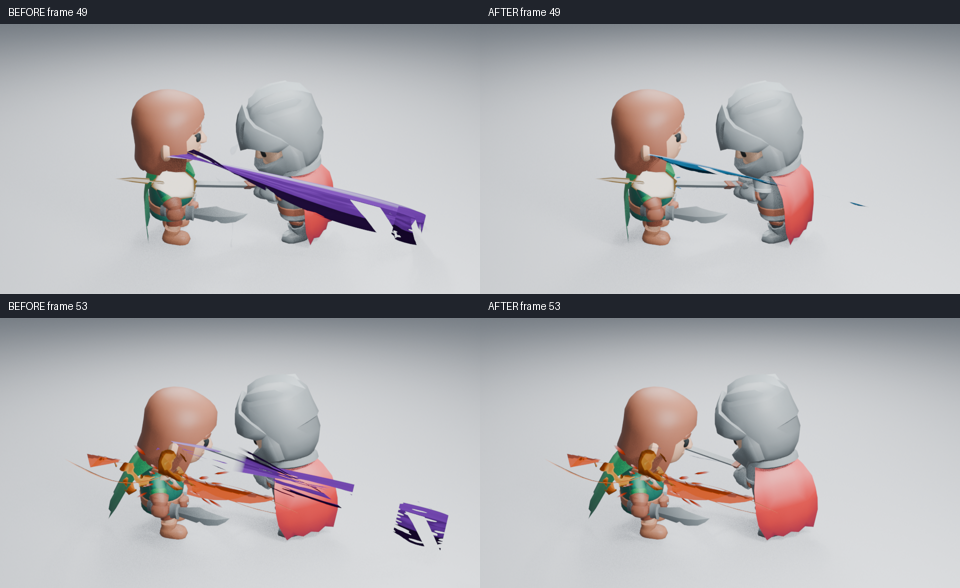
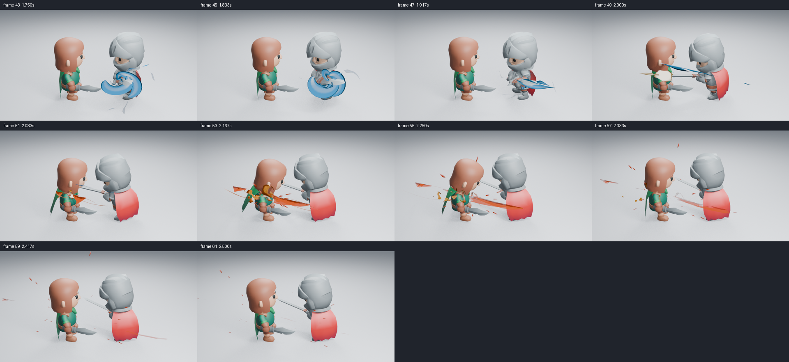

# 蓄力、挥斩与命中的视觉衔接

本轮使用同一套 KayKit 角色、攻击动作、接触点、相机和照明，检查近身斩击中能量是否有明确去向，以及刀光有没有遮住角色和命中。渲染为 Blender 5.2.2、960×540、Eevee 16 samples、AgX，无额外辉光。



对照图只缩小排列原始 PNG，并添加帧号；原始高清图见 [命中前](images/combat-handoff-before-49.png)、[命中后](images/combat-handoff-after-49.png)、[消散前](images/combat-handoff-before-53.png)、[消散后](images/combat-handoff-after-53.png)。这里的“前／后”表示代码修改前后，而非动作顺序。

## 原因与改动

**刀光端部没有在深度上闭合。** 几何节点把径向宽度收为零，但 Bank 的横向折叠仍保留高度，因此尖端可以成为一条直立截线。现在折叠乘以该位置的真实带宽分布：主刀面、逐渐展开的前端和收窄的残影一起收尖。没有增加几何；Bank=0、Contour=0 及 Clean / Stylized 继续使用同一生成器。

**展示用大弧线覆盖了过多动作范围。** 剑长约 1.55，接触前两帧转过约 86°；原镜头直接套用 185° 刀光和 0.62 宽度。镜头现在按这段真实转角的 85% 设置 Arc，Width 为剑长的 14%，Expansion=0，并用已有参数收敛弯折和残影。控制器仍用普通关键帧跟随剑柄；原生 Spin 和独立残影时钟保留。默认独立资产的弧度、宽度和风格按钮没有改成这套镜头数值。

**蓄力的释放方向与剑刃无关。** 真实充能生成器现在让内核沿局部 +Z 前送，而非仅向两端伸长；蓄满尺寸从 1.9 调至 2.3，内部进流的截面随积蓄降低权重，让中心与辅助路径有主次。这些数值和节点都能继续手动编辑。镜头用旋转关键帧在挥斩前将局部 +Z 转向剑尖，刀光沿用蓝色主体。没有更换角色动画、提高发光或修改命中生成器。

## 实际画面判断

已经逐张读取浅背景第 36、43、45、47、48、49、51、53、55、57、59、61、80 帧，暗背景第 47／49／53 帧，远景第 36／49／53 帧，反向第 49 帧。积蓄转向剑刃后，蓝色能量的去向比竖直收缩更清楚；第 49 帧能同时看到角色躯干和白热命中，第 53 帧不再有大块紫色残影伸出画面右侧。第 57／61 帧余烬消散，第 80 帧恢复干净。另实际读取默认独立刀光斜视第 5／13 帧，主体和细残弧仍保持原有风格。



这十张抽帧来自实际高清渲染，每张相隔 1/12 秒；另读第 48 帧检查加速中的衔接。它们能说明能量方向与先后关系，不能完整证明实时播放时的速度感。远景白热命中仍可见，侧面的刀光与细残影很弱；暗背景也保留了这一差异。

改善集中在衔接和画面主次，不能据此宣布整体艺术品质合格。蓄力末段仍像较实的弯片；远景中心有轮廓、细亮带仍弱；刀光从当前机位看接近侧面，部分细尾很弱；Impact 的橙色压力面仍偏硬，后段散开后层次不足。反向机位的命中焦点仍被角色遮住，不能记为命中可读性通过。未观看实时 24 fps 视频。

## 复现与功能验证

从仓库根目录运行：

```sh
LP_NUM_THREADS=2 blender -b -t 2 --factory-startup --disable-autoexec --python-exit-code 1 --python tools/character_combat.py -- --frames 36 43 45 47 48 49 51 53 55 57 59 61 80
```

加 `--dark` 或 `--far` 检查其他条件；相机和光照仍由同一镜头生成器设置。每批设置记录源文件 SHA256，若渲染中改动源码则拒绝该批证据。修改前的对照来自 `0b8a845` 保存的原生场景，修改后功能源码为 `7e4bf68`。

本地 11 项刀光、22 项完整资产检查通过，包含端部闭合、释放前送、倍速与跳帧、独立复制与手动节点保存。它们验证功能，不代替上面的画面判断。

保存场景在关闭自动执行、没有载入插件的新进程中按 53、45、49 倒序跳帧，三张高清 PNG 的全部通道与原渲染一致；第 47／49／51 帧原生释放轴朝向剑刃，第 96 帧效果几何清空，进程正常退出。该功能结果不包括实时视频或交互视口表现。

刀光与完整资产的小尺寸原生跳帧也通过，均正常退出。软件渲染实测使用 2 CPU 配额、Blender 两线程、Mesa llvmpipe，在同一保存镜头只开关 VFX 集合：第 49 帧丢弃三轮预热后各测九次，后台求值中位数无／有特效为 **0.832／12.130 ms**，p95 为 **0.881／12.603 ms**。丢弃两个预热渲染后，匹配的单次高清渲染为 **15.457／26.668 秒**；第一次有特效准备和渲染为 72.395 秒。只有一组有效配对，不报告渲染 p95，也不换算为视口 FPS。

图像与保存场景摘要见 [检查清单](images/combat-handoff-samples.json)。图片是检查资料，不参与资产播放。
