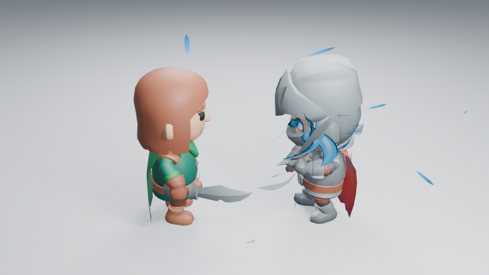
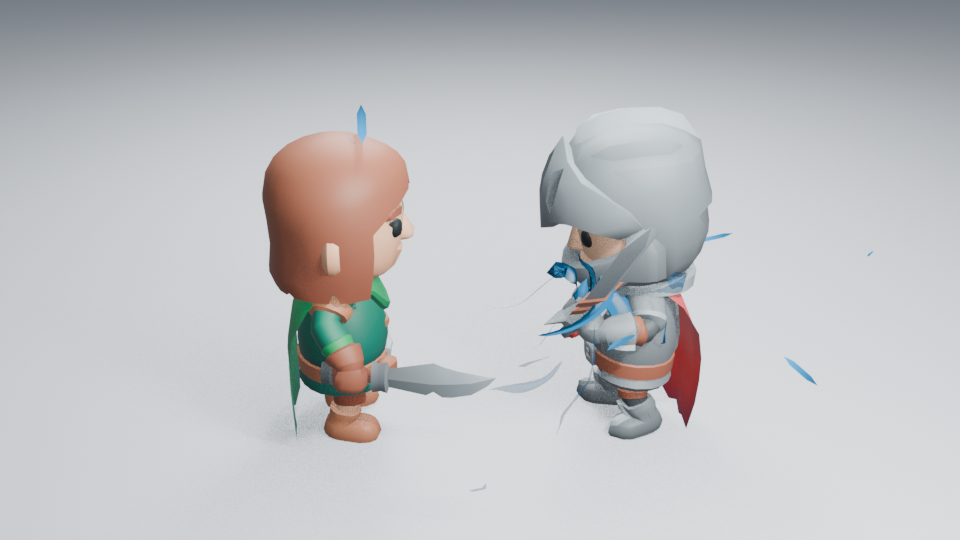

# 充能预备姿态与剑柄能量交接

完整角色抽帧显示，充能前半段角色大部分时间保持双手剑待机，能量变化缺少动作回应。本轮检查现有动作与绑定点，尝试让剑身逐渐收回到斜向预备，再把手部积蓄送入挥斩。它继承 #188 的接触时序，不改变充能、刀光或命中生成器。

## 原生动作与绑定点

实际渲染并查看了待机、横斩开头、下劈开头、格挡和施法抬剑五个姿态。格挡过早朝向对手，施法会让剑尖出画，均未采用。下劈开头能保留双手持剑，并形成较清楚的斜向轮廓。

角色使用 Blender 原生 NLA，即把动作片段放到时间轴上混合。只慢放下劈动作的前段，第 1–41 帧生效，前 12 帧渐入、后 4 帧渐出；第 37–69 帧原挥斩保留。原导入动作没有改写，可在 NLA Editor 继续裁剪与调整。

最初直接沿用剑身中点绑定，第 32／37 帧的曲面遮住眼部。随后把积蓄点放在距剑柄约 20% 刃长处，保持到第 37 帧；第 43 帧送回原 50% 刃长位置。位置只用普通关键帧，不增加侧栏参数或 Python 播放处理。模型、相机、灯光、发光与节点造型不变。





## 当前画面判断

已实际查看第一版和剑柄绑定版各六张 960×540 Eevee 图，以及五个裸动作姿态。剑柄绑定版为第 16／32／37／39／43／49 帧；相机、照明、16 samples、AgX 均与时序基线相同，没有额外辉光。

第 32／37 帧的蓝色曲面移到手部和胸前，眼部比初次绑定清楚；斜向预备与第 39 帧的回转形成变化，第 43 帧回到原剑身位置，第 49 帧保留接触表现。它改善了预备姿态的辨识和绑定遮挡，但不能证明身体力量感已经充分。充能早期中心仍小，进流较醒目，蓄满曲面仍像弯片。

同帧待机基线、暗背景、远景、动作抽帧和原生高清复现尚在执行，**当前不宣布整段艺术验收通过**。第一版预备的接触图与时序基线只有一个像素的单通道相差 1，不宣称两份独立构建完全像素一致。

## 功能检查与复现

接触时序回归通过；新进程未加载插件，确认预备姿态确实改变，关闭预备层后第 41–56 帧剑刃轨迹保持一致，开头仍为原姿态，倒序跳帧一致。另验证第 16／37 帧能量绑定点在剑柄附近、第 43／49 帧回到原剑身位置。进程正常退出，Ruff 0.14.1 全库 lint 与格式通过。这些检查不替代美术判断。

```sh
LP_NUM_THREADS=2 MESA_SHADER_CACHE_DISABLE=true blender -b -t 2 --factory-startup --disable-autoexec --python-exit-code 1 --python tools/character_combat.py -- --frames 16 32 37 39 43 49
```

这是一套新建角色镜头的原生编排，不会修改用户现有动作或节点。对应 #189，依赖 #188；源码、已查看帧与图片摘要见[检查清单](images/preparation-samples.json)。#137 的充能主体设计与 #89 的整库艺术工作继续保留。
