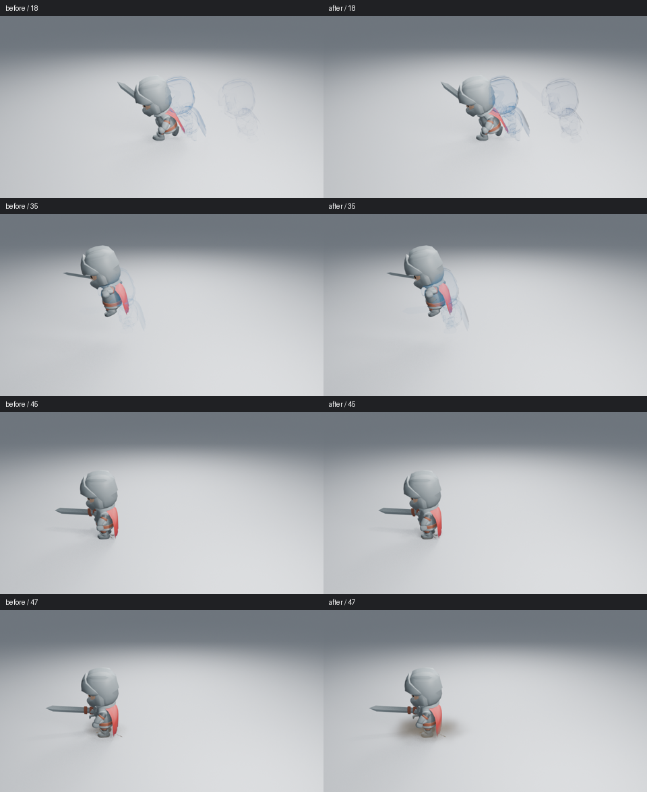

# 冲刺、腾空与落地烟尘

这段 84 帧角色动作使用原生 Running_A、Jump_Full_Short、根位移关键帧，以及实际 Dash Echoes 和 Dust Impact 生成器。三个残影捕获第 6、15、24 帧；求值后的脚部网格在第 44 帧回到地面，触发烟尘。角色、相机、光照和发光强度保持一致，高清图为 Blender 5.2.2、960×540、Eevee 32 samples、AgX，无额外辉光。



高清原图：[18 前](images/dash-landing-before-18.png)／[后](images/dash-landing-after-18.png)、[35 前](images/dash-landing-before-35.png)／[后](images/dash-landing-after-35.png)、[45 前](images/dash-landing-before-45.png)／[后](images/dash-landing-after-45.png)、[47 前](images/dash-landing-before-47.png)／[后](images/dash-landing-after-47.png)。并排图只缩小排列与添加帧号。第 47 帧的前图是只改过薄尘时钟的候选，用于区分侧尘造型的实际收益。

## 画面原因与真实生成器

**旧残影的主体和轮廓一起消失。** 原材质的正面填充仅为边缘的 15%，随后共同乘以寿命透明度，因此旧姿态在浅背景中接近细线。现在正面保留 30% 填充，有色暗轮廓使用稍晚的消退曲线，两者取较大覆盖，不叠加成不受控制的透明度。轮廓仍经过视角边缘、噪声侵蚀和正面限制，Opacity=0、Dissolve=1 可以完全隐藏。没有增加捕获网格、发光或源角色复杂度。

**烟尘初期的体积太小。** 原侧尘和中央烟尘都花约七帧长成，早期小密度团容易被网格采样和脚部遮挡吞掉。只加快低矮薄尘的出现时钟，对第 45 帧整幅画面帮助有限。本轮让现有两侧尘团从接触开始快速向外展开，初期高度压低，随后恢复翻滚形状；中央烟尘与延迟出现的小尘团保留。折叠噪声在压低后的空间中计算，避免破坏薄层。体积网格、质量档位和粒子数量保留。

**交接需要配合实际落地。** 镜头用已有 Echo Tail 把最后一个腾空残影的结束对齐第 44 帧接触，从 18 调为 20 帧；捕获位置、姿态和三份数量保留。这是镜头时间编排，材质和侧尘改动则进入了所有新建效果的真实生成器。

## 已查看的画面与边界

已实际读取修改前后的高清阶段，以及最终第 18、35、43、44、45、47、52、76 帧。第 18／35 帧的头盔和外轮廓较容易辨认，主体仍保持透明；第 43 帧留有较弱的腾空记忆。第 47 帧已有低矮侧尘，第 52 帧接上滚动烟尘；第 76 帧恢复干净。

改善集中在轮廓与先后层次，不能据此宣布整段动作有足够力量感。第 45 帧反馈仍弱，旧残影仍偏线描；已经逐张读取全部 42 张原生隔帧，覆盖第 1–83 帧、每隔一帧；它们为 480×270、32 samples，用于检查完整时序，不代替高清细节判断。暗背景第 18／35／47 帧与远景同帧已实际读取：暗背景主体轮廓较清楚，远景第 35 帧旧姿态仍偏淡。部分交叠阶段会带出蓝色叠影，烟尘整体仍偏柔和。**未观看实时播放；这段角色衔接的检查已完成，整体艺术品质继续由 #89 跟踪。**

完整抽帧：[第 1–11 帧](images/dash-landing-motion-01.png) · [第 13–23 帧](images/dash-landing-motion-02.png) · [第 25–35 帧](images/dash-landing-motion-03.png) · [第 37–47 帧](images/dash-landing-motion-04.png) · [第 49–59 帧](images/dash-landing-motion-05.png) · [第 61–71 帧](images/dash-landing-motion-06.png) · [第 73–83 帧](images/dash-landing-motion-07.png)。这些是真实时间轴 PNG，没有当作已观看的实时视频。另提供 [12 fps 隔帧预览 MP4](images/dash-landing-sampled.mp4)：42 个实际样本、480×270、3.5 秒，与 84 帧／24 fps 时间轴等长。没有补成 24 fps，也没有声称观看该视频。

暗背景和远景原图：[暗背景 18](images/dash-landing-dark-18.png) · [远景 35](images/dash-landing-far-35.png)。共查看最终 14 张高清阶段、42 张隔帧和六张导出预览。

## 原生与功能验证

14 项残影、6 项烟尘、2 项脚部接触、14 项艺术控制和 22 项完整资产检查通过。新增像素检查覆盖轮廓仍受 Opacity、Fade、Dissolve 和颜色控制，完整资产保存不改变像素；早期体积是真实密度，Dust Density=0 会清空。源角色模型、材质、形态键与动画保留。

无插件新进程按 52→18→35 倒序重渲染，三张高清 PNG 全部通道与原图一致；角色继续原生移动，第 84 帧效果几何清空，进程正常退出。无源残影、Echo Tail、完整资产和场景几何跳帧也通过。功能检查不代替实际看图。Low／Medium／High 的残影和烟尘共六个完整资产已重新构建，并在无插件进程检查预览、原生节点与结束帧，正常退出。256×256 预览已实际查看，只用于资产辨识。CI [40893495715](https://github.com/mumu-lhl/blender-vfx-studio/actions/runs/40893495715) 全部 12 项成功。

## 当前设备上的成本

Blender 5.2.2、两线程、CPU 配额两核、Mesa 25.0.7 llvmpipe（LLVM 19.1.7），960×540、Eevee 32 samples。相同保存场景只开关效果集合；求值各预热三次，再测九次。下表按阶段分开，避免把残影和烟尘混成一个中位数。

| 阶段 | 无效果求值：中位／p95 | 有效果求值：中位／p95 | 无／有效果渲染 |
| --- | --- | --- | --- |
| 第 18 帧，透明残影 | 0.73／0.96 ms | 6.91／7.28 ms | 28.86／87.84 s |
| 第 47 帧，体积侧尘 | 0.79／0.93 ms | 66.14／67.88 ms | 27.79／34.95 s |

渲染先做两次预热，再测两个同帧开关对照，每种状态仅一次，不能计算可靠的渲染 p95。透明残影的实际渲染开销明显，体积密度主要增加求值成本；这些是当前设备的后台测量，不是视口 FPS，也没有同设备旧版性能对照。原始测量与资产摘要保存在下方清单。

## 生成和编辑

```sh
LP_NUM_THREADS=2 blender -b --factory-startup --disable-autoexec --python-exit-code 1 -t 2 --python tools/dash_landing_preview.py -- --frames 18 35 43 44 45 47 52 76
```

`--sampled` 渲染真实时间轴的隔帧图并加入落地帧，`--sequence` 渲染全部 84 帧；`--dark`、`--far` 生成对照。输出包含可编辑 `.blend`、接触轨迹和采样记录，位于忽略版本管理的 `work/dash-landing-review/`。

可用两个组合控制器调整整体时间或位置，或编辑各层原生节点、材质和 Echo Tail。源角色的 NLA 动作条与根位移保留。源码、图片和原生文件摘要见 [检查清单](images/dash-landing-samples.json)；图片不参与效果播放。
