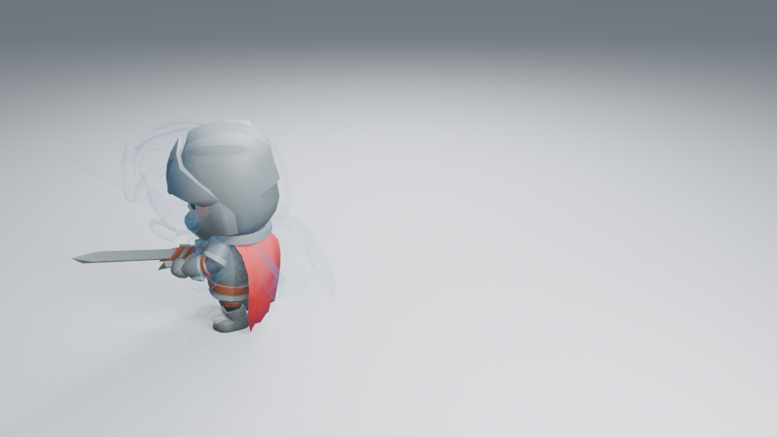
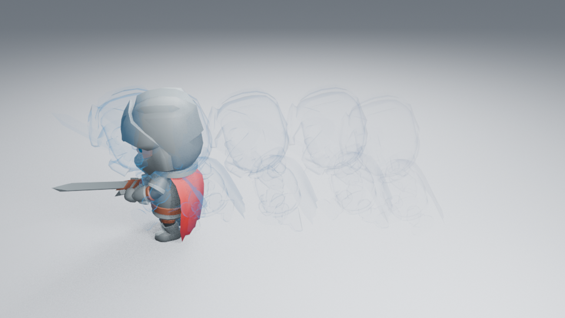

# 残影数量与时间采样

捕获工具直接使用 **Echo Count** 与 **First / Last Frame**。数量为 2–32，首尾均包含；中间姿态均匀分布，必要时求值子帧，不要求跨度整除。比如 1–12 帧、五个残影得到 1、3.75、6.5、9.25、12。

数量改变保存的姿态数与半透明叠层成本，**不会降低源网格细节**。每个姿态仍求值修改器、骨骼与形态键，并保存为独立原生网格。Low / Medium / High 完整示例继续使用两／三／四个姿态；捕获自己的角色不必通过质量标签选数量。

## 行为检查

八项 Blender 测试通过：保留源数据与原帧／子帧、默认示例数量与时间、负缩放面朝向、非整除跨度与五姿态、实际 UI 操作、负时间的子帧、无效输入不改变数据、完整保存／复制／安全删除。捕获顶点逐一对照源动画在各子帧的求值结果；删除源角色后仍可播放。保存的五姿态在不导入插件的新进程重开通过。

已实际读取 960×540 Eevee 角色镜头：6–19 帧均匀捕获五姿态，第 12／19／31 帧浅背景与第 19 帧暗背景。中间姿态时间为 9.25／12.5／15.75，分别保存不同位置与姿态；更多残影确实形成较密的轨迹，但浅背景旧影和末段仍偏淡，不称为整体艺术品质通过。暗背景的轮廓更可辨认。三个浅背景阶段在无插件新进程中按 31／12／19 重渲染，与原图解码像素一致，第 37 帧清空，正常退出。Linux 默认缩放的实际捕获弹窗另用静态 Cube 验证了 1–12 帧、五姿态及 2.75 帧间距，确认后生成五层并保留源；这项操作检查不代替动画品质判断，见 [GUI 记录](GUI_CHECKS.md)。其他平台窗口与实时播放未验收。

## 复现角色对照

```sh
blender -b --factory-startup --disable-autoexec --python-exit-code 1 --python tools/dash_preview.py -- --echo-count 5 --capture-first 6 --capture-last 19 --frames 12 19 31
```

加 `--dark` 或 `--far` 检查相应背景和距离。输出目录带数量与首尾帧，保留源文件摘要，不覆盖默认三姿态的比较。CI 在原有 dash-review 附件中保存这组比较与原生重开记录。软件 Eevee 两线程实测生成这组图需要较长时间；这里没有匹配的三姿态成本对照，不能据此报告加速比或视口帧率。当前跑步示例末段切回站姿仍硬；完整冲刺接落地镜头由 [#156](https://github.com/mumu-lhl/blender-vfx-studio/issues/156) 另行验证，本次采样改动不宣称解决该衔接。

捕获不保存运行时源引用。源动画改变需重新捕获；新捕获不会覆盖已有特效，确认后可删除旧组。想保留手改节点请使用 **Save Complete Effect**，参数 JSON 不包含姿态网格。

## 捕获后的尾部编辑

[#172](https://github.com/mumu-lhl/blender-vfx-studio/issues/172)／[PR #173](https://github.com/mumu-lhl/blender-vfx-studio/pull/173) 在捕获组合上提供 **Set Echo Tail**。它修改已有原生时间比例，保留当前进场间隔、Local Speed、姿态网格、材质、节点和变换动画，不需要原角色或再次捕获。组 Duration 随尾部和 Local Speed 重新计算，以容纳各层结束；循环按新周期立即求值。

Tail 的数值是乘速前的每层 Duration。组 Speed 和各层 Local Speed 继续影响实际播放时长。已经动画化的组 Duration、层时间比例或 Local Speed，以及改写过的原生时间驱动，会在修改前拒绝，避免覆盖用户编排。捕获混入其他效果后也不批量修改。普通姿态变换动画和手工节点继续保留。

13 项残影检查与 14 项组合回归通过，覆盖尾部延长／缩短、保持进场间隔、局部／整体倍速及循环、手改节点和变换动画、无效输入不修改数据、独立载入。删除源角色后保存，再在无插件进程跳帧核对新尾部几何与结束帧，通过；CI 使用 `tests/dash_tail_reopen.py` 检查这项行为。

### 实际画面与窗口

已实际读取 **8 张 960×540 Eevee 图**：同样在 6–19 帧捕获五姿态，尾部 18／30 各看浅背景 19／31／45；另看尾部 30 的第 31 帧暗背景与远景。延长后 19 帧旧影更明显、31 帧保留更多姿态、45 帧仍有末段淡出。远景细边继续偏弱，延长寿命不等于整体艺术品质升级；更多时段存在透明叠层，默认仍为 18，没有把画质或数量强制降低。

原 18 帧尾部，第 31 帧：



只在捕获后设置 30 帧尾部，其余设置相同：



修改场景无插件按 45／19／31 高清重渲染，解码像素一致，新结束帧清空且正常退出。源文件与图片摘要见 [样本记录](images/echo-tail-samples.json)。这些是阶段对照，没有实时播放验收。

Linux 实际窗口还检查了侧栏按钮与 360 像素宽弹窗：取消保持 18；确认 30 后，1–13 帧三姿态组的 Duration 从 30 变为 42，进场仍约为 1／7／13，原对象保留。标签可读，其他平台／缩放未检查，见 [GUI 记录](GUI_CHECKS.md)。

```sh
LP_NUM_THREADS=2 blender -b -t 2 --factory-startup --python-exit-code 1 --python tools/dash_preview.py -- --echo-count 5 --capture-first 6 --capture-last 19 --tail 30 --frames 19 31 45
```

`--tail` 在捕获完成后调用同一编辑接口；不传时保留默认值。输出目录带尾部值，原生重开检查读取实际结束帧。完整效果保存时长与私有节点，参数 JSON 不保存捕获姿态。

功能源码 `2157792` 的 [CI 40711832268](https://github.com/mumu-lhl/blender-vfx-studio/actions/runs/40711832268) 最终全部 12 项成功。Lightning 首次在下载 Blender 的官方摘要校验处失败，未执行插件；整轮结束后仅重试该作业，下载验证与后续渲染、原生检查通过。没有弱化校验或重跑已成功的其他作业。
