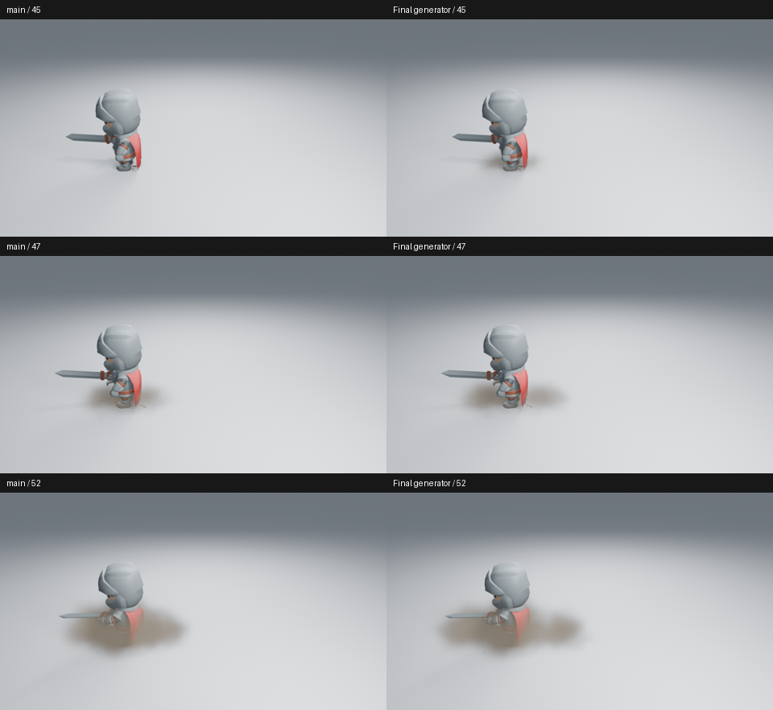
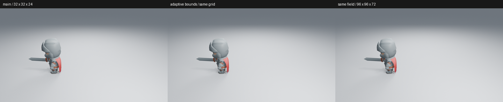
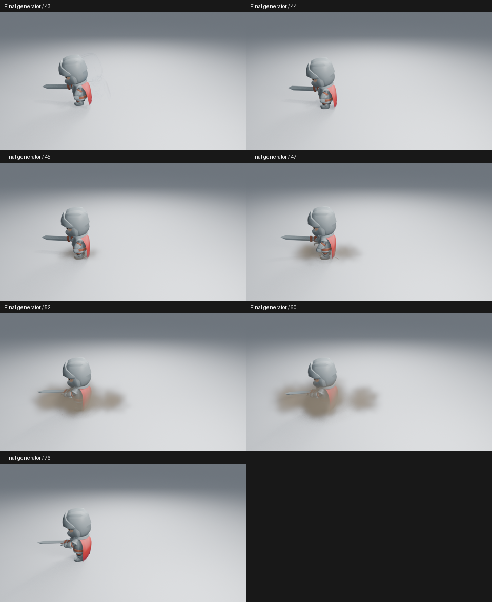
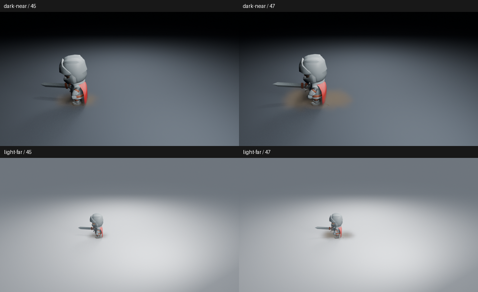
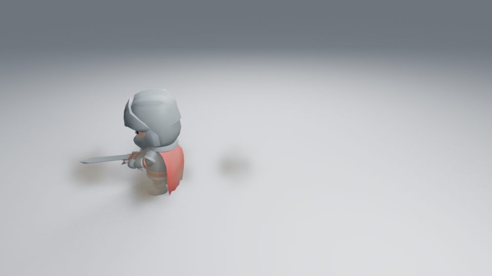
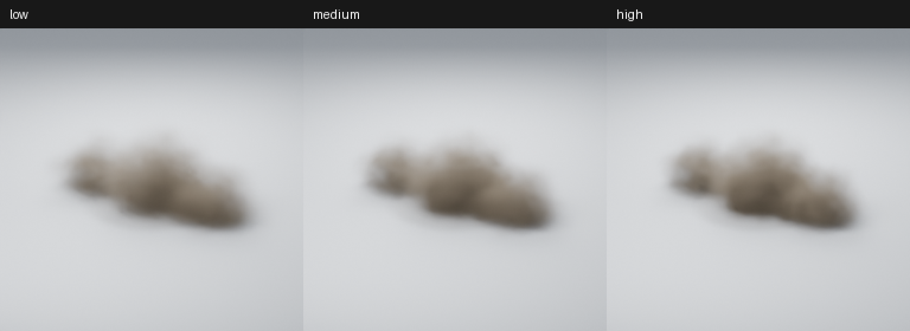

# 让落地侧尘及时接上脚部接触

角色在第 44 帧落地，侧尘先向脚外铺开，再抬升翻滚。这次修改真实 Dust Impact 生成器中两侧尘团的生长和外移节奏，保留体积烟尘、中央烟尘、延迟小尘团及地面薄尘。密度、颜色、粒子数量、质量档位、角色、相机和曝光不变。



## 原因与原生节点

原侧尘需要约三帧长成，早期高度又很低，第一帧的大部分密度仍挤在脚边。缩小密度网格范围没有明显恢复反馈；把相同 Medium 密度场提高到 96×96×72，第一帧也仍弱。因此没有采用采样候选，没有以提高质量档位代替造型和节奏调整。



最终两侧尘团在默认 32 帧生命周期中约一帧半完成铺开，初期保留厚度，向外运动先快后慢。中央烟尘和其他延迟尘团保持原节奏。修改只涉及现有 Geometry Nodes 的生长、接触截面和运动曲线；没有增加侧栏参数、模拟或播放回调。

**Width / Expansion / Dust Rise Height / Dust Roll Speed / Dust Density / Fade** 继续控制大小、扩散、抬升、卷动、密度和消散。原生节点保留 **Rolls Up、Low Contact Crown、Outward Ease Power**，可继续手工编辑。

## 当前实际看图判断

已读取最终浅背景近景第 43／44／45／47／52／60／76 帧，以及暗背景、浅背景远景各第 45／47 帧。高清为 Blender 5.2.2、960×540、Eevee 32 samples、AgX，没有额外辉光。



第一帧能看到脚外的低矮侧尘，后续接成较宽的云团，没有只在末段增加烟量。**改善主要在近景早期反馈；远景第一帧仍弱，次级轮廓不够丰富，云团仍偏柔和。** 这不代表整个落地动作已有成熟成片的力量感。

真实生成器重新创建的第 45 帧与原生节点原型 RGBA 完全一致。基线第 45／47 帧与已有审查原图也逐像素一致，直接复用[第 45 帧](images/dash-landing-after-45.png)和[第 47 帧](images/dash-landing-after-47.png)，避免重复保存。

全部 25 张原生抽帧已实际读取：43–56 每帧，58–76 每隔一帧，另看第 84 帧。样本为 480×270、Eevee 16 samples；按顺序检查接触、翻滚、收缩与恢复，不当作高清细节或实时播放验收。后段仍有软团块收缩的感觉。

[43–48](images/dust-contact-motion-01.png) · [49–54](images/dust-contact-motion-02.png) · [55–64](images/dust-contact-motion-03.png) · [66–76](images/dust-contact-motion-04.png) · [84](images/dust-contact-motion-05.png)。



另在无插件新进程补渲染并读取了第 68 帧高清衰减图，保持 960×540、32 samples，进程正常退出。侧尘在中心团块之前变淡，身体逐渐露出；收缩感仍保留。最终共查看 12 张高清图。



**未观看实时 24 fps 视频，没有宣布整体艺术验收通过。**

## 功能、完整资产与成本

六项烟尘行为和无插件原生重开通过。新进程按 52→43→45 乱序重渲染，三张高清 RGBA 与原图完全一致，角色原生位移继续运行，第 84 帧所有效果清空。Low／Medium／High 完整资产已重建并原生追加，2→9→2 可复现，第 33 帧清场，Density=0 关闭主体；没有导出场景、相机或预览用图片。

三档实际嵌入预览已从 `.blend` 提取并实际查看，RGB 与构建时的 PNG 完全一致。缩略图仅用于资产辨识，不代替高清角色判断：



同一保存角色镜头第 45 帧，只开关整个 VFX 集合；2 CPU 配额、Blender 两线程、Mesa 25.0.7 llvmpipe。求值各预热三次后测九次；渲染丢弃两个预热后测一组配对。

| 测量 | 无 VFX | 有 VFX |
| --- | ---: | ---: |
| 求值中位数 | 0.557 ms | 53.572 ms |
| 求值 p95 | 0.618 ms | 54.228 ms |
| 配对高清渲染 | 19.327 s | 30.192 s |

首次有特效准备与渲染为 45.152 秒。这是整套 Medium 场景的成本，不是新旧节点或三档质量的性能比较；单组渲染不能提供可靠分布，也不能换算为视口 FPS。主验证进程正常退出，Ruff lint／format 通过；功能与性能数据不代替上面的艺术判断。

功能源码 `4f73d01`，组合检查源码 `5eede88`；工作由 [#211](https://github.com/mumu-lhl/blender-vfx-studio/issues/211)／[PR #212](https://github.com/mumu-lhl/blender-vfx-studio/pull/212) 跟踪，整体艺术品质仍由 [#89](https://github.com/mumu-lhl/blender-vfx-studio/issues/89) 跟踪。

设置、原生重开、源码和图像摘要见[清单](images/dust-contact-samples.json)。远端 CI 仍在执行。

复现角色阶段：

```sh
LP_NUM_THREADS=2 MESA_SHADER_CACHE_DISABLE=true blender -b -t 2 --factory-startup --disable-autoexec --python-exit-code 1 --python tools/dash_landing_preview.py -- --frames 43 44 45 47 52 60 76
```

添加 `--dark` 或 `--far` 生成背景与距离对照；输出位于忽略版本管理的 `work/`。

## 实际 CI 交付包

已下载组合源码 `5eede88` 的 [CI 41257852017](https://github.com/mumu-lhl/blender-vfx-studio/actions/runs/41257852017) 安装附件，核对全部 33 个插件 Python 文件、打包原图和 18 份原生资产。包内三档烟尘在无插件新进程完成 2→9→2 几何复现、第 33 帧清场与 Density=0 关闭，新的接触生长和外移节点保留；没有导出场景、相机或图片数据，进程正常退出。

三档嵌入预览已实际提取、读取，与本地预览的 RGB 最大差异均为 1 个 8-bit 色阶；下图直接来自实际附件，不当作三档高清艺术验收：


附件为 6,633,608 字节，SHA-256 为 `d0ff7716f894e29b54b1f901d2fc25f90c5a60b21a5f6e5faaa5801d43280648`。各文件、原生检查与预览差异已补入检查清单；其他长 CI 作业仍在执行。
