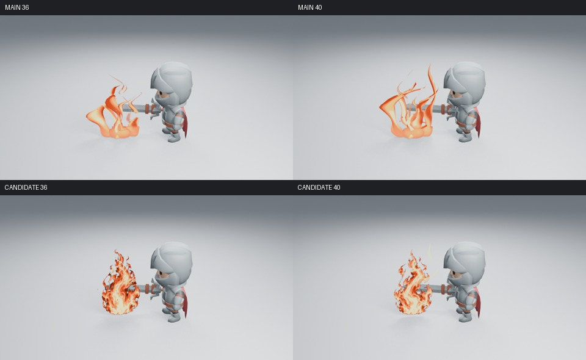
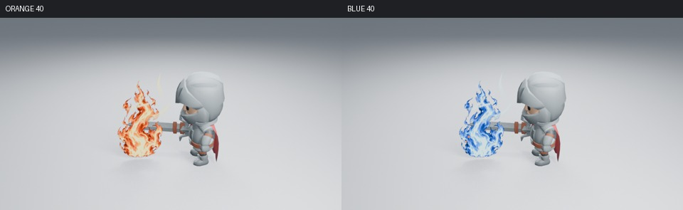
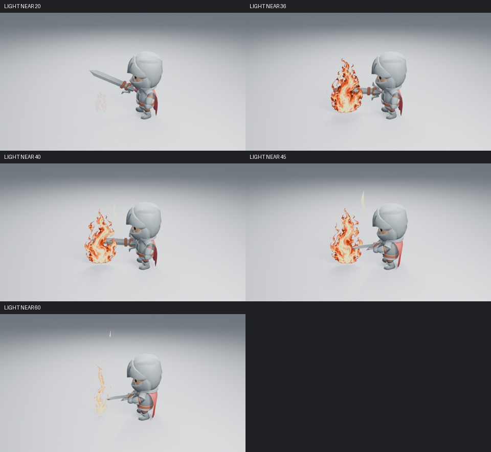
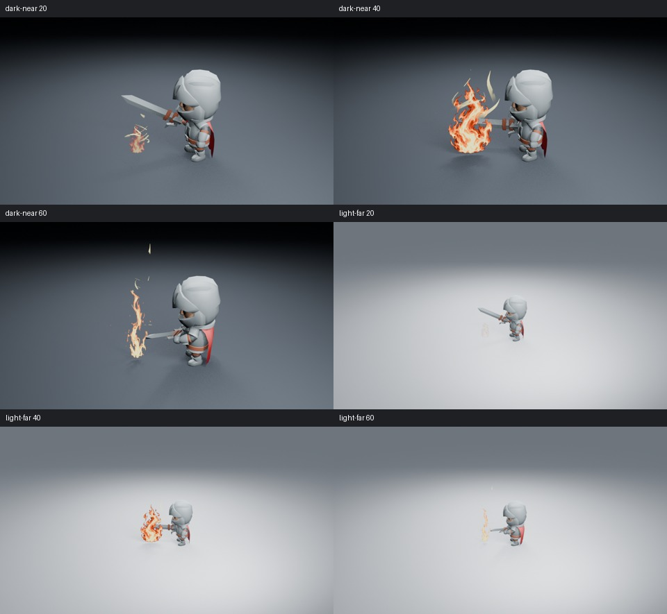
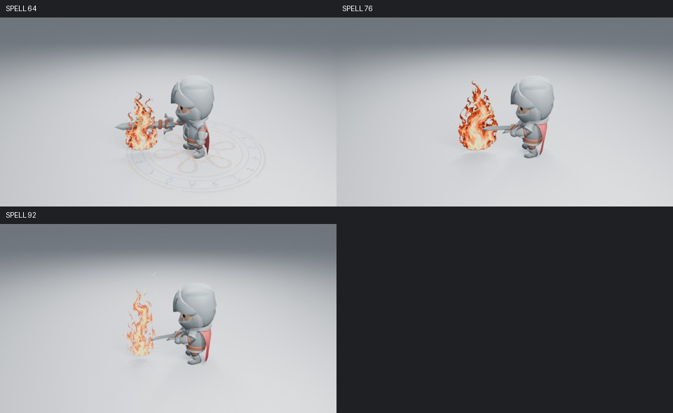
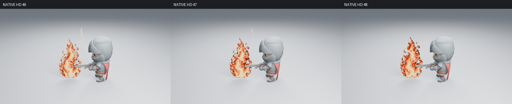
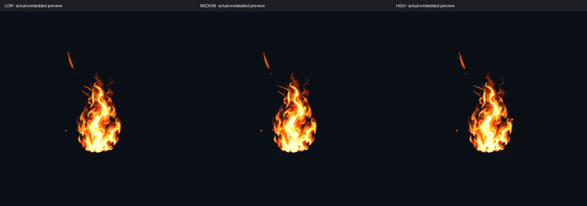

# 火焰主体与上升热流

这轮改变真实 Stylized Fire 生成器。原来的几何火舌即使增加分叉和冷热色带，主要轮廓仍是宽而光滑的薄片。现在用原创灰度密度图形成较完整的卷曲火团，三维火丝退到上部辅助位置；主体、火丝与余烬有不同的视觉权重。没有增加发光强度、粒子数量或演示后期。



[第 40 帧原图](images/fire-body-after-40.png)为 **960×540、Eevee 16 samples、AgX**。相机、角色、灯光与基线一致。比较页只排列、缩放和标注，没有调色或重绘。

## 节点如何形成主体

Geometry Nodes 在原有主焰层中加入带 UV 的承载面，沿用 Width、Fire Height、生命周期和断燃控制。它只绕特效自身上轴朝向活动相机，不抵消用户设定的火焰方向；没有相机或相机恰在上轴时，保留三维火流。初始候选直接使用相机完整旋转，专项回归复现轴向错误（点积 0.587）；改为绕自身上轴后，同一回归达到 0.9999 以上。

Shader Nodes 对同一密度图做两个错相采样。根部保持稳定，上部随现有 Fire Flow Speed 向上流动；交接权重避免采样时钟回绕时整段重置。Fire Curl 和 Noise Scale 控制原生扰动，Dissolve 与 Fade 控制密度侵蚀和从根部断燃。原有五点热色色带、Heat Tint 及 Orange／Blue／Green 同时作用于主体和火丝。Fire Flow Speed=0 可冻结主焰几何和材质，余烬保持独立播放。没有增加侧栏参数、时间回调或新的保存格式。



密度图由 OpenAI 图像生成工具为本项目原创生成，未输入或复制参考作品；原始 PNG 未作像素编辑，已打包进完整资产。来源与摘要见[纹理记录](assets/FIRE_DENSITY.md)。第三方参考只用于学习灰度形状、热色映射与流动分层：[Cyanilux 火焰拆解](https://www.cyanilux.com/tutorials/fire-shader-breakdown/)实际读取了技术说明与节点图；[Jordan Jaminet 的个人火焰练习](https://realtimevfx.com/t/sketch-10-jordanov/4273)实际查看灰度图和 12 张有序 GIF 样本。它们不是本项目的渲染，也没有作为随附素材。

此前缩小辅助火片和数学区域合成的试验没有证明足够收益，保留在实验分支，未替代正式生成器。较慢流动的首轮候选与最终采样分别记录，本文图像均来自最终源码。

## 实际画面与观看边界

已实际读取浅背景 20／36／40／45／60，暗背景和远景各 20／40／60、蓝焰 40，以及完整施法 64／76／92，共 15 张高清阶段图，另补查 46／47／48 三张连续高清。部分通过有序缩图页检查，主峰、蓝焰、远景、暗背景及施法关键帧另读取了原始 PNG。







主体比空心火带更集中，卷曲破口、橙红边缘和内部热流更清楚。手部仍可辨认，剑身可以穿过火团。**只接受主体集中和上升流动的收益，不宣布整体艺术验收通过。** 初生与退场在浅背景仍淡，远景细余烬偏弱；主轮廓仍有固定 S 形图案感，三维体积与身体发力联系仍不足。该主体是绕轴朝向相机的平面，不是体积火焰；俯视与快速切换机位仍需实际镜头验证。

最终保存场景在未加载插件的新进程渲染 35 张火焰样本：出现前、点燃、23–46 帧连续，以及后段断燃和清场。全部六页已实际读取：[1](images/fire-body-motion-01.jpg) · [2](images/fire-body-motion-02.jpg) · [3](images/fire-body-motion-03.jpg) · [4](images/fire-body-motion-04.jpg) · [5](images/fire-body-motion-05.jpg) · [6](images/fire-body-motion-06.jpg)。根部未随采样整体上移，主段可见热流向上推进；有序样本中未见整团突然重置。

针对原先容易突变的 46→47→48 帧另在无插件新进程渲染三张高清并实际读取：主体保持连续，未见原来的整团骤缩；上部淡色火丝仍有片状感。



完整施法另取 1／40、54–102 帧每隔四帧及 104 帧，共 16 张，全部三页已实际读取：[1](images/fire-body-spell-motion-01.jpg) · [2](images/fire-body-spell-motion-02.jpg) · [3](images/fire-body-spell-motion-03.jpg)。这些样本检查交接、保持、断燃与恢复，**没有逐帧检查整个前奏，也没有观看实时 24 fps 播放**。

## 原生行为与完整资产

9 项火焰、14 项艺术控制及 25 项入门资产集成检查通过，覆盖艺术参数、停止流动、换色、保留手动节点、独立实例、完整保存和安全删除。火焰 60→36→40、完整施法 92→64→76 在新进程重渲染，六张高清图 RGBA 与保存前一致，70／104 帧清场。最终本地批次正常退出 0。

18 份完整资产已重建，并从实际 examples ZIP 无插件追加验证。三档火焰另检查 8→20→8 可复现、53 清场、相机有无切换及打包密度图原始字节。资产不夹带相机、场景或预览图片数据块。实际嵌入预览已提取读取，RGB 与构建用 PNG 一致。



首次 CI 的旧断言只允许 Impact 使用贴图，因而拒绝火焰密度图；原生重开与包内追加断言也逐项修正为只允许指定打包图，并核对摘要。没有放宽对预览图、相机或场景的排除。源码 `aa85bd1` 的[本轮 CI](https://github.com/mumu-lhl/blender-vfx-studio/actions/runs/41284030499)三平台后台、充能衔接、闪电与战斗镜头已成功，其余六项视觉任务仍在运行，暂不宣称全绿。实际下载的安装附件已核对 33 个插件 Python 文件、两张原图和 18 份资产；包内三档火焰的原生取帧、清场、相机切换与密度图摘要通过，实际嵌入预览已读取，RGB 与本地构建完全一致。


## 实测成本

同一保存角色镜头第 40 帧只开关 VFX 集合。Blender 5.2.2、2 CPU 配额、两线程、Mesa 25.0.7 llvmpipe；求值各预热三次后测九次，渲染丢弃两次预热后测一组配对。

| 测量 | 无 VFX | 有 VFX |
| --- | ---: | ---: |
| 求值中位数 | 0.476 ms | 3.410 ms |
| 求值 p95 | 0.492 ms | 3.488 ms |
| 配对高清渲染 | 10.343 s | 28.187 s |

首次有特效准备与渲染为 46.860 秒。这是 Medium 整套场景的成本，不能换算为视口 FPS；一组渲染不足以报告稳定分布或通用版本差异。主焰增加的几何很少，材质与覆盖面积仍带来明显成本，不能拿顶点数证明廉价。Low／Medium／High 改变三维火丝和余烬，不减少主密度图的纹理成本。

## 复现与后续

最终运行源码为 `aa85bd1`，基线为 `a610371`；设置、源码／图像摘要、原生检查和测量见[清单](images/fire-body-samples.json)。

```sh
LP_NUM_THREADS=2 MESA_SHADER_CACHE_DISABLE=true blender -b -t 2 --factory-startup --disable-autoexec --python-exit-code 1 --python tools/fire_preview.py -- --frames 20 36 40 45 60
```

分别添加 `--dark`、`--far` 或 `--palette BLUE` 检查相应条件。完整施法使用 `tools/spell_preview.py -- --frames 64 76 92`；`--sequence` 可输出完整镜头。保存后的原生高清复现使用 `tests/fire_visual_reopen.py` 与 `tests/spell_visual_reopen.py`。

后续优先判断完整角色镜头中的点燃、释放与力量传递，不围绕同一截面无限加节点。[#198](https://github.com/mumu-lhl/blender-vfx-studio/issues/198) 与整体艺术问题 [#89](https://github.com/mumu-lhl/blender-vfx-studio/issues/89) 保持跟进。
