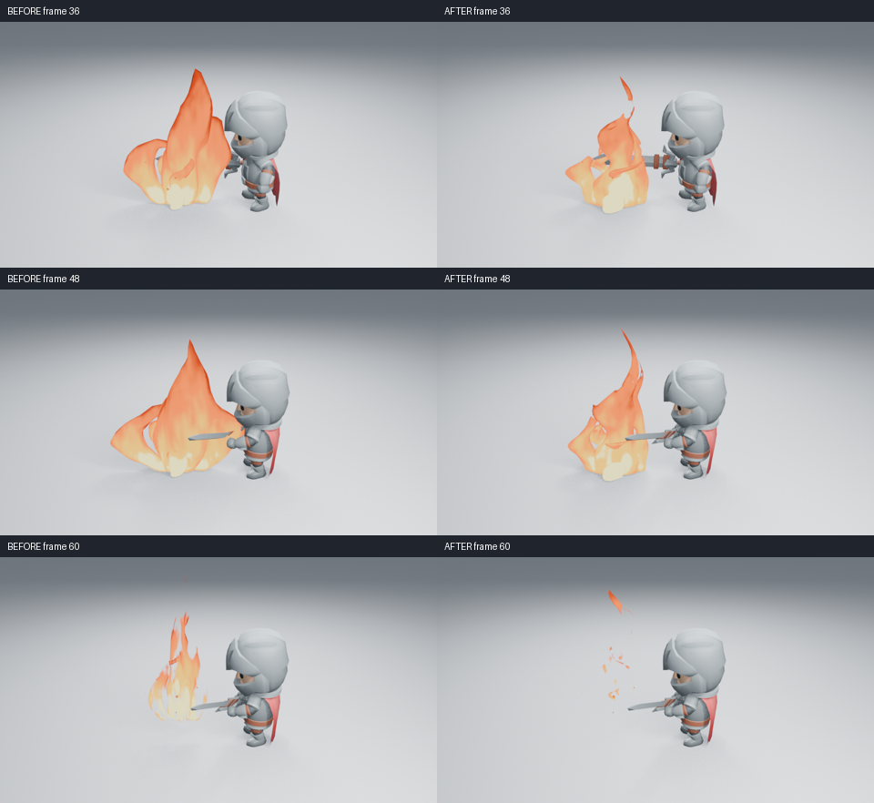
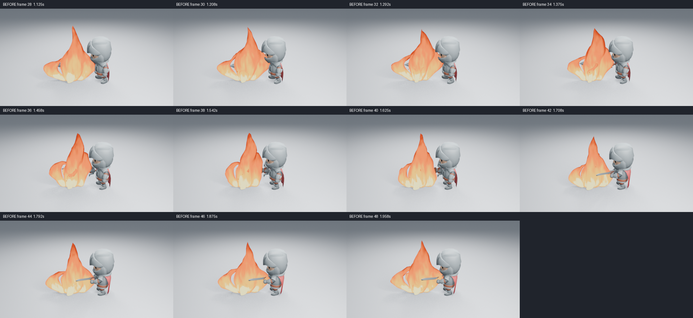
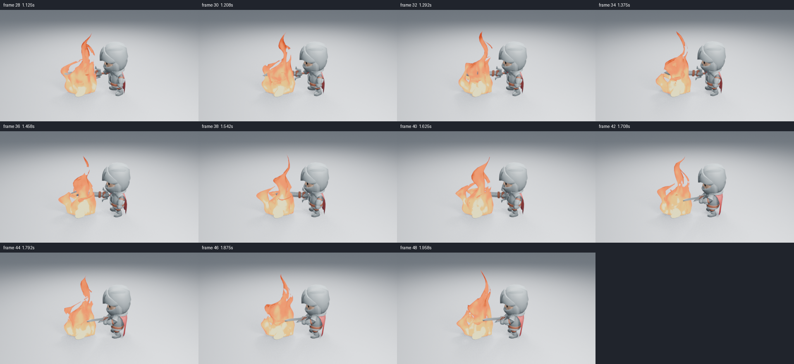

# 持续火焰的形状与流动

本轮解决的是火焰在维持阶段像几片光滑叶片的问题。使用相同角色、施法动作、相机、照明与 Eevee 设置比较真实生成器：960×540、16 samples、AgX，没有额外辉光，发光强度和火星数量没有增加。



左右分别为当前 main 基线与候选生成器。高清原图：[36 帧前](images/fire-flow-before-36.png)／[后](images/fire-flow-after-36.png)、[48 帧前](images/fire-flow-before-48.png)／[后](images/fire-flow-after-48.png)、[60 帧前](images/fire-flow-before-60.png)／[后](images/fire-flow-after-60.png)。排列图只缩小图片并加标签。

## 问题为什么出现

原材质在生命周期前约三分之二几乎没有轮廓切口，只有最后断燃才破开；因此即使表面噪声移动，整片外轮廓仍很完整。几何宽度又基本同步起伏，且围绕整体原点缩放，难以读出不同火舌中向上移动的收颈。材质使用自己的时间系数，没有随 Fire Flow Speed 一起变化。

现在每个截面保存自己的路径中心，几何节点围绕它形成错开的鼓起和收颈，并把弯折向上移动。较窄、较直立的侧焰辅助主体，底部保持连接。材质的上升色带、切口与各火舌使用同一流动时钟；上半段持续分叉，细尖可以脱落。退场优先切断底部，留下较薄的上部火丝，避免把已有切口与退场阈值直接相加后过早整片消失。

默认 Flow Speed 为 22；设为 0 可以停止主焰的几何与材质流动，余烬仍由自己的粒子层控制。Height、Curl、Width、色带、Fade 和完整效果保存方式保留，没有增加侧栏参数。三个质量档继续决定网格细节与余烬生成率。

## 参考与实际判断

实际读取了 ryanzeng 的 [风格化营火拆解](https://realtimevfx.com/t/stylized-zelda-camp-fire-breakdown/9613) 中原 GIF 的 8 张抽帧，以及作者的 Shader 图。参考原则是稳定的热芯、不同层的主次、向上移动的切口和顶部脱落；该作品使用纹理与流动材质，本项目采用自己编写的网格和程序化节点，没有复制纹理、网格或代码。参考图只保存在本地分析目录，不进入资产包。

已经实际查看基线第 20／36／48／60 帧，候选浅背景第 20／28／36／48／60 帧、暗背景第 36／48／60 帧、远景第 36／48 帧，以及两组第 28–48 帧每隔一帧的样本，共 22 张。高清图展示出现、维持与断燃；480×270 样本用于检查连续变化，不能代替高清阶段图。





在这些实际图像中，主体比基线更直立，宽大完整的火面减少；第 28–48 帧可以看到不同位置的收颈向上移动、细尖断开后续上，底部热芯继续保留。第 60 帧留下分散火丝，不再只是一片近乎完整的透明外壳。明暗背景都有相同的先后关系。

这仍不是整体艺术验收通过。第 34–38 帧的上部有较圆的鼓包，部分色块偏柔，远景的细切口和余烬较弱；两张远景图只能证明该阶段的主体轮廓可读，不能证明所有距离都成立。没有观看实时 24 fps 视频。

## 完整施法与预览

本地实际读取“魔法阵 → 火焰 → 消散”第 40／64／96 帧；另下载并校验 [CI 40729568694](https://github.com/mumu-lhl/blender-vfx-studio/actions/runs/40729568694) 的施法附件 12836833658，确认 Fire 生成器 SHA256 与当前代码一致、108 帧 24 fps 视频与源 PNG 摘要对应，并实际读取全部 54 张隔帧解码图。完整图组：[1–17](images/fire-spell-sequence-01.png)、[19–35](images/fire-spell-sequence-02.png)、[37–53](images/fire-spell-sequence-03.png)、[55–71](images/fire-spell-sequence-04.png)、[73–89](images/fire-spell-sequence-05.png)、[91–107](images/fire-spell-sequence-06.png)。没有按真实播放速度观看视频。


逐笔形成、保持、火焰出现、圆阵退场、断燃与恢复的顺序清楚，火焰不会在角色恢复时留下完整火面。但圆阵符记向上升起、火焰在身前地面出现，两者仍缺少明确的能量传递；不能把正确时序和这组图记为整段施法的艺术验收通过。CI 的无插件三阶段像素检查与第 104 帧清空通过，这属于功能验证。

蓝火第 36 帧已实际查看。生产资产构建器另外重建并查看了 Low / Medium / High 三张 Cycles CPU 缩略图；原生新进程读取三个导出资产，均保留可编辑 `fire_center` 属性、速度控制、256×256 内嵌预览及正确退场。缩略图使用既有 Standard 显示变换，高清角色图使用 AgX；不把缩略图的鲜艳程度当作高清画质结论。

首个原型侧焰过于横向，另一个候选叠加阈值后在第 60 帧整片消失，均没有作为最终图像或默认资产采用。环境切换中断的一批渲染已重新生成；只记录正常结束、源文件校验完成的批次。

## 复现与功能验证

基线源码为 `2dba02d`，当前火焰源码为 `22b1c96`。在对应源码中运行：

```sh
LP_NUM_THREADS=2 blender -b -t 2 --factory-startup --disable-autoexec --python-exit-code 1 --python tools/fire_preview.py -- --frames 20 28 36 48 60
```

加 `--dark` 或 `--far` 生成对应条件。原生抽帧使用保存场景，不载入插件：

```sh
MESA_SHADER_CACHE_DISABLE=true LP_NUM_THREADS=2 blender -b -t 2 --factory-startup --disable-autoexec work/fire-review/light-near/fire.blend --python-exit-code 1 --python-expr 'import bpy; bpy.context.scene.render.resolution_percentage = 50' -s 28 -e 48 -j 2 -o //samples/fire-#### -a
```

6 项局部功能检查通过，包括流动停止时几何与材质同步静止、重新启用流动、后段火丝不提前清空、Fade、完整资产独立载入、删除保留用户对象及质量档位。功能结果不代替上述视觉判断。

在无插件、关闭自动执行的新进程中按 60／20／36 倒序跳帧，三张 960×540 PNG 的全部通道与原渲染一致，第 70 帧效果几何清空，进程正常退出。采样动画也使用无插件原生场景并正常结束。

整合角色衔接修改后，22 项完整资产、14 项艺术控制、6 项火焰检查与完整资产原生重开通过。控制回归明确检查：仅去掉几何速度驱动时，材质仍读取它，侧栏应继续显示；两边都不读取时才隐藏。[CI 40780508231](https://github.com/mumu-lhl/blender-vfx-studio/actions/runs/40780508231) 全部 12 项成功，包括三平台后台套件、原生资产与完整施法序列。自动检查成功不代替上面已注明来源的实际看图范围。源码、图像、视频、导出及实测摘要见 [检查清单](images/fire-flow-samples.json)。

## 实测成本

Blender 5.2.2、2 CPU 配额、两线程、Mesa 25.0.7 llvmpipe。在同一保存镜头只开关特效集合，第 36 帧各丢弃三轮预热后测量九次；两个预热渲染后保留一组匹配高清渲染。

| 测量 | 无特效 | 有特效 |
| --- | ---: | ---: |
| 后台求值中位数 | 0.714 ms | 3.951 ms |
| 后台求值 p95 | 0.758 ms | 4.055 ms |
| 配对高清渲染 | 15.646 s | 23.617 s |

第一次有特效准备与渲染为 52.703 秒，保留在原始记录中，没有当作预热后的成本。这是后台求值和软件渲染时间，不是交互视口 FPS，也不足以计算渲染 p95。没有用固定顶点数量作为通过标准。
