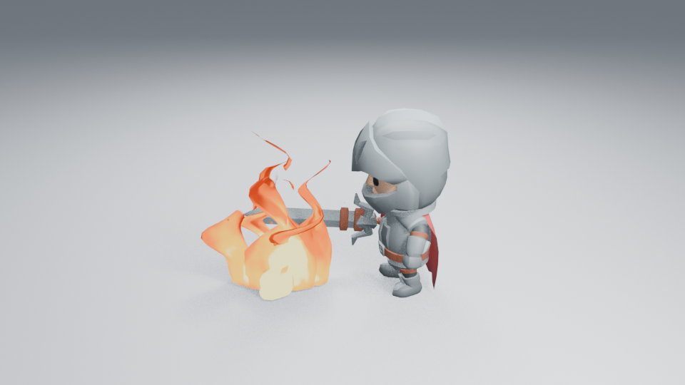
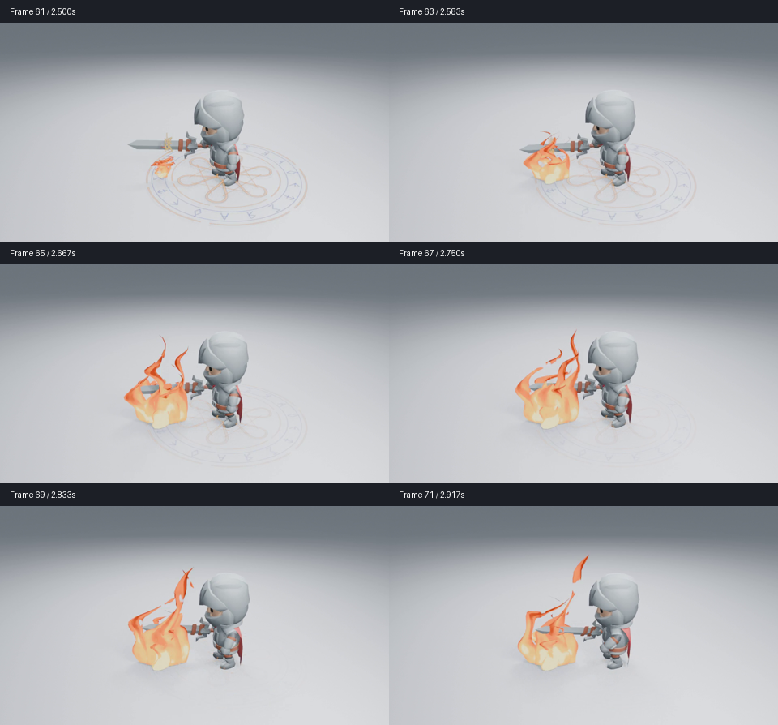

# 持续火焰的分叉与热流检查

这轮修改真实 Fire 生成器，目标是减少中上部完整的平滑大面，让火舌有持续向上生长、分开和断裂的变化。角色、动作、相机、灯光、粒子数量及发光强度保留。图像为 Blender 5.2.2、960×540、Eevee 16 samples、AgX，无额外辉光。



## 画面原因与原生节点

原火舌沿环形截面连续收尖。宽窄与弯折能让它们摆动，但不会产生真正分叉；高度渐变和宽噪声也容易在中段保留大块相似颜色。

两根主火舌现在由共享下部接到错开的上部双尖。各支沿同一 Flow Speed 时钟错相生长，Geometry Nodes 控制伸长和展开，Shader Nodes 在重置前先侵蚀断开。单纯同时伸长会像固定叉角，整支透明淡出则会留下半透明叶片，因此用生长与侵蚀共同完成交接。

材质保留原来的热色色带，加入沿流向上卷的窄冷缝，区分相邻热流；没有增加发光。原生 **Fork Spread** 调整展开范围，**Flow Seam Contrast** 调整内部冷缝，常用宽高、Flow Speed、Curl、颜色和生命周期保持原有入口。共享下部与各支使用短距离相交，不依赖布尔运算或逐帧 Python。

## 已查看的画面与边界

已实际读取基线第 36／48 帧与当前第 36／40／48 帧高清角色图。中上部有不同高度的分叉和缺口，完整大面减少，尖端不再固定地同时伸长；底部亮色团块仍偏圆，整体仍有片状边缘。没有声称达到成熟游戏火焰品质。

[36 前](images/fire-forks-before-36.png) · [36 后](images/fire-forks-after-36.png) · [40 后](images/fire-forks-after-40.png) · [48 前](images/fire-forks-before-48.png) · [48 后](images/fire-forks-after-48.png)。图片直接复制自渲染，没有裁切或调色。浅背景第 25／60／69 帧、明暗和远景第 36／40 帧，以及完整施法第 64／76／92／104 帧也已实际读取。方向关系与退场保留，远景细尖偏弱，底部块感仍明显。整段隔帧和三档导出已查看，CI 已全部成功；**未观看实时播放，不宣布整体艺术品质通过。**

参考的用途与原作方法见 [参考区分](LIBRARY_REFERENCE_STUDY.md)。本轮实际查看了原作者成片 GIF 的八张样本：可见错相运动与变化的边界，但其 HDR、辉光和纹理也影响了观感，不能当作本项目实现或验收结果。

[暗背景 40](images/fire-forks-dark-40.png) · [远景 40](images/fire-forks-far-40.png) · [施法 76](images/fire-forks-spell-76.png) · [衰减 60](images/fire-forks-decay-60.png)。

## 完整时间轴抽帧

已逐张查看从保存的原生场景直接渲染的全部 36 张隔帧：第 1–71 帧，每隔一帧，480×270、16 samples，新进程未导入插件，正常退出。这组图用于时序检查，不代替上面的高清细节。

[1–11](images/fire-forks-motion-01.png) · [13–23](images/fire-forks-motion-02.png) · [25–35](images/fire-forks-motion-03.png) · [37–47](images/fire-forks-motion-04.png) · [49–59](images/fire-forks-motion-05.png) · [61–71](images/fire-forks-motion-06.png)。另外提供 [12 fps 抽帧 MP4](images/fire-forks-sampled.mp4)，36 个实际样本、3 秒，与 72 帧／24 fps 时间轴等长，没有补帧。另已取回 [CI 的完整 960×540、24 fps MP4](images/fire-forks.mp4)：72 个实际渲染帧、3 秒，生成器摘要一致；没有把该视频标为已观看。**未观看视频或实时播放。**

第 19–23 帧点燃后展开，保持阶段的双尖交替伸长、侵蚀断开；高度变化较大，不能仅凭抽帧断言实时节奏自然。第 55–61 帧下部先散成碎片，随后恢复干净。相比固定双角与整支透明淡出的候选，生长和消散更清楚，底部团块与局部薄片仍未解决。

## 当前设备上的成本

Blender 5.2.2、两线程、两核 CPU 配额、Mesa 25.0.7 llvmpipe（LLVM 19.1.7），960×540、Eevee 16 samples。在同一保存场景只开关特效集合，第 40 帧求值各预热三次、再测九次。

| 第 40 帧 | 无特效 | 有特效 |
| --- | --- | --- |
| 求值中位数／p95 | 0.72／0.75 ms | 5.59／5.82 ms |
| 同帧渲染，预热后一次 | 15.92 s | 21.33 s |

渲染只有一组配对，不能计算可靠的渲染 p95；这些后台测量不是视口 FPS，也没有相同设备上的旧版性能对照。几何与 Shader 复杂度是否值得保留，要结合实际画面判断，不能用顶点数量代替成本。

## 功能检查与复现

8 项火焰、14 项艺术控制和 22 项完整资产检查通过，包含停止流动、实际热缝像素、分叉范围不改变共享下部、完整资产节点编辑与独立复制。无插件顶点回放与八套完整资产回放通过。高清图在无插件新进程按 48→36→40 倒序重渲染，三张 PNG 全通道一致，第 70 帧清空，正常退出。三档完整资产已重新生成，在无插件进程验证分叉属性、原生节点、256×256 嵌入预览与结束帧，正常退出；三张 Cycles CPU 预览已实际查看。测试通过不代表艺术验收。CI [40911022777](https://github.com/mumu-lhl/blender-vfx-studio/actions/runs/40911022777) 全部 12 项成功（功能提交 `a7658f9`）。底部团块、薄边和实时播放判断的限制仍保留，整体艺术工作继续由 #89 跟踪。

```sh
LP_NUM_THREADS=2 blender -b -t 2 --factory-startup --disable-autoexec --python-exit-code 1 --python tools/fire_preview.py -- --frames 36 40 48
```

使用 `--dark`、`--far` 对照，或 `--sequence` 渲染全部 72 帧。完整施法使用 `tools/spell_preview.py`。图像、批次与源码摘要见 [检查清单](images/fire-forks-samples.json)。工作由 [#184](https://github.com/mumu-lhl/blender-vfx-studio/issues/184) 跟踪，整体品质见 [#89](https://github.com/mumu-lhl/blender-vfx-studio/issues/89)。


## 完整施法镜头的补查

另读取 CI 同一功能源码生成的完整施法视频：108 帧、960×540、24 fps、4.5 秒。源码摘要全部匹配分叉生成器；实际解码并查看第 1–107 帧的全部 54 张隔帧，九页排列图见下。这里只缩小排列、标注时间，没有修改原画面；未观看视频实时播放。

[1–11](images/fire-spell-motion-01.png) · [13–23](images/fire-spell-motion-02.png) · [25–35](images/fire-spell-motion-03.png) · [37–47](images/fire-spell-motion-04.png) · [49–59](images/fire-spell-motion-05.png) · [61–71](images/fire-spell-motion-06.png) · [73–83](images/fire-spell-motion-07.png) · [85–95](images/fire-spell-motion-08.png) · [97–107](images/fire-spell-motion-09.png)。



符记在第 53–59 帧向剑前聚集，第 61 帧开始接上火焰；第 65–89 帧的轮廓交替分叉、抬升，局部尖端脱离；第 91–99 帧由下向上断开，恢复阶段干净。分叉和断开确实进入完整角色镜头，但底部持续呈较圆的团块，释放符记相对角色偏小，角色准备阶段也缺少明显蓄势。空间衔接和火舌轮廓的收益保留，整段释放力度仍未通过艺术验收。该补查不增加节点或参数，后续应依据完整构图处理这些问题。

视频来源、54 张样本与图片摘要见 [补查清单](images/fire-spell-motion-samples.json)。这批资料与上面的独立火焰抽帧分开记录。
