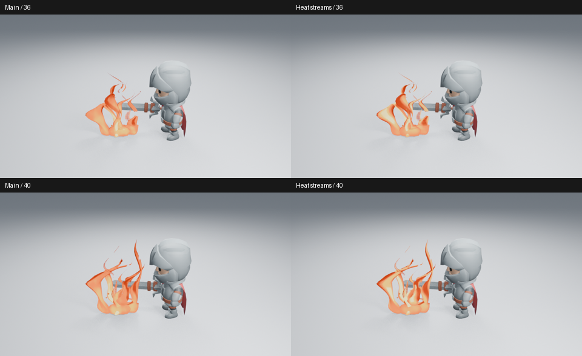
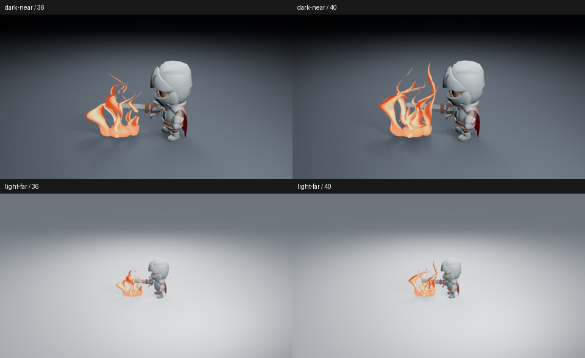
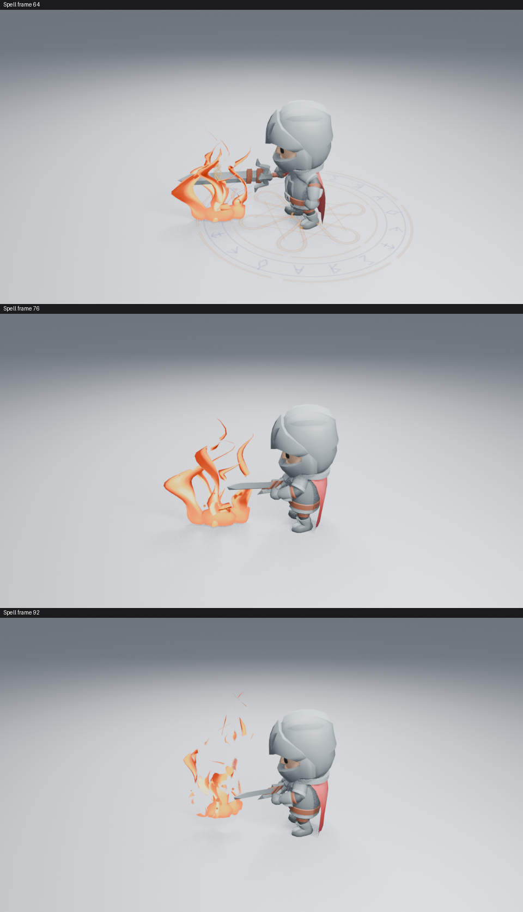
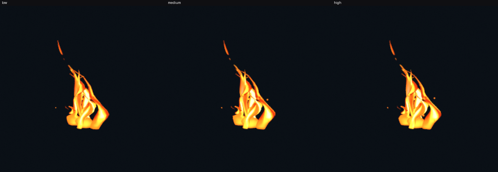

# 让冷热流动成为火焰的主要内部层次

这轮只改变真实 Stylized Fire 的原生材质。原来的上升流主要冷却狭窄接缝，大部分表面接近同一橙色；细噪声较强，却没有形成清楚的热流方向。现在同一条周期流同时产生热峰和冷谷，小噪声退到次要位置。几何、透明裁切、粒子数量、发光强度与角色镜头均未改变。



高清：[36 帧](images/fire-heat-streams-after-36.png) · [40 帧](images/fire-heat-streams-after-40.png)。比较页只缩放、排列、标注，没有调色或增加后期。

## 节点原因与实际结果

Shader Nodes 继续使用截面的周期属性和现有流动时钟。`Hot And Cool Flow` 将流场映射到 −1～1，而不是只从表面扣去一条冷缝；`Broad Heat Variation` 降低细噪声权重，基础热度与沿高度的降温一起调整，避免热峰把整个主体推成白色。已有五点色带、Orange／Blue／Green、Heat Tint 与停止流动控制保留，`Flow Seam Contrast` 仍可原生编辑。没有新增侧栏参数或另一套生成器。

同一保存场景中先修改材质进行试验，再由正式生成器重建：第 36、40 帧的 RGBA 完全一致。试验也确认第 40 帧的求值几何与基线相同，发光强度仍为 2.2。





热峰现在沿较长的火流形成亮区，冷谷分开相邻面；完整施法中也能看出这种层次。不过，**宽火面仍像薄片，46→47 帧的退场仍快，远景细余烬和身体发力仍弱。这里只接受内部冷热分层的局部收益，不宣称整套火焰或角色施法已通过艺术验收。** 没有用更亮的发光替代造型问题。

## 观看范围与复现

原始高清图均为 960×540、Eevee 16 samples、AgX，无额外辉光。实际查看浅背景 20／36／40／45／46／47／48／60，暗背景与远景各 36／40、蓝焰 40，完整施法 64／76／92。连续 45–48 帧也与基线逐帧比较。

保存场景在未加载插件、关闭自动执行的新进程中渲染了 36 张火焰样本，全部六页已读取：[1](images/fire-heat-streams-motion-01.jpg) · [2](images/fire-heat-streams-motion-02.jpg) · [3](images/fire-heat-streams-motion-03.jpg) · [4](images/fire-heat-streams-motion-04.jpg) · [5](images/fire-heat-streams-motion-05.jpg) · [6](images/fire-heat-streams-motion-06.jpg)。32–44 帧连续，其余燃烧阶段主要隔一帧；45–48 帧另用[高清前后对照](images/fire-heat-streams-reset-comparison.png)检查快速退场。

完整施法另取 28 张原生样本：1／40 帧和 54–104 帧隔帧，全部五页已读取：[1](images/fire-heat-streams-spell-motion-01.jpg) · [2](images/fire-heat-streams-spell-motion-02.jpg) · [3](images/fire-heat-streams-spell-motion-03.jpg) · [4](images/fire-heat-streams-spell-motion-04.jpg) · [5](images/fire-heat-streams-spell-motion-05.jpg)。这组覆盖释放前、点燃、维持、断燃和清场，**没有逐帧检查整个施法前奏，也没有观看实时 24 fps 播放**。原始 PNG 未改动；抽帧页只排列、标注后保存为 JPEG。

[完整施法前后对照](images/fire-heat-streams-spell-comparison.png)显示，收益集中在火面内的亮带，整体剪影基本不变，不能把这项材质调整当成主体重设计。

## 功能、完整资产与实测成本

八项火焰和十四项艺术控制检查通过，覆盖原生时间、停止流动、形变、换色、保留手动色带／节点、复制、完整资产与安全删除。火焰 60→20→40、完整施法 92→64→76 在新进程重渲染，六张高清图 RGBA 与保存前一致，第 70／104 帧清场。首轮验证脚本使用了错误的艺术控制测试文件名，修正路径后从该步骤继续，已通过的测试没有重跑；最终验证批次退出 0。

三档完整资产已重建并无插件追加，8→20→8 可复现、53 清场，冷热流节点和自定义预览保留，没有夹带场景、相机或预览图片数据。三张实际嵌入预览已提取查看，RGB 与构建用 PNG 一致。



同一保存角色镜头第 40 帧只开关 VFX 集合。2 CPU 配额、Blender 5.2.2 两线程、Mesa 25.0.7 llvmpipe；求值各预热三次后测九次，渲染丢弃两次预热后测一组配对：

| 测量 | 无 VFX | 有 VFX |
| --- | ---: | ---: |
| 求值中位数 | 0.461 ms | 2.826 ms |
| 求值 p95 | 0.489 ms | 2.940 ms |
| 配对高清渲染 | 10.220 s | 13.879 s |

首次有特效准备与渲染为 31.637 秒。这是 Medium 整套镜头的成本，不是新旧材质比较；单组渲染不能提供稳定分布，也不能换算成视口 FPS。原始设置、源码／图像摘要和测量见[清单](images/fire-heat-streams-samples.json)。CI 仍在运行，暂不宣称成功。

复现高清阶段：

```sh
LP_NUM_THREADS=2 MESA_SHADER_CACHE_DISABLE=true blender -b -t 2 --factory-startup --disable-autoexec --python-exit-code 1 --python tools/fire_preview.py -- --frames 20 36 40 45 46 47 48 60
```

分别添加 `--dark`、`--far` 或 `--palette BLUE` 检查相应条件。完整施法用 `tools/spell_preview.py -- --frames 64 76 92`。

基线 main 为 `37b94e4`，运行代码为 `bc98a9f`。[PR #213](https://github.com/mumu-lhl/blender-vfx-studio/pull/213) 引用 [#198](https://github.com/mumu-lhl/blender-vfx-studio/issues/198)；后续仍以完整角色画面的收益为准，避免围绕单个材质无限微调。
