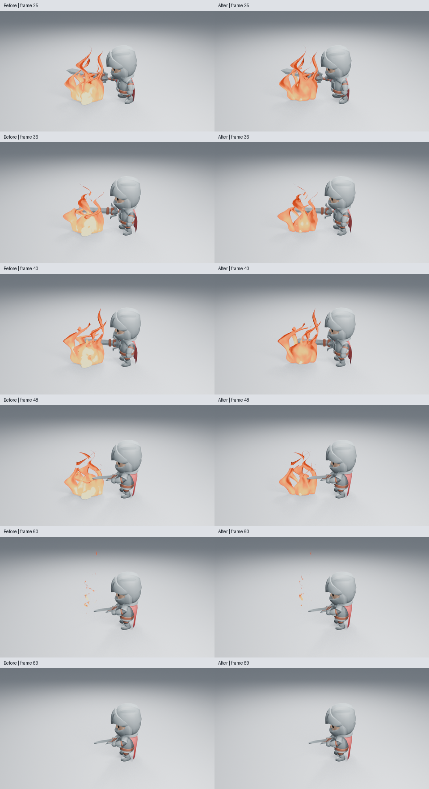
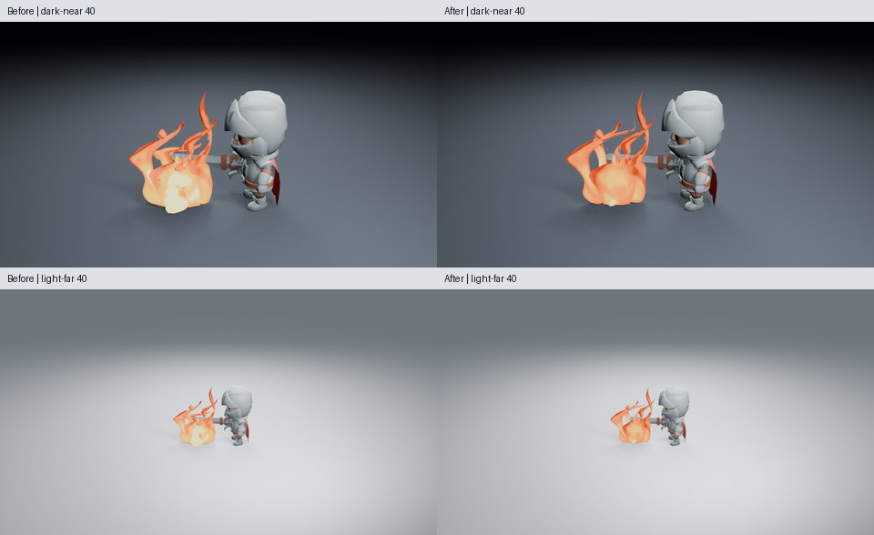
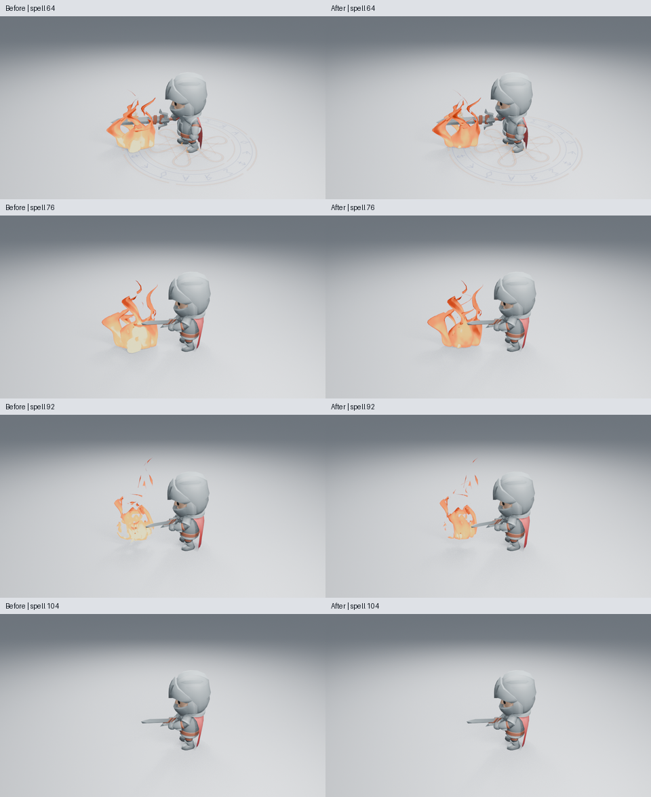
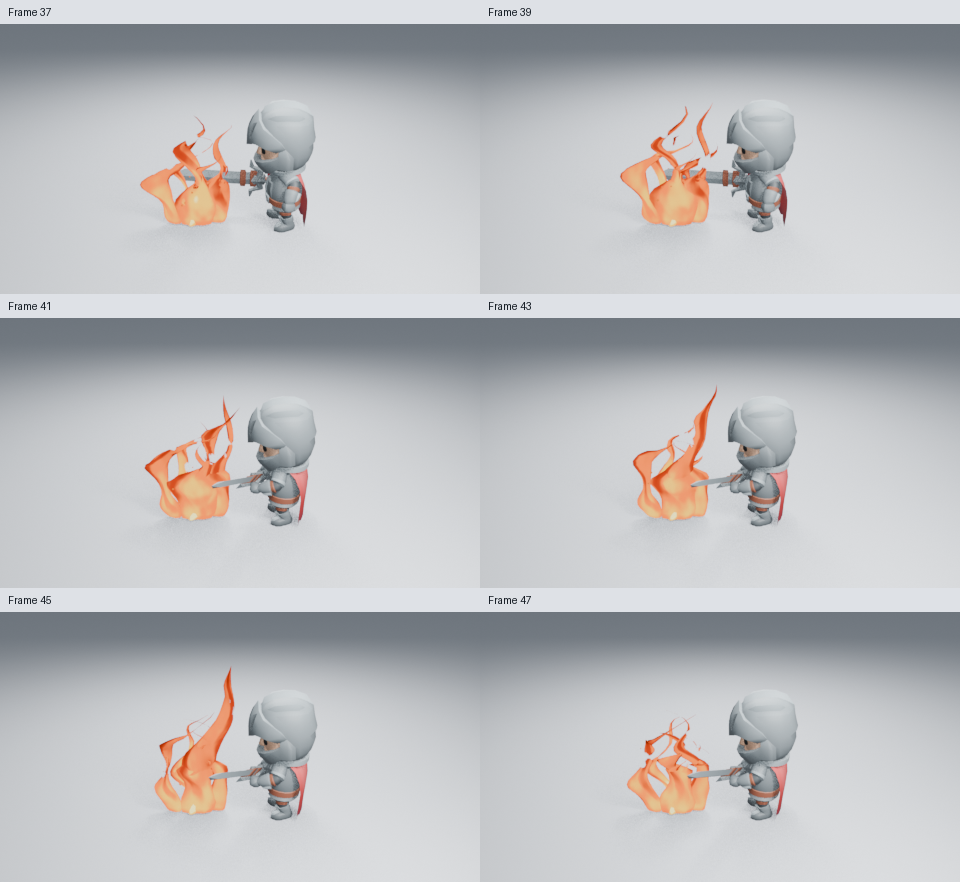
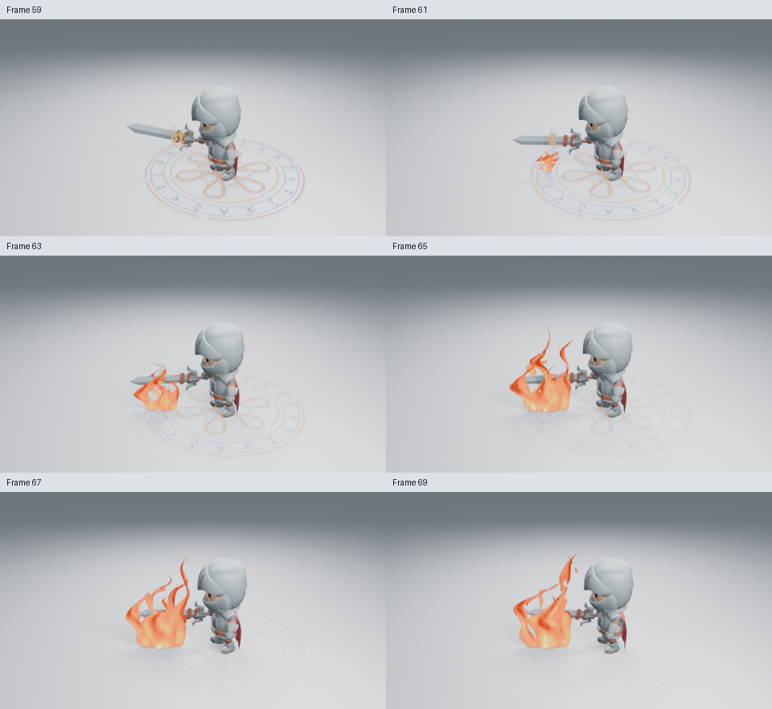
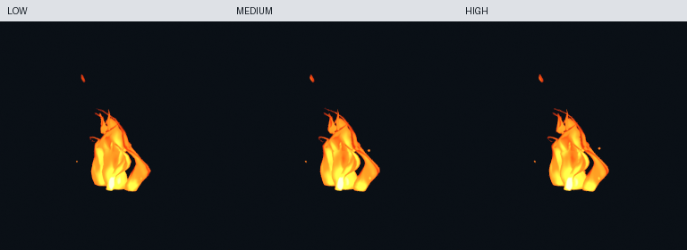

# 火焰下部的热流与轮廓

这轮修改真实 Stylized Fire 生成器，减少前方突出的亮色圆团，让下部参与原有的上升变化。分叉设计、质量档位、颜色预设、发光强度、粒子数量和角色编排保持原有入口，没有添加侧栏参数。

原始高清：[第 36 帧](images/fire-rooted-after-36.png) · [第 40 帧](images/fire-rooted-after-40.png)。比较页只缩小排列原始 PNG 并加帧号，没有调色或重绘。

## 真实造型与节点

两个内焰采用较窄、较长且靠近中心的静态网格，让亮色形体沿上方延伸。根部截面收窄；几何节点的脉动从更低处开始，保留接地的根部，让它上方的宽窄变化随同一 Flow Speed 时钟向上传播。上部分叉仍错相生长和侵蚀，没有改成整支同时缩放。

材质降低基部外焰对最亮色带的占用，让较低位置也参与原有冷缝。热芯保留独立的热量加值，五色色带、配色预设、Strength、Dissolve 和 Fade 继续生效。Mesh、Geometry Nodes 与 Shader Nodes 都保存在完整资产中，播放没有 Python 回调或外部纹理依赖。

## 实际画面判断

已实际读取 12 张火焰高清：浅背景第 25／36／40／48／60／69 帧，暗背景和远景各第 36／40 帧，蓝火与绿火各第 36 帧。全部为 Blender 5.2.2、960×540、Eevee 16 samples、AgX，无额外辉光。第 36／40／48 帧前方的圆团明显收敛，分叉走势保留；远景能找到橙色主体，细尖与内部热流仍较弱。

完整施法第 64／76／92／104 帧也已实际读取：点燃、持续燃烧和退场都采用真实生成器，魔法阵及火焰的开始时序保留。

**仅确认下部圆团与主次的局部改善，整体火焰艺术品质尚未通过。** 下部仍有较完整的橙色面，上部仍偏薄片；完整施法的身体蓄势和远景细节也有限。没有因为节点或测试增加就宣布品质合格，尚未观看实时播放。

## 原生验证与进度

8 项火焰、14 项艺术控制和 22 项完整资产检查通过，包含时间、停止流动、颜色控制、分叉范围、保存与独立复制；火焰及八套资产无插件回放通过。独立火焰 48→36→40、完整施法 92→64→76 在未加载插件的新进程重渲染，六张高清图逐通道相同，分别检查第 70／104 帧清场。

施法检查脚本已支持 `--frames`，与其他视觉检查一致，默认仍为 96／16／64。修复前的失败来自脚本忽略选帧并要求未渲染的参考图；修复后的实际高清比较通过，没有改动效果播放来绕过失败。

完整火焰周期的 36 张奇数帧（1–71）已实际读取，480×270、16 samples：

[1–11](images/fire-rooted-fire-motion-01.png) · [13–23](images/fire-rooted-fire-motion-02.png) · [25–35](images/fire-rooted-fire-motion-03.png) · [37–47](images/fire-rooted-fire-motion-04.png) · [49–59](images/fire-rooted-fire-motion-05.png) · [61–71](images/fire-rooted-fire-motion-06.png)。

第 19–25 帧点燃并长起，保持阶段下部宽窄与热区随时间改变，后段断开并清场。隔帧不代替实时速度感验收。施法释放段第 59–107 帧的全部奇数帧共 25 张也已实际读取，480×270、16 samples：

[59–69](images/fire-rooted-spell-motion-01.png) · [71–81](images/fire-rooted-spell-motion-02.png) · [83–93](images/fire-rooted-spell-motion-03.png) · [95–105](images/fire-rooted-spell-motion-04.png) · [107](images/fire-rooted-spell-motion-05.png)。这组覆盖符记到达、点燃、持续燃烧和恢复，未将未重新渲染的前半段算入本轮观看范围。

三档完整资产与 256×256 预览已重新生成并实际查看。新进程仅用原生 bpy 载入集合，核对质量标识、自定义预览、8→20→8 可复现与第 53 帧清场；未导出相机、灯光或场景。

两核配额、两线程、Blender 5.2.2、Mesa 25.0.7 llvmpipe，同一保存场景第 40 帧只开关特效集合，求值各预热三次、再测九次；渲染先预热两次，再作一组同帧配对。

| 第 40 帧 | 无特效 | 有特效 |
| --- | ---: | ---: |
| 求值中位数 | 0.49 ms | 3.88 ms |
| 预热后同帧渲染 | 11.72 s | 14.88 s |

分辨率为 960×540、Eevee 16 samples。这不是视口 FPS，没有修改前后同设备性能对照；一组渲染不足以计算可靠的分布或 p95。将充能与火焰改动合并到独立检查分支后，全库 Ruff、24 项资产、8 项火焰及原生回放也通过。原始数据、图像与源码摘要见[检查清单](images/fire-rooted-samples.json)。功能源码为 `e5d93cc`，选帧工具修复为 `136f76e`。由 [#198](https://github.com/mumu-lhl/blender-vfx-studio/issues/198) 跟踪，PR 为 [#199](https://github.com/mumu-lhl/blender-vfx-studio/pull/199)。

组合源码 `5ccc86f` 的 [CI 41192883592](https://github.com/mumu-lhl/blender-vfx-studio/actions/runs/41192883592) 正在运行；它合入已验证充能与文档，火焰生成器保持上述功能源码不变。先前仅含火焰与选帧工具的构建被这次组合构建取代。
