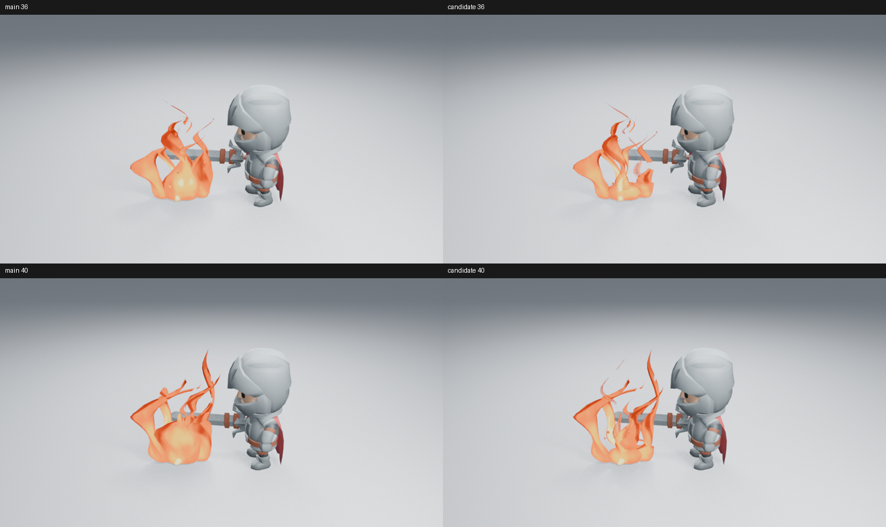
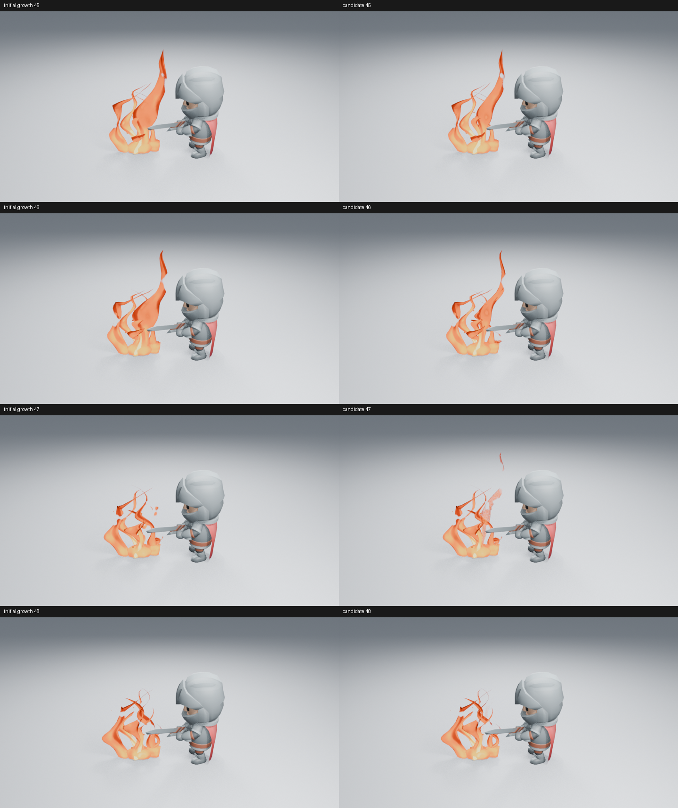
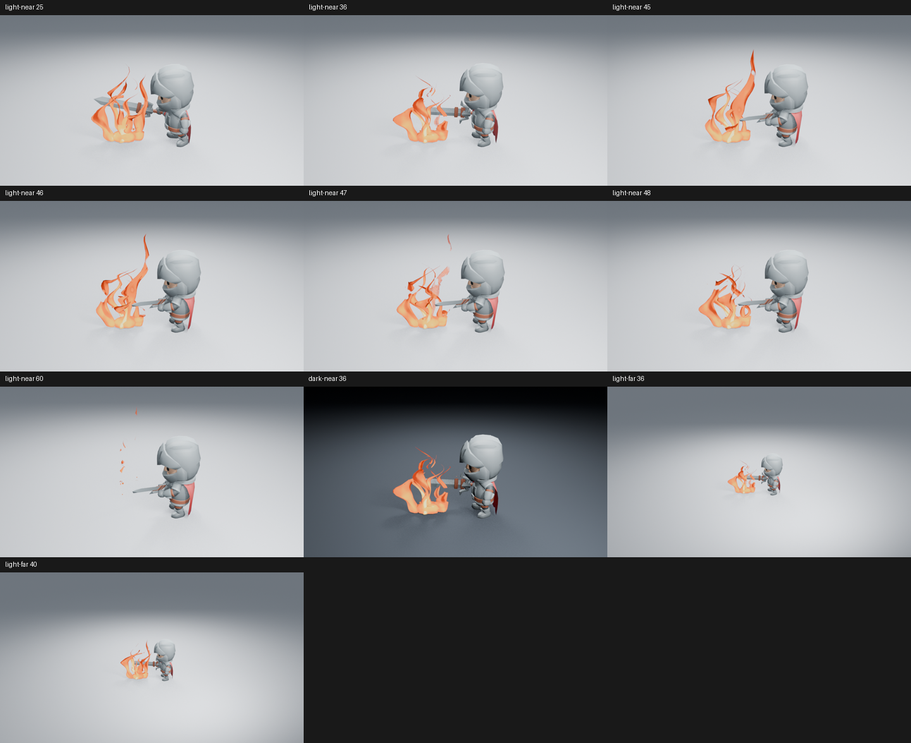
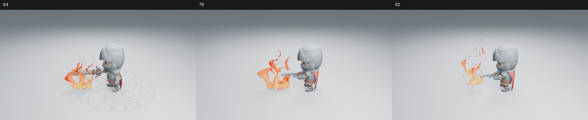
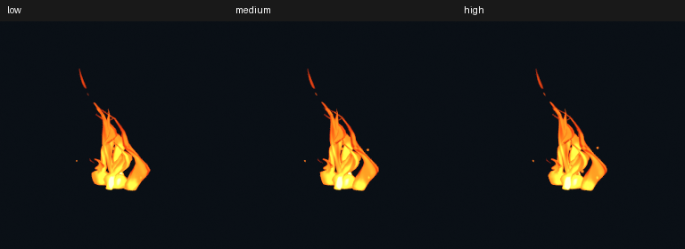

# 让主火流从根部长起，再收细散去

这轮改变真实 Stylized Fire 生成器的主体生长方式。共同根部保持低位，两条主要火流从靠近根部的位置交替长起；旧火流继续上升时收细、散去，由下一条接续。没有增加发光、粒子数量或后期，也没有改角色、布景和镜头。



基线使用已记录的 main 火焰图，其生成器摘要与当前 main 一致。高清原图：[候选 36](images/fire-shoot-life-after-36.png) · [候选 40](images/fire-shoot-life-after-40.png)。比较页仅缩放、排列并添加帧号。

## 为什么需要改变主体

分层检查中，隐藏两个内焰仍有大团块，只留下主火舌也能看到鼓起的底部。因此问题不只是内焰叠加或噪声不足：主要火舌的下部常驻，上部才反复伸长，形成“圆团上插枝条”的轮廓。单纯增加冷缝开口使上部更碎，未解决下部，已经拒绝该候选。

实际生成器保留较低的共同根部，把已有错相生长扩展到主要火流的大部分长度。原有分叉、热芯、冷缝、质量档位与编辑控制保留。Geometry Nodes 用同一时钟控制向上伸长和逐渐收窄；Shader Nodes 保留少量边缘侵蚀，再按每条火流的寿命逐渐散去。没有引入流体模拟、缓存或 Python 每帧操作。

## 重置边界检查

第一轮生长候选的第 46 帧仍有宽大高火流，第 47 帧却整段消失。分色与原生几何读取确认它属于主火舌，顶点仍在高处，可见表面却被材质一次裁掉。只收窄几何不足以消除这个跳变，因此同步调整了独立火流的可见度，避免主要依赖强侵蚀阈值退场。



最终第 47 帧能看到高火流细化并散去，第 48 帧由另一条接续。快速退场仍明显，**只确认这段衔接改善，没有观看实时视频，也不宣称所有循环边界都已验收**。

## 实际看图范围与限制

最终源码已读取 15 张 960×540、Eevee 16 samples、AgX 图，无额外辉光：火焰浅背景 25／36／40／45／46／47／48／60，暗背景和远景各 36／40；完整施法 64／76／92。





下部不再由完整圆团占住，火流之间有空隙，主热区仍可辨认。**火带仍偏薄，部分宽面与快速收尾仍明显；远景细余烬和角色蓄势仍弱，整体艺术品质尚未通过。** 这项局部改善不能当作成熟成片质量。

保存场景在未加载插件、关闭自动执行的新进程中渲染了 36 张 480×270 样本，全部六页已实际读取：

[1–25](images/fire-shoot-life-motion-01.png) · [27–34](images/fire-shoot-life-motion-02.png) · [35–40](images/fire-shoot-life-motion-03.png) · [41–47](images/fire-shoot-life-motion-04.png) · [49–59](images/fire-shoot-life-motion-05.png) · [61–71](images/fire-shoot-life-motion-06.png)。

其中第 32–44 帧连续，其余燃烧阶段主要隔一帧；另用高清连续 45–48 帧补查上述退场。样本覆盖点燃、维持、断燃与清场，不替代实时 24 fps 播放。

## 原生验证与成本

八项火焰行为检查通过，覆盖时间、停止流动、尺寸、分叉、侵蚀、复制、完整资产和安全删除。火焰 40→25→48、完整施法 92→64→76 在新进程中重渲染，六张高清 PNG 的 RGBA 与原图完全一致，分别在第 70／104 帧清空。所有进程正常退出，Ruff lint 与 format 检查通过。

三档完整资产已重建并纯原生追加，8→20→8 可复现，53 清场，没有夹带预览场景、相机或预览用贴图数据。实际嵌入预览已提取并查看，三张 RGB 与用于写入的渲染 PNG 一致。



同一保存角色镜头第 40 帧，只开关整个 VFX 集合。2 CPU 配额、Blender 两线程、Mesa 25.0.7 llvmpipe；求值先各预热三次，再测九次；渲染丢弃两个预热后测一组配对。

| 测量 | 无 VFX | 有 VFX |
| --- | ---: | ---: |
| 求值中位数 | 0.474 ms | 3.516 ms |
| 求值 p95 | 0.681 ms | 3.862 ms |
| 配对高清渲染 | 10.449 s | 14.002 s |

首次有特效准备与渲染为 33.405 秒。这里只测默认 Medium 的整套角色场景，不是各质量档位或新旧版本的性能比较；单组渲染不足以报告 p95，也不能换算为视口 FPS。原始设置、源码与图像摘要见[清单](images/fire-shoot-life-samples.json)。

火焰源码为 `8e9cbb2`；随后合入 main 时确认本镜头调用的角色、动作片段、布景函数及核心构建代码未变，分项图像保留原始摘要。工作由 [#198](https://github.com/mumu-lhl/blender-vfx-studio/issues/198) 跟踪；远端 CI 尚待运行。

复现：

```sh
LP_NUM_THREADS=2 MESA_SHADER_CACHE_DISABLE=true blender -b -t 2 --factory-startup --disable-autoexec --python-exit-code 1 --python tools/fire_preview.py -- --frames 25 36 40 45 46 47 48 60
```

添加 `--dark` 或 `--far` 检查其他条件。完整施法使用 `tools/spell_preview.py -- --frames 64 76 92`，输出均位于忽略版本管理的 `work/`。
