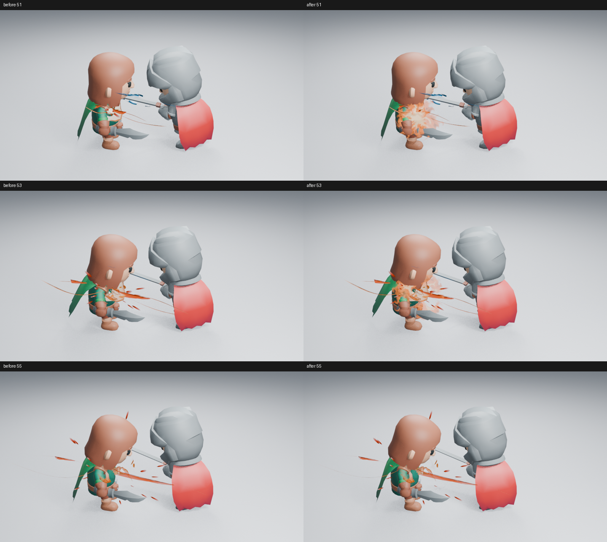
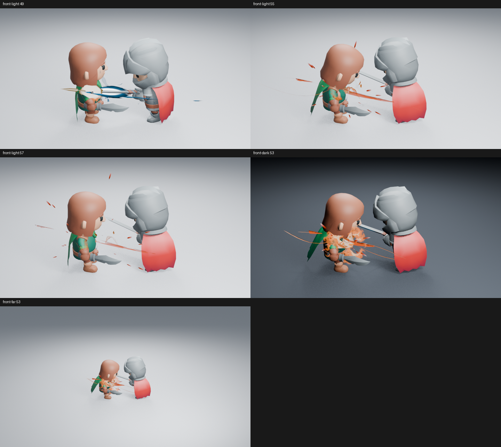
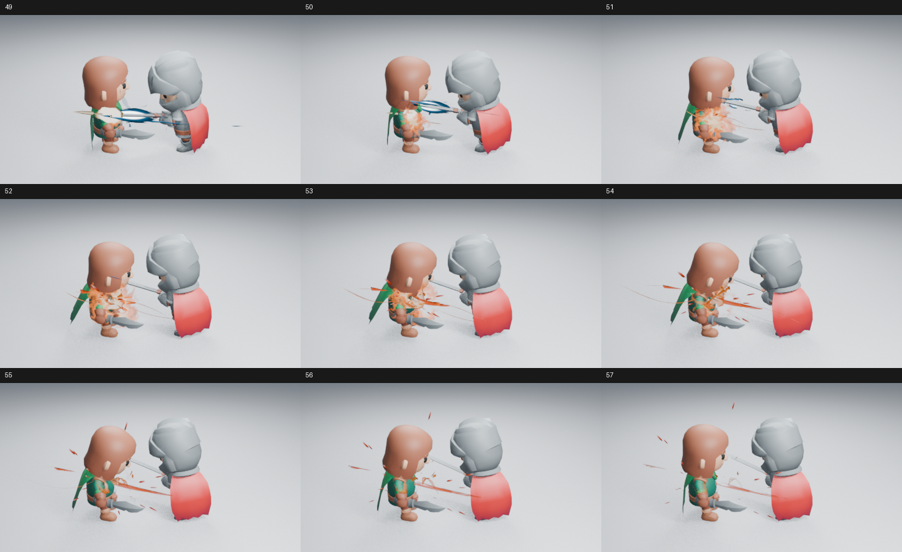
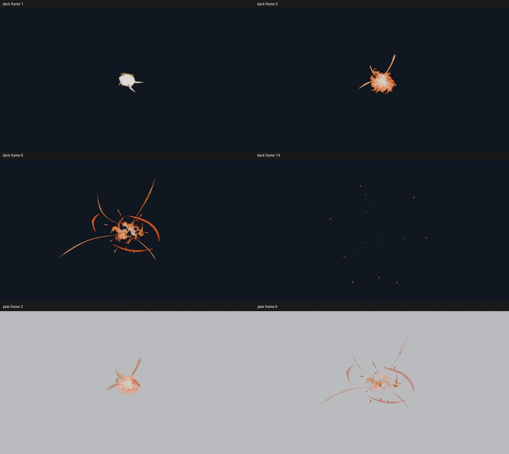

# 命中中心的翻卷热气

这次补足短闪之后的爆发主体：接触先亮起，暖色热气快速撑开，再分成卷边和碎片退场。细喷射、压力弧与余烬继续承担外扩和恢复阶段。实际角色图中，第 51 帧的中心比只有细片时更集中，第 53 帧仍能看见卷散，而第 55 帧已让出角色躯干。**这是局部画面改善，不代表整套战斗已达到成熟游戏的艺术品质。**



高清原图：[第 51 帧](images/impact-burning-after-51.png)、[第 53 帧](images/impact-burning-after-53.png)。对照保持角色、接触点、相机、灯光和其他效果不变，只隐藏新增热气层；并排图仅缩放、排列并添加帧号。

## 原因与实现

原来的白热短闪只有三帧。退场后，开放压力曲面与细喷射可以表示方向，却缺少撑住接触中心的连续形态。继续收紧压力曲面，会加重折叠薄片感；封闭扰动网格的试作又像实体团块，没有进入正式生成器。

参考 [M.Atif 的爆炸分层拆解](https://realtimevfx.com/t/stylized-frag-launcher-explosion-overwatch-inspiration-breakdown-posted/1894/21) 时，实际读取了作者和游戏示例的四组 GIF 抽帧、技术文字及 Burst Core 截图。可借鉴的是短闪、持续外扩核心和余留碎片各司其职，不是照搬层数或素材。原作品使用 Fork Particle Studio；本项目没有把它当成 Blender 教程，也未观看实时播放。

真实 Impact Burst 生成器加入 **Impact • Burst Core**，复用现有 Flipbook 播放器。原创八帧热量图提供非对称卷边、内部孔洞和分离形态，Shader Nodes 将热量映射到可编辑主色与较亮热区。贴图来源和许可见 [原图说明](assets/BURST_HEAT.md)，原图已随源码提交，构建无需调用图像生成服务。

该层默认八帧，Geometry Nodes 负责取帧、生命周期和朝向活动相机；所有驱动均能在关闭自动执行、不加载插件时求值。一个平面避免交叉透明卡片的排序问题，节点中保留少量朝相机前移的深度，减轻接触表面吞没中心的问题。角色测试另外按接触法线保留 0.08 单位间隙。没有改变相机、后期、全局发光或粒子数量来制造对比收益。

**这是带体积观感的平面图集，不是真实气体体积。** 贴图内部形态已画入图像；可在 Image Editor 编辑或替换，原生节点继续控制取帧、尺寸、色彩和透明度。它不随视角产生真实体积视差，透明叠加及复杂遮挡不能保证任意角度都有相同效果。

## 实际看图范围

角色图使用 Blender 5.2.2、Eevee 16 samples、960×540、AgX，无额外辉光。已读取浅背景近景第 49、51、53、55、57 帧，暗背景第 51、53 帧，浅背景远景第 51、53 帧，以及同场景隐藏热气的第 51、53、55 帧。



另读取了反向机位的 [第 51 帧](images/impact-burning-reverse-51.png) 和 [第 53 帧](images/impact-burning-reverse-53.png)。热气有少量可见，但中心仍被角色躯干挡住，该方向的命中焦点仍未通过检查；没有用无视深度的叠加去遮盖这个问题。

近景的中心不再只剩几条薄片；暗背景能区分暖色卷边与较亮内部。远景仍能看到中心，但细喷射和压力弧依旧偏弱。峰值会遮住部分受击胸口和手臂；面部与攻击者轮廓保留，不能因此认定所有角色构图都合适。



另从保存场景在未加载插件的新进程中渲染并逐张读取第 49–57 帧，没有跳过中间帧。短闪交给热气，热气再退让给外扩线与余烬，未见核心清空后重新出现。该检查只覆盖接触后的九帧，**未观看实时 24 fps 视频，也不等于完整动作的速度感验收**。



独立效果另读取六张 960×540 Eevee 图：暗背景第 1、3、6、14 帧，浅背景第 3、6 帧。峰值有不对称卷边，退场分离，后段保留余烬；浅背景尾段细线对比仍不足。Asset Browser 的 256×256 实际嵌入预览也已提取检查，RGB 与用于写入的预览 PNG 一致，不能代替高清检查。

角色预备动作与本效果另在同一场景完成了九张高清及 47 张有序样本检查，见[整镜头记录](COMBAT_COMBINED_REVIEW.md)。这不是把旧阶段图拼在一起，也没有将其中未重复渲染的视角记为本批次新结果。

## 功能验证与成本

- 20 项 Impact 测试和无插件重开通过，覆盖时间缩放、宽度、配色、透明播放、实例隔离、删除、Ungroup All、完整资产及 Cycles。相机朝向不把相机或场景导入效果资产。
- 25 项入门库测试和原生重开通过。完整资产打包贴图，排除预览场景与预览图片。
- 保存的角色镜头按 53→51→55 倒序重渲染，三张高清全通道像素与原图一致；第 96 帧效果清空。独立完整资产纯 bpy 追加确认五层、打包原图摘要、八帧核心清空和整体第 25 帧清空，进程正常退出。完整 18 文件示例 ZIP 已从源码重建，并由独立的原生包检查逐一追加验证。
- 安装 ZIP 的验证、启用、创建带贴图的 Impact Burst、卸载通过。重复构建 ZIP 字节一致，包内 PNG 与源码原图字节相同。Ruff lint 与 format 检查通过。

同一保存角色镜头第 51 帧，只开关整个 VFX 集合。设备为 2 CPU 配额、Blender 两线程、Mesa 25.0.7 llvmpipe；后台求值丢弃三轮预热后各测九次，渲染丢弃两个预热后测一组配对。

| 测量 | 无 VFX | 有 VFX |
| --- | ---: | ---: |
| 后台求值中位数 | 0.588 ms | 8.892 ms |
| 后台求值 p95 | 0.678 ms | 10.024 ms |
| 配对高清渲染 | 10.933 s | 21.080 s |

首次有特效准备与渲染为 49.811 秒。以上是整套角色场景的开关对照，**不是新增图集的单独成本，也不是新旧版本的性能比较**。单组配对不足以报告渲染 p95；后台求值和软件渲染不能换算为视口 FPS。

原始设置、源码与原图摘要、逐帧和功能记录见 [清单](images/impact-burning-samples.json)。功能检查不扩大上述看图范围；整体艺术问题继续由 [#178](https://github.com/mumu-lhl/blender-vfx-studio/issues/178) 和 [#89](https://github.com/mumu-lhl/blender-vfx-studio/issues/89) 跟踪。

复现角色阶段：

```sh
LP_NUM_THREADS=2 MESA_SHADER_CACHE_DISABLE=true blender -b -t 2 --factory-startup --disable-autoexec --python-exit-code 1 --python tools/character_combat.py -- --frames 49 51 53 55 57
```

添加 `--dark`、`--far` 或 `--reverse` 检查不同条件。独立效果使用 `tools/impact_preview.py -- --engine BLENDER_EEVEE --view-transform AgX --frames 1 3 6 14`。输出位于忽略版本管理的 `work/`，不会覆盖已记录图片。
