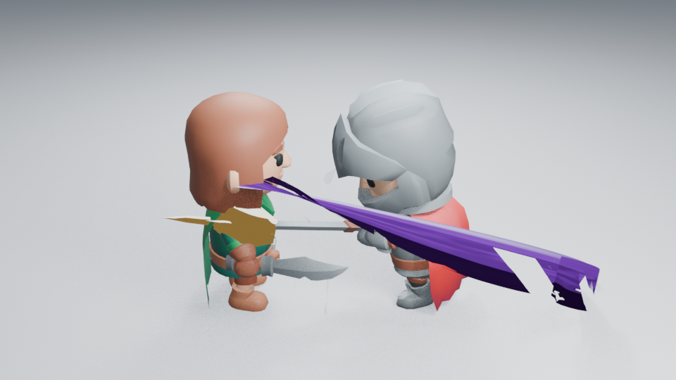
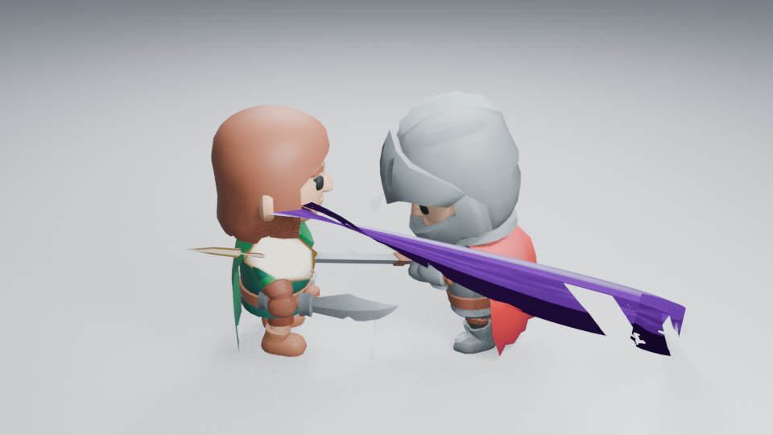

# 命中短闪的旋转可读性

2026-10-28，[#170](https://github.com/mumu-lhl/blender-vfx-studio/issues/170)／[PR #171](https://github.com/mumu-lhl/blender-vfx-studio/pull/171)。范围是命中最初三帧的短闪，不改压力体、冲击波或余烬。

## 问题与真实材质

角色第 49 帧的命中焦点像暗金色块。短闪用表面法线与固定世界方向的点积决定白面，低于 0.48 就只显示主色的 0.12。角色绑定改变朝向后，镜头可见面可能全部落进暗色分支。

当前材质按表面朝向观察方向的关系划分白热中心与有色边缘，再用网格已有的热度属性区分中心和四条不等长尖线。中心权重大，辅助线较低。热色混合读取原生主颜色；不增加 Strength、尺寸、时长、对象、粒子或顶点。去掉了只为旧短闪添加、最终已无用途的世界方向着色辅助函数。已有完整资产与手工材质不自动改写。

修改前，角色命中起帧：



同一机位、曝光与强度的当前生成器：



## 实际查看与边界

已实际读取 **14 张 960×540 Eevee 对照图**：修改前／后各看浅背景 49／50／51／53，以及 49 帧暗背景、远景与反向机位。49 帧出现即达到峰值，50 帧收缩，51 帧保留小焦点并交给压力体；近景和远景均更容易读出命中位置。光照、相机和合成设置保持相同。

反向机位的焦点被角色身体挡住，只见少量尖线，**不能把这个机位记为焦点可读性通过**。深度遮挡保留，没有让短闪穿透模型。近景长刀尾仍占据较多画面，压力体的硬片感也未由此解决；整体艺术品质继续由 #89 跟踪。没有实时播放验收，本轮只检查三个实际短闪帧与必要机位。

第 53 帧整个画面的解码像素与修改前相同，确认短闪结束后其余层未受影响。修改场景无插件按 51／49／50 重渲染，三个阶段像素完全相同，96 帧清空且正常退出。源码、原图和原生重开摘要见 [样本记录](images/impact-flash-samples.json)。

## 必要检查

旋转可读性检查先在原材质失败：64×64 Cycles CPU 画面中，中心小区域 RGB 最暗通道的最高值约 0.23。修正后，三组旋转保留明亮中心，原生颜色能改变画面，Strength=0 清空颜色，三帧几何生命周期保持。15 项 Impact 检查通过。该测试确认可见焦点与控制有效，不能替代上面的艺术观察。

```sh
LP_NUM_THREADS=2 blender -b -t 2 --factory-startup --python-exit-code 1 --python tools/character_combat.py -- --frames 49 50 51 53 --output work/flash-review/light
MESA_SHADER_CACHE_DISABLE=true LP_NUM_THREADS=2 blender -b -t 2 --factory-startup work/flash-review/light/character.blend --python-exit-code 1 --python tests/character_visual_reopen.py -- --frames 51 49 50
```

生成时加 `--dark`、`--far` 或 `--reverse` 分别检查这些机位。只对无插件重开使用局部 Mesa 缓存设置，不忽略退出失败。
