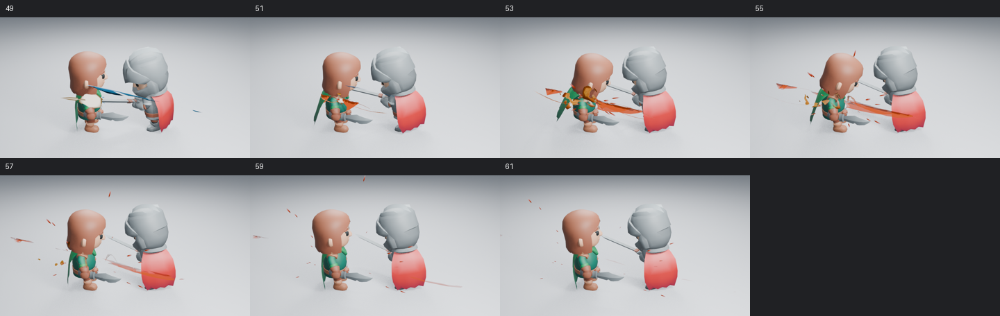
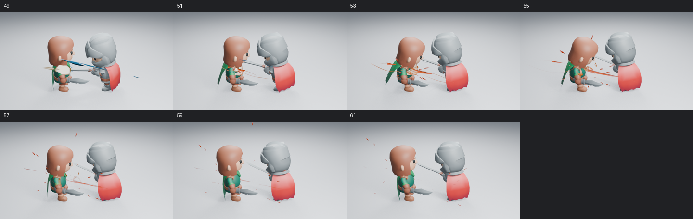

# 近身命中的焦点与压力层次

本轮沿用相同角色、攻击动作、接触点、相机和照明，检查 Impact Burst 为什么会遮住命中，而主体仍显得分散。角色对照为 Blender 5.2.2、960×540、Eevee 16 samples、AgX，无额外辉光；独立资产阶段图使用其预览脚本的 Standard 显示变换。


高清原图：[51 前](images/impact-focus-before-51.png)／[后](images/impact-focus-after-51.png)、[53 前](images/impact-focus-before-53.png)／[后](images/impact-focus-after-53.png)、[57 前](images/impact-focus-before-57.png)／[后](images/impact-focus-after-57.png)。左列为修改前，右列为修改后；并排图只缩小排列和添加帧号。

## 画面问题对应的原因

**粗硬的大橙色面主要来自 Shockwave。** 分层渲染显示，主压力体集中在被击角色肩部，大面却横穿两名角色之间。只缩短喷流，整镜头几乎没有改善。因此真实生成器把压力弧的默认 Width 从 0.30 收至 0.12，Expansion 从 3 收至 2；侧栏和原生节点仍可调整。

**封闭管体和固定明暗容易形成金属片观感。** 主压力体原来有封闭截面和固定世界方向的三段明暗。现在用有厚薄变化、卷曲和扭转的开放曲面，把较热的颜色沿流向与截面中心绘制。压力体缩短外射距离，根部保留宽度，细喷射承担较长的方向线。Size、Body Curl、Fade、颜色和材质编辑继续生效，没有新增发光强度或粒子数量。

**整组旋转不能解决主体贴合。** 压力面应沿被击表面展开，细线和压力弧却需要保留挥剑方向。直接旋转整个 Main Shards 会连细喷射一起转向，穿过脸部。本轮在几何节点中仅旋转压力体顶点；镜头使用接触法线设置 **Pressure Surface Alignment → Rotation**，其他角色和效果层保持原编排。此输入保存在原生节点中，不需要运行插件。

## 已查看的画面与判断边界

已逐张读取浅背景第 49、50、51、53、55、57、59、61 帧，并读取主体与压力弧的独立诊断渲染。第 49／50 帧的接触短闪保留；第 53 帧不再由大橙色面横穿空隙，接触处的暖色与细喷射更容易分辨；第 57 帧角色躯干与恢复动作更清楚。尾部仍保留余烬，未把所有层同时裁掉。





另实际读取暗背景、浅背景远景和反向机位各第 49／53 帧。暗背景的暖色主体与细线仍可区分；远景保留接触短闪，细节偏弱。[反向第 49 帧](images/impact-focus-reverse-49.png) 的短闪仍被角色遮住，[第 53 帧](images/impact-focus-reverse-53.png) 主要看见外射线，**该角度未通过命中焦点可读性检查**。独立资产出现、峰值、衰减三帧和侧视峰值也已读取：开放压力面保留翻卷形状，尾段主要留下余烬；256×256 嵌入预览另行查看，不代替高清图。

这些变化改善了遮挡与主次，**尚不足以宣布整体命中力量感合格**。压力体仍偏薄，远景细层和反向遮挡仍需镜头中的进一步设计。上述共 18 张最终高清静帧与有序抽帧不能证明实时速度感；未观看实时 24 fps 播放。整体品质继续由 [#89](https://github.com/mumu-lhl/blender-vfx-studio/issues/89) 跟踪，本项工作见 [#178](https://github.com/mumu-lhl/blender-vfx-studio/issues/178)。

## 功能验证与复现

17 项 Impact、14 项艺术控制和 22 项完整资产检查通过，包括开放压力体的接触宽度、独立朝向不改变细喷射与卷流、完整资产保存、颜色和退场控制。Rim Contrast 在斜视角检查：它控制掠射角的着色，不要求正面出现同等粗的暗边。Cycles 检查、无插件保存重开和完整资产原生跳帧通过，进程正常退出。

角色场景在没有载入插件、关闭自动执行的新进程中按 57→51→53 倒序重渲染，三张 960×540 PNG 全部通道与原渲染一致；压力面的原生朝向符合接触法线，第 96 帧效果几何清空，进程正常退出。该结果验证原生播放，不代表艺术验收。

使用正式资产构建脚本定向重建 Impact Burst，实际查看嵌入预览对应的 PNG；新进程原生追加确认四层、节点与缩略图保留，第 25 帧清空。这次本地定向 ZIP 只含该资产，没有当作完整 18 文件示例包发布。

```sh
LP_NUM_THREADS=2 blender -b -t 2 --factory-startup --disable-autoexec --python-exit-code 1 --python tools/character_combat.py -- --frames 49 50 51 53 55 57 59 61
```

添加 `--dark` 或 `--far` 检查其他条件；生成器和镜头会记录源码摘要。功能源码为 `252dd33`，基线为 `edbb1fd` 所含的上一轮战斗镜头。图片与批次记录见 [检查清单](images/impact-focus-samples.json)。

## 实测成本

同一保存角色镜头第 53 帧，只开关 VFX 集合；2 CPU 配额、Blender 两线程、Mesa 25.0.7 llvmpipe。后台求值丢弃三轮预热后各测九次；渲染丢弃两个预热，再测一组配对。

| 测量 | 无 VFX | 有 VFX |
| --- | ---: | ---: |
| 后台求值中位数 | 0.883 ms | 11.247 ms |
| 后台求值 p95 | 1.053 ms | 11.530 ms |
| 配对高清渲染 | 14.428 s | 31.246 s |

首次有特效准备与渲染为 60.790 秒。单组配对不足以报告渲染 p95，也不是与旧版本的性能对照；后台求值与软件渲染均不能换算为交互视口 FPS。没有以固定顶点数量作为通过标准。

[CI 40784648344](https://github.com/mumu-lhl/blender-vfx-studio/actions/runs/40784648344) 全部 12 项成功，包括三平台后台套件和角色视觉作业。自动检查不扩大本文实际看图与艺术判断的范围。
