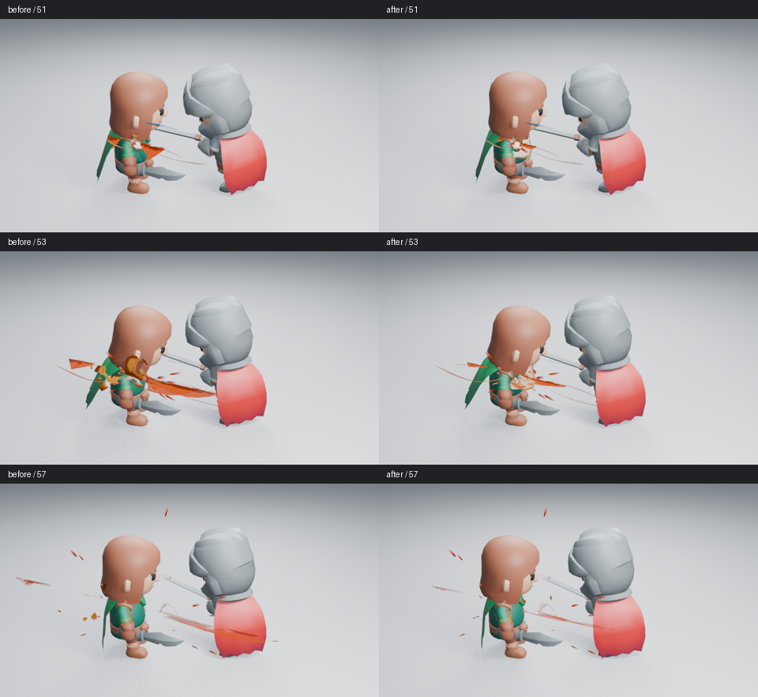

# 近身命中的焦点与压力层次

本轮沿用相同角色、攻击动作、接触点、相机和照明，检查 Impact Burst 为什么会遮住命中，而主体仍显得分散。所有对照为 Blender 5.2.2、960×540、Eevee 16 samples、AgX，无额外辉光。



高清原图：[51 前](images/impact-focus-before-51.png)／[后](images/impact-focus-after-51.png)、[53 前](images/impact-focus-before-53.png)／[后](images/impact-focus-after-53.png)、[57 前](images/impact-focus-before-57.png)／[后](images/impact-focus-after-57.png)。左列为修改前，右列为修改后；并排图只缩小排列和添加帧号。

## 画面问题对应的原因

**粗硬的大橙色面主要来自 Shockwave。** 分层渲染显示，主压力体集中在被击角色肩部，大面却横穿两名角色之间。只缩短喷流，整镜头几乎没有改善。因此真实生成器把压力弧的默认 Width 从 0.30 收至 0.12，Expansion 从 3 收至 2；侧栏和原生节点仍可调整。

**封闭管体和固定明暗容易形成金属片观感。** 主压力体原来有封闭截面和固定世界方向的三段明暗。现在用有厚薄变化、卷曲和扭转的开放曲面，把较热的颜色沿流向与截面中心绘制。压力体缩短外射距离，根部保留宽度，细喷射承担较长的方向线。Size、Body Curl、Fade、颜色和材质编辑继续生效，没有新增发光强度或粒子数量。

**整组旋转不能解决主体贴合。** 压力面应沿被击表面展开，细线和压力弧却需要保留挥剑方向。直接旋转整个 Main Shards 会连细喷射一起转向，穿过脸部。本轮在几何节点中仅旋转压力体顶点；镜头使用接触法线设置 **Pressure Surface Alignment → Rotation**，其他角色和效果层保持原编排。此输入保存在原生节点中，不需要运行插件。

## 已查看的画面与判断边界

已逐张读取修改前后浅背景第 51、53、57 帧，并读取主体与压力弧的独立诊断渲染。第 53 帧不再由大橙色面横穿空隙，接触处的暖色与细喷射更容易分辨；第 57 帧角色躯干与恢复动作更清楚。尾部仍保留余烬，未把所有层同时裁掉。

这些变化改善了遮挡与主次，**尚不足以宣布命中力量感合格**。压力体仍偏薄，远景细节、暗背景、相邻动画帧和高清无插件重开正在检查。未观看实时 24 fps 播放；功能检查不代替艺术判断。整体品质继续由 [#89](https://github.com/mumu-lhl/blender-vfx-studio/issues/89) 跟踪，本项工作见 [#178](https://github.com/mumu-lhl/blender-vfx-studio/issues/178)。

## 功能验证与复现

17 项 Impact 行为检查通过，包括开放压力体的接触宽度、独立朝向不改变细喷射与卷流、完整资产保存、颜色和退场控制。Rim Contrast 在斜视角检查：它控制掠射角的着色，不要求正面出现同等粗的暗边。Cycles 检查和无插件保存重开通过，进程正常退出。

```sh
LP_NUM_THREADS=2 blender -b -t 2 --factory-startup --disable-autoexec --python-exit-code 1 --python tools/character_combat.py -- --frames 49 50 51 53 55 57 59 61
```

添加 `--dark` 或 `--far` 检查其他条件；生成器和镜头会记录源码摘要。功能源码为 `252dd33`，基线为 `edbb1fd` 所含的上一轮战斗镜头。图片与批次记录见 [检查清单](images/impact-focus-samples.json)。
