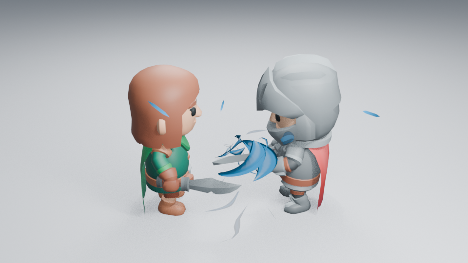
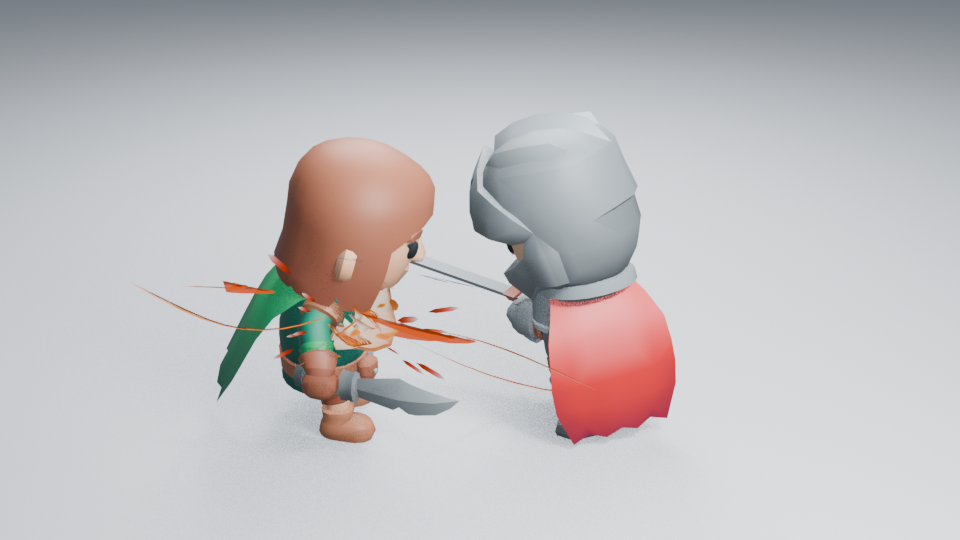
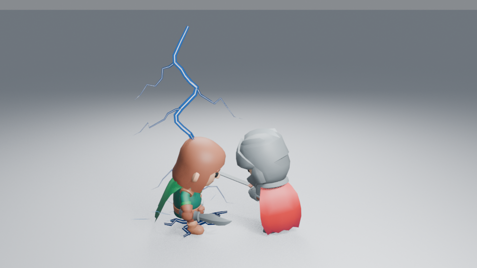
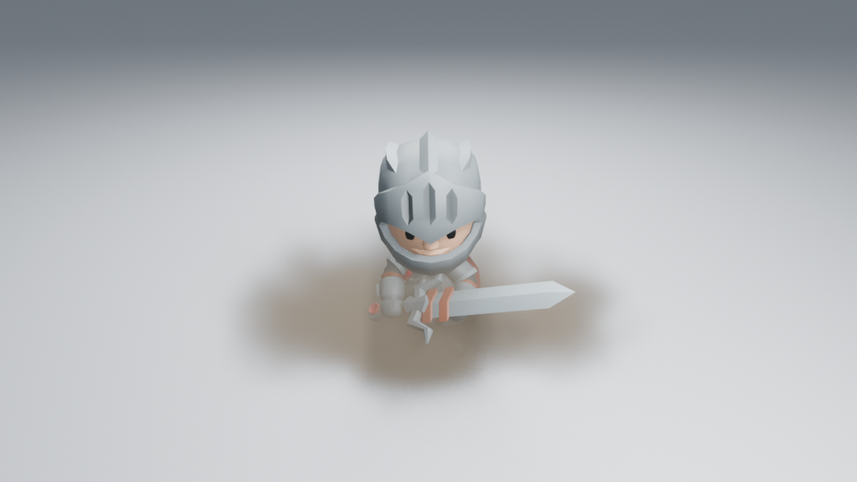
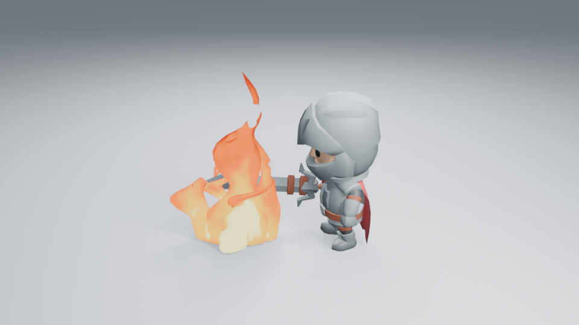
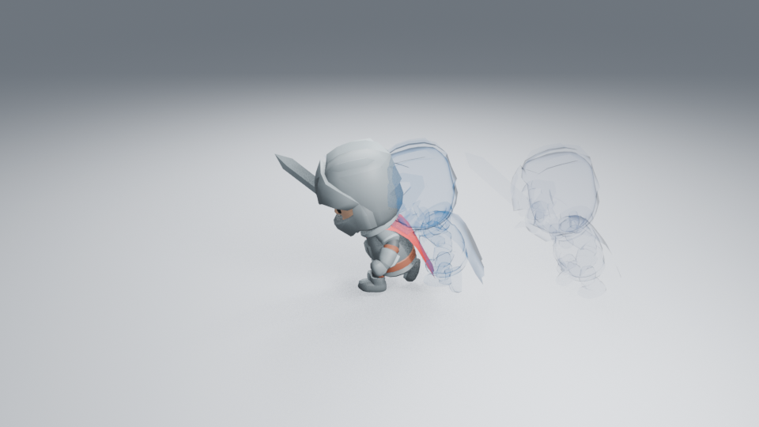
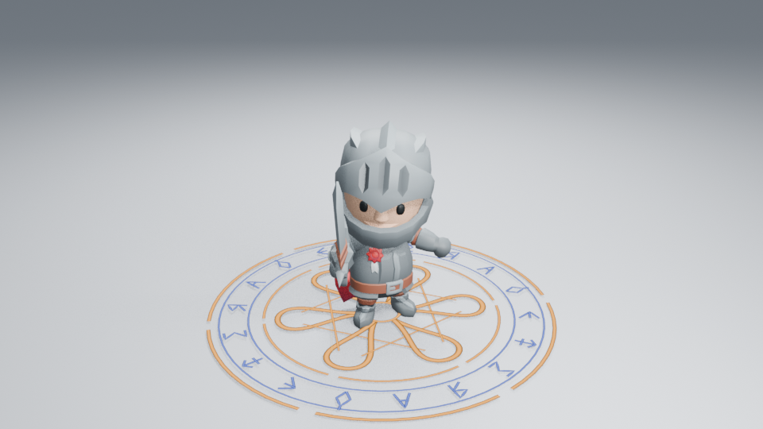
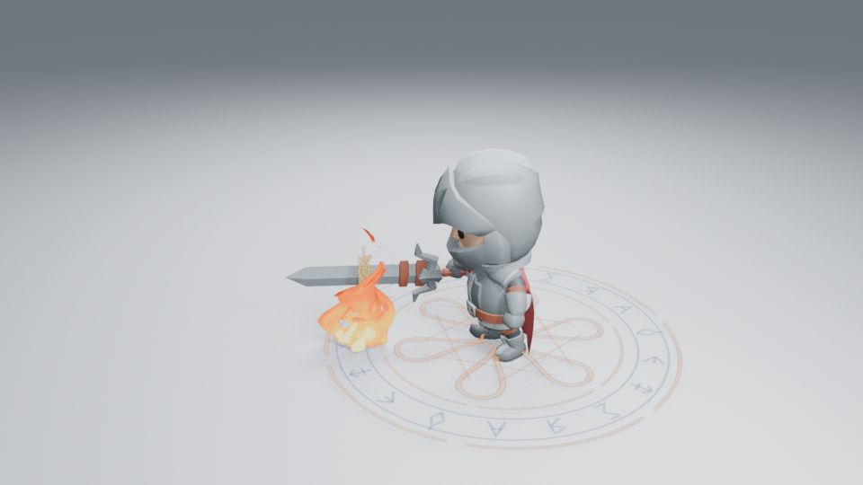

# 特效的真实角色镜头

这里展示内置效果的实际角色渲染，来源包括 CI 和本地检查，均为 **960×540、Eevee、AgX、无额外辉光**。图片直接复制自渲染 PNG，没有调色、裁切或重绘；点击可查看原尺寸。单帧只说明当前画面，完整时序、隔帧观看范围与成本见各效果记录。

角色、地面、灯光和相机用于检查，**不包含在效果资产中**。残影本身包含已捕获的角色网格，也可用 Capture Dash Echoes 捕获自己的角色。测试角色来源及 CC0 许可见 [资产说明](../assets/character-review/README.md)。

## energy-charge



卷曲能量片积蓄后转向剑刃释放，外围进流和粒子承担汇聚方向。第 **36 帧**，本地角色镜头；[编辑与衔接检查](COMBAT_HANDOFF_REVIEW.md)。末段仍偏片状，未观看实时播放。

## Impact Burst



接触附近的翻卷压力面，配合较长的细喷射和稍后消散的余烬。第 **53 帧**，本地角色镜头；[同帧与动画抽帧检查](IMPACT_FOCUS_REVIEW.md)。压力面仍偏薄，远景细层较弱，未观看实时播放。

## lightning-strike



主干复击时，地表分叉电弧重新展开。第 **8 帧**，本地角色镜头；[同帧与动画抽帧检查](LIGHTNING_CONTACT_REVIEW.md)。远景第三次放电和细枝仍偏弱，未观看实时播放。

## dust-impact



落地后的体积烟尘；主体不发光，需要场景灯光。 第 **39 帧**；[编辑与实际检查](DUST_REVIEW.md) · [原始 Actions 附件](https://github.com/mumu-lhl/blender-vfx-studio/actions/runs/40519038623)。

## stylized-fire



直立外焰、热芯与向上移动的断口。第 **36 帧**，本地角色镜头；[编辑与实际检查](FIRE_FLOW_REVIEW.md)。部分阶段仍有鼓包，远景细余烬较弱。

## dash-echoes



真实冲刺位移留下的透明姿态，随后腾空并接上落地烟尘。第 **18 帧**，本地角色镜头；[完整动作与实际检查](DASH_LANDING_REVIEW.md)。远景旧姿态仍偏淡，未观看实时播放。

## magic-circle



保持阶段的主印和反转符文带；细笔画在远景较弱。 第 **40 帧**；[编辑与实际检查](MAGIC_REVIEW.md) · [原始 Actions 附件](https://github.com/mumu-lhl/blender-vfx-studio/actions/runs/40466594123)。

## 施法与火焰释放



符记从施法位置向剑前汇聚，火焰开始接入。第 **62 帧**，本地角色镜头；[多阶段与原生节点检查](SPELL_TRANSFER_REVIEW.md)。聚拢线条仍有重叠，初生火焰仍偏片状，未观看实时播放。

## 复现图像

从全新克隆，在安装 Blender 5.2.2 后，使用对应脚本的 `--frames` 参数，例如：

```sh
blender -b --factory-startup --disable-autoexec --python-exit-code 1 -t 2 --python tools/fire_preview.py -- --frames 36
```

默认生成浅背景近景，`--dark` 和 `--far` 用于对照。输出在忽略版本管理的 `work/`，不会覆盖上述已记录图像。设备、Blender 或渲染器版本可能导致像素差异。充能的来源、帧位与摘要见 [角色衔接清单](images/combat-handoff-samples.json)，命中见 [焦点清单](images/impact-focus-samples.json)，其他五套见 [清单](images/library-gallery.json)；图片不作为插件运行依赖。
