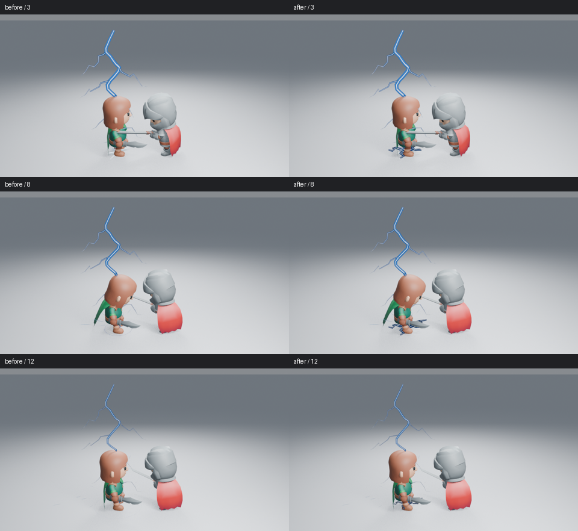

# 落雷与地表接触的三次反馈

本轮检查主干放电与接触点是否同时产生反馈。对照使用同一角色、相机、动作、照明与曝光，Blender 5.2.2、960×540、Eevee 16 samples、AgX，无额外辉光。



原始高清图：[第 3 帧前](images/lightning-contact-before-3.png)／[后](images/lightning-contact-after-3.png)、[第 8 帧前](images/lightning-contact-before-8.png)／[后](images/lightning-contact-after-8.png)、[第 12 帧前](images/lightning-contact-before-12.png)／[后](images/lightning-contact-after-12.png)。并排图只缩小排列与添加帧号，没有调整颜色或亮度。

## 原因与实现

主干已有三段放电脉冲，但 Contact Flash、Contact Sparks 和 Contact Corona 都只在开头运行一次。实际查看第 3、8、12 帧时，后两次主要只见主干变化，落点缺少新的反馈。原 Corona 是细圆环，部分又被脚部遮住，无法承担接触主形。

现在的 **Contact Corona** 使用连通、收尖的地表分叉电弧。每条主路径带一个较弱的分叉，交叉丝带保留不同角度的可见性；颜色仍来自可编辑的蓝色边界、白色细芯和原生颜色控制。没有增加发光强度、火花数量，也没有更换展示镜头。

地表电弧复用主干的三段脉冲，每次重新传播，在间歇清空。首轮候选传播约三帧，后两次在峰值时仍未伸出脚部，实际图中反馈仍弱；最终传播约一帧，使电弧及时展开，再随较弱的复击收细。普通粒子继续承担第一击后的短暂飞散，不把每个辅助层都做成同样强的三次爆发。

节点内可以直接编辑休止形状、路径偏移、传播和脉冲。控制器的 **Radius / Expansion / Width / Dissolve** 影响地表范围、展开和裁切；**Width=0**、**Dissolve=1** 清空该层。Low / Medium / High 调整分叉与路径细节；保存完整节点应使用 **Save Complete Effect**。

## 当前图像判断

已逐张读取同机位修改前后第 3、8、12 帧。落点附近出现可辨认的地表分叉，后两次不再只剩主干；第一次最强，第三次较细。当前线条仍偏图形化，细枝和脚部遮挡还需远景与连续抽帧判断。不能据此宣布整个落雷达到成熟成片品质。

完整隔帧、暗背景、远景、高清原生重开和实测成本正在补齐；**未观看实时 24 fps 播放**。工作由 [#180](https://github.com/mumu-lhl/blender-vfx-studio/issues/180) 跟踪，整体艺术品质仍见 [#89](https://github.com/mumu-lhl/blender-vfx-studio/issues/89)。

## 功能验证与复现

7 项闪电行为检查通过，包含三次接触与间歇、倍速和时长调整、独立参数、宽度关闭、侵蚀、完整资产复制与安全删除。无插件新进程按乱序帧读取接触顶点和主干，数据一致，间歇与退场清空，进程正常退出。功能检查不代替上面的艺术判断。

```sh
LP_NUM_THREADS=2 blender -b -t 2 --factory-startup --disable-autoexec --python-exit-code 1 --python tools/lightning_preview.py -- --frames 3 8 12
```

`--dark` 和 `--far` 使用相同生成器生成对照。基线为 `edbb1fd`，功能源码为 `501d3b4`；批次设置、图像与源码摘要见 [检查清单](images/lightning-contact-samples.json)。
