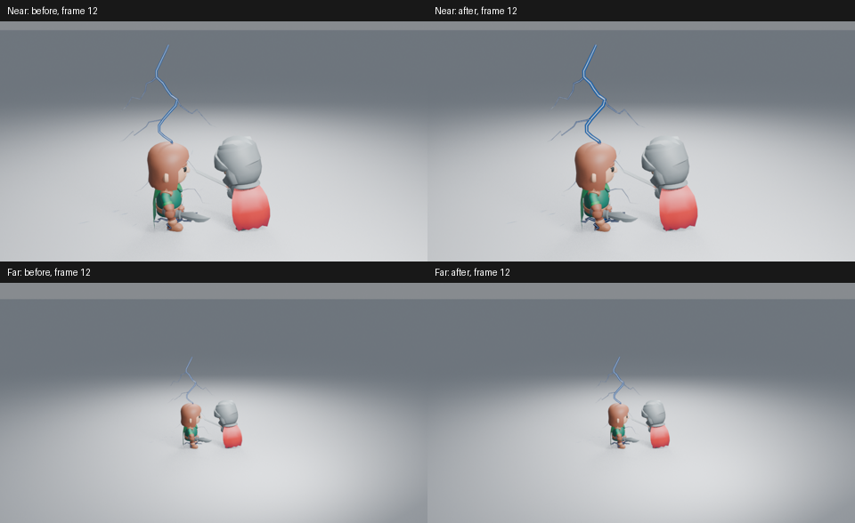
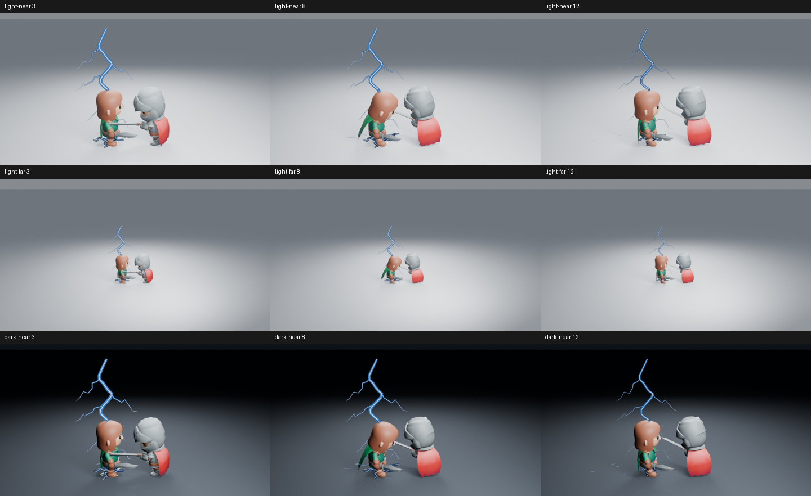
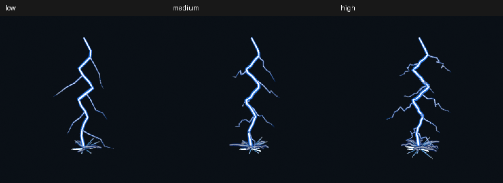

# 保留较弱复击的线条覆盖

闪电第三次放电在浅色远景中容易变成难以辨认的细线。这次只改变真实主干与地表电弧的线宽响应，保留第一击峰值、颜色、放电时间、发光强度及现有编辑控制。



原始高清图：[近景前](images/lightning-coverage-near-before-12.png)／[后](images/lightning-coverage-near-after-12.png)、[远景前](images/lightning-coverage-far-before-12.png)／[后](images/lightning-coverage-far-after-12.png)。并排图仅缩放排列并添加标签，没有调色或增强辉光。

## 节点原因与改动

主干和地表电弧都把完整线宽直接乘以放电脉冲。第三次脉冲最大为 0.45，线条随之收至 45%；材质又按原有 `0.25 + 0.75 × pulse` 降低光量，亚像素细枝的覆盖和光量同时减弱。单纯提高发光不能恢复已消失的线条覆盖。

两个 Geometry Nodes 树现在用 `sqrt(pulse)` 控制线宽。第三次峰值保留约 67% 线宽，第一击仍为 100%；材质和原有清场门限不变。较弱阶段都使用这条响应，包括首击回落段；只有第一击峰值保证逐像素不变。分别可在 **Weak Discharge Width** 与 **Weak Return Width** 编辑此响应。没有新增侧栏参数、粒子、回调或模拟，也没有改变角色、相机及场景曝光。

同一保存场景插入原生节点后渲染的原型，与实际生成器重新创建的远景第 12 帧 RGBA 完全一致。第一击第 3 帧在修改前后 RGBA 完全一致，避免以削弱第一击换取复击对比。**Width=0**、侵蚀、质量档位及原有时间控制继续生效。

## 实际画面与观看范围

已读取浅背景近景、浅背景远景和暗背景各第 3／8／12 帧，共九张最终 960×540 PNG：Blender 5.2.2、Eevee 16 samples、AgX、Medium，无额外辉光。



浅背景第三次主干和部分分支更容易辨认，第一击仍承担最强视觉权重。**落点被角色脚部遮住的部分没有恢复，远景末端细枝仍弱**；这些是保留的艺术问题，不把线宽改善当成整套闪电验收通过。

另在不加载插件、关闭自动执行的新进程中，渲染并实际读取第 1–28 帧的全部连续样本，480×270、Eevee 16 samples：

[1–6](images/lightning-coverage-motion-01.png) · [7–12](images/lightning-coverage-motion-02.png) · [13–18](images/lightning-coverage-motion-03.png) · [19–24](images/lightning-coverage-motion-04.png) · [25–28](images/lightning-coverage-motion-05.png)。

三段放电之间仍有主干与地表电弧的明确间歇，后段清场，没有把三次放电连成常亮线；初次飞散火花按自己的寿命短暂保留。连续抽帧用于判断出现和消退顺序，**没有观看实时 24 fps 视频**。

## 功能、资产与成本

七项闪电行为检查及原生重开通过。新进程 12→3→8 重渲染的高清 RGBA 与原图完全一致，第 19 帧清场。Low／Medium／High 完整资产已重建并原生追加，3→8→3 几何一致，第 19 帧清空；节点与控制保留，没有夹带场景或相机。所有验证进程正常退出。

三档实际嵌入预览已从 `.blend` 提取，RGB 与构建时的 PNG 完全一致，并实际查看：


同一保存角色镜头第 12 帧，只开关整个 VFX 集合；2 CPU 配额、Blender 两线程、Mesa 25.0.7 llvmpipe。求值各预热三次后测九次，渲染丢弃两个预热后测一组配对：

| 测量 | 无 VFX | 有 VFX |
| --- | ---: | ---: |
| 求值中位数 | 0.529 ms | 3.418 ms |
| 求值 p95 | 0.553 ms | 3.485 ms |
| 配对高清渲染 | 9.661 s | 9.937 s |

首次有特效准备与渲染为 25.787 秒。这是整套 Medium 场景的成本，不是新旧节点的性能比较；单组渲染不能提供稳定分布，也不能换算为视口 FPS。功能验证不代替上面的艺术判断。

功能源码 `5adff51`，基线为 main `5dd92a5`，随后与火焰分支组合；闪电生成器和本镜头调用的代码未变。设置、源码与图像摘要见[清单](images/lightning-coverage-samples.json)。工作由 [#209](https://github.com/mumu-lhl/blender-vfx-studio/issues/209) 跟踪，整体艺术品质仍由 [#89](https://github.com/mumu-lhl/blender-vfx-studio/issues/89) 跟踪；组合源码 `6467388` 的全部 12 项必要 CI 已成功；后续提交仅更新文档与检查记录，插件、生成器、测试和 CI 配置与该源码一致。

复现高清角色阶段：

```sh
LP_NUM_THREADS=2 MESA_SHADER_CACHE_DISABLE=true blender -b -t 2 --factory-startup --disable-autoexec --python-exit-code 1 --python tools/lightning_preview.py -- --frames 3 8 12
```

分别添加 `--dark`、`--far` 生成对照；`--sequence` 生成连续序列。输出位于忽略版本管理的 `work/`。

## 实际 CI 交付包

已下载源码 `6467388` 的 [CI 41256427566](https://github.com/mumu-lhl/blender-vfx-studio/actions/runs/41256427566) 安装附件，核对 33 个插件 Python 文件、打包贴图与 18 份原生资产。包内三档闪电在无插件新进程中完成 3→8→3 原生几何复现和第 19 帧清场，主干与地表电弧的新线宽节点均保留，没有导出场景、相机或图片数据。进程正常退出。

三档实际嵌入预览已提取并读取；Medium 与本地 RGB 相同，Low／High 有像素差异，范围见清单。下图直接来自实际附件：



附件为 6,629,026 字节，SHA-256 为 `556b65469bc14a9f689a4bb5c085daa7f4a64990ef0f411a65eb2d91f86970df`；各资产摘要已补入检查清单。该源码全部 12 项必要 CI 已成功；条件发布步骤跳过符合当前非发布构建。
