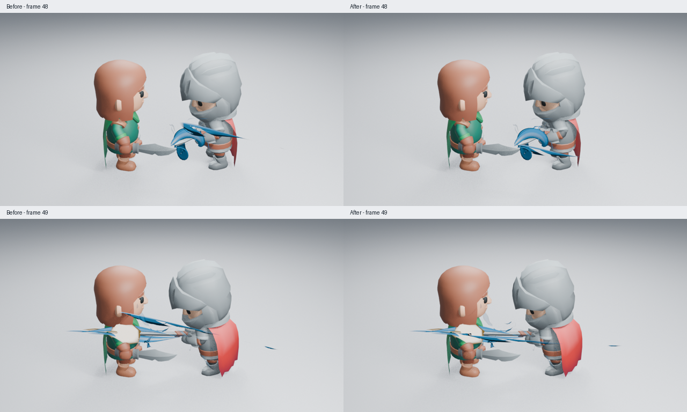
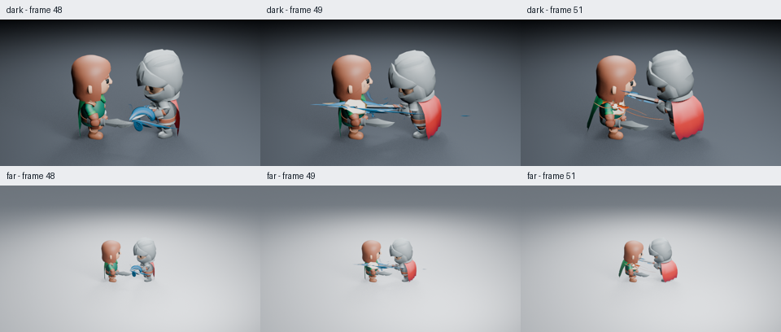
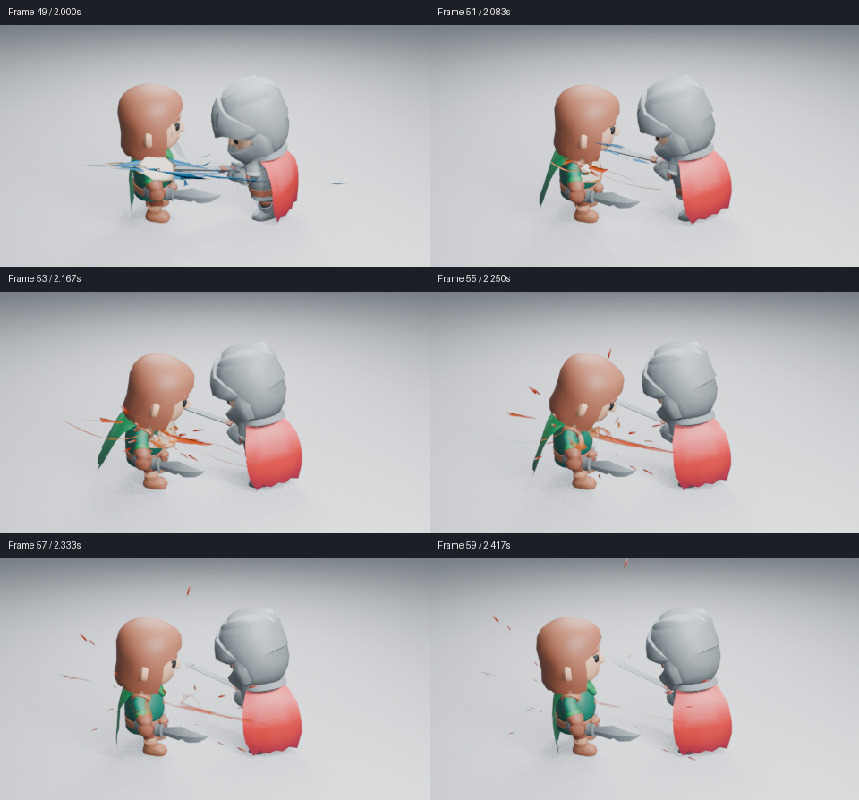
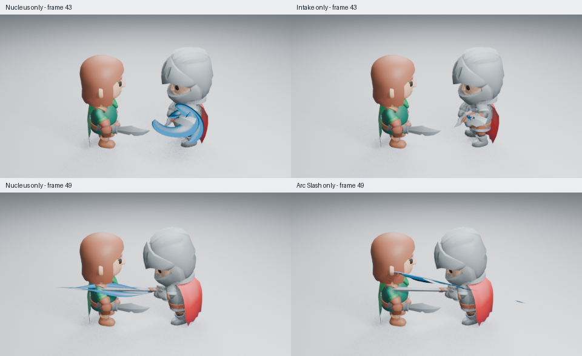

# 刀光在真实剑刃上的空间对齐

2026-10-30，跟踪 [#192](https://github.com/mumu-lhl/blender-vfx-studio/issues/192)。角色战斗的第 49 帧，刀光原本横穿受击者头部，真实剑刃却在手臂和胸口高度。这项修复处理镜头实例的原生变换，不替换刀光生成器或充能主形。



原始 960×540：[接触帧修复前](images/slash-plane-before-49.png) · [修复后](images/slash-plane-after-49.png)。对照图仅缩小 PNG 并加帧号，没有调色或改变合成。

## 为什么会偏离

镜头用第 47、51 帧的剑刃方向推算一个固定平面，再把中间帧的刀光放在这个平面中。但角色挥剑不是严格的平面运动：第 48、49 帧的剑刃分别偏出该平面约 11.54°、12.10°。从真实求值网格测得，刀光前缘与剑尖相差约 0.311、0.325 个场景单位，剑长约 1.549。仅检查起止方向和接触检测会漏掉这个误差。

`character_scene.py` 现在逐帧调整平面法线，去掉其中沿当前剑刃的分量。结果是最接近原参考方向、又确实包含当前剑刃的平面；再按原来的 Spin 和展开时钟抵消主体转角。最后保存普通位置和四元数旋转关键帧，不在播放时运行 Python。命中层继续使用原平面，角色动作、充能、相机、灯光和材质没有改变。

## 画面判断与限制

浅背景已实际读取第 47、48、49、51、53 帧，以及修复前第 48、49、51 帧；暗背景和远景均已读取第 48、49、51 帧，并读取修复前暗背景和远景第 49 帧，共 16 张高清图。均为 Blender 5.2.2、960×540、Eevee 16 samples、AgX，无额外辉光。第 48 帧刀光下降到真实剑刃一带，第 49 帧不再横穿头部，能量与命中位置更一致；第 51 帧仍交给橙色压力体与余烬。

**局部对齐改善不等于整体艺术验收。** 第 47 帧充能卷片仍大而实，第 49 帧多条蓝片重叠，白色命中核偏规则，压力体和远景细层仍需要打磨。充能主形的火瓣和实体候选已因胸甲、圆盾观感被拒绝，独立归档于[实验分支](https://github.com/mumu-lhl/blender-vfx-studio/blob/9474a9b/docs/experiments/CHARGE_FLARE.md)，没有混入本修复。未观看实时视频。



原始高清：[暗背景接触帧](images/slash-plane-dark-49.png) · [远景接触帧](images/slash-plane-far-49.png)。远景仍有横向长片，次级细节较弱。

## 功能验证与复现

回归先在主线第 48 帧复现 0.311 的前缘误差，再检查第 47–51 帧实际求值网格：展开中的离散前缘须靠近真实剑尖，完全展开后误差须小于 0.00001。修复后通过，充能接触时序与原角色轨迹也通过。保存后在未加载插件的新进程检查平面、时间、方向和第 96 帧清场，正常退出。Ruff 0.14.1 的全库 lint 与格式检查通过。

```sh
LP_NUM_THREADS=2 MESA_SHADER_CACHE_DISABLE=true blender -b -t 2 --factory-startup --disable-autoexec --python-exit-code 1 --python tools/character_combat.py -- --frames 47 48 49 51 53
```

加 `--dark` 或 `--far` 复现对应条件。修改前场景的功能源码为 `d1695f7`，与当前基线 `5db53f9` 的运行代码相同；修复功能源码为 `639edfc`。无插件新进程按 51→48→49 倒序重渲染，三张 960×540 PNG 的全部 RGBA 像素与生成时一致，角色动画及第 96 帧清场通过，正常退出。完整动作的 48 张原生隔帧也已全部实际读取，渲染进程正常退出；细节见下文。

## 可用设备上的成本

在同一保存场景第 49 帧，仅切换 VFX 集合。设备为 2 核 CPU 配额，Blender 和 llvmpipe 各 2 线程，Mesa 25.0.7 软件 Eevee；960×540、16 samples。九次有效场景求值的中位数为无特效 **0.81 ms**、有特效 **10.37 ms**，p95 为 0.82／11.95 ms。排除两次预热后，一组匹配渲染为无特效 **12.26 s**、有特效 **26.00 s**。首次有特效预热为 56.16 s，保留首次等待成本。

这不是视口帧率，也不是显卡结果；一组渲染不足以估计渲染 p95。这项修复没有增加播放回调、几何或材质，但旋转会改变遮挡与实际渲染成本，因此没有用相同节点数量证明性能。


## 整段原生隔帧

关闭自动执行、未加载插件，从同一保存场景直接渲染第 1–95 帧的全部奇数帧。48 张为 480×270、16 samples；相邻样本间隔 1/12 秒，不是视频解码或补帧。八页均已实际读取：

[1–11](images/slash-plane-motion-01.png) · [13–23](images/slash-plane-motion-02.png) · [25–35](images/slash-plane-motion-03.png) · [37–47](images/slash-plane-motion-04.png) · [49–59](images/slash-plane-motion-05.png) · [61–71](images/slash-plane-motion-06.png) · [73–83](images/slash-plane-motion-07.png) · [85–95](images/slash-plane-motion-08.png)。



前半段仍偏待机，外围碎片和硬卷片抢眼；第 49 帧刀光在剑刃高度接入白色命中核，第 51–59 帧交给橙色压力面和余烬，第 73–95 帧恢复干净。没有发现本次平面修正造成新的退场残留，但隔帧不能代替按 24 fps 实际观看，速度感仍未进行实时验收。



这四张诊断图关闭其他效果层，用于确定画面来源，没有当作完整效果验收。转剑时的大弯片主要属于内核；进流仅留少量碎线，头部的长片则属于刀光。因此本次修复刀光平面，没有为进流增加独立转向框架。

源码、16 张高清图、48 张隔帧、三阶段原生复现及成本原始数据见[检查清单](images/slash-plane-samples.json)。

功能源码 `639edfc` 的 [CI 41074038788](https://github.com/mumu-lhl/blender-vfx-studio/actions/runs/41074038788) 已完成全部 12 项并成功；后续提交只补文档和实图。
