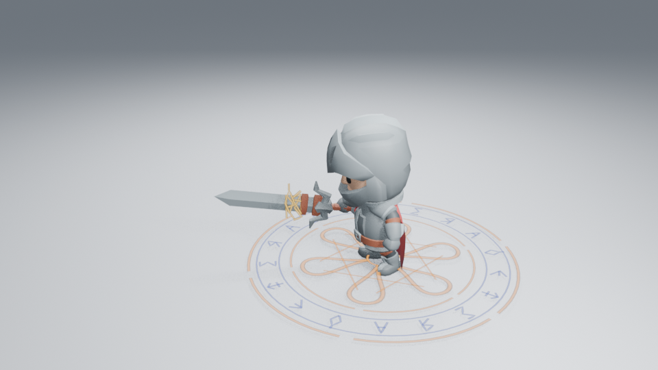
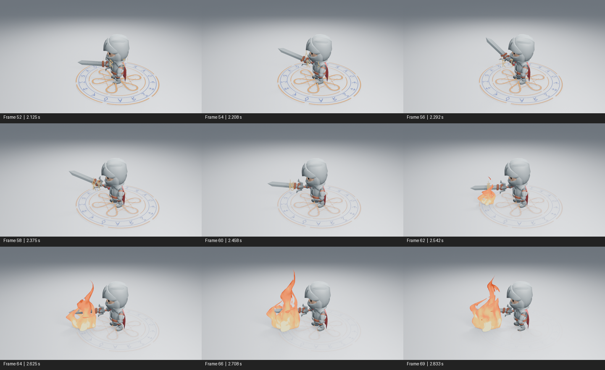
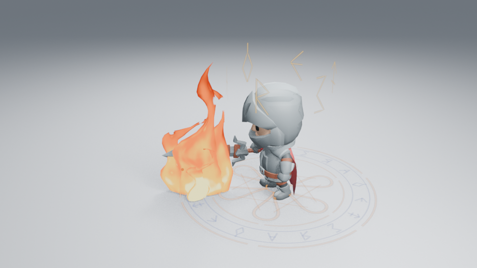

# 符记汇聚与火焰点燃的衔接

本轮沿用同一名角色、施法动作、相机、光照和发光强度，检查魔法阵的释放符记有没有明确去向。角色图使用 Blender 5.2.2、960×540、Eevee 16 samples、AgX，无额外辉光。



## 画面原因与生成器

原释放层把符记沿局部 Z 轴抬高，符记中心始终围绕角色；火焰从第 52 帧起在前方直接出现。实际读取第 37–71 帧抽帧及第 64 帧高清图时，能看到先后关系，但头顶符记与前方火焰没有形成空间联系。

真实 Magic 生成器现在保留各字形的中心位置。**Release Gather** 让这些中心随释放汇聚，字形本身及笔画宽度保留；没有把整个图案直接缩小成细点。**Release Direction** 使用归一化的本地方向，**Sigil Lift** 控制沿该方向的移动距离；零方向停止平移，默认仍向上。两个控制都保存在释放层 Geometry Nodes 中，可直接编辑、插帧并用完整效果保存。

释放移动集中在默认周期的后段，地面主印的逐笔形成和符文反转保留。镜头把释放层放在角色施法位置附近，收拢范围，让符记向火焰核心移动；角色第 52 帧释放，第 60 帧开始点燃，第 104 帧清空。火焰使用原有生成器与时长控制，没有增加粒子、发光或修改相机。

## 已查看的画面与边界



图中帧号与时间来自实际时间轴，末项间隔为三帧，其余为两帧；这里只缩小排列和标注，没有重绘画面。

已实际读取修改后的第 16、52、54、56、58、60、62、64、66、69、96、104 帧，以及修改前的第 40、52、60、64、96 帧高清图和第 37–71 帧有序抽帧。第 52 帧的符记靠近施法位置，第 60 帧形成剑前的能量包，第 64 帧接上火焰；第 96 帧继续退场。符记不再一直漂到头顶上方。




这个变化改善了空间去向，**不等于释放力度或整段艺术品质通过**。聚拢符记仍有线条重叠，初生火焰仍偏完整片状；相邻帧中能看到第 54–60 帧的汇聚、第 62 帧的小火苗和第 66–69 帧持续燃烧；暗背景与远景第 60／64 帧也已实际读取：方向关系保留，但远景符记仍只是很小的线团，不能宣称远景细笔画通过。未观看实时 24 fps 播放。工作由 [#182](https://github.com/mumu-lhl/blender-vfx-studio/issues/182) 跟踪，整体品质仍见 [#89](https://github.com/mumu-lhl/blender-vfx-studio/issues/89)。

[暗背景 60](images/spell-transfer-dark-60.png) · [远景 64](images/spell-transfer-far-64.png) · [修改前 52](images/spell-transfer-before-52.png) · [修改前 60](images/spell-transfer-before-60.png)。点燃时刻刻意后移八帧，因此同帧火焰的年龄不同；这组对照用于判断交接，不用来声称火焰造型本身改善。

## 功能验证与复现

5 项魔法阵和 4 项施法场景检查通过，包含方向归一化、零方向、汇聚时保留笔画宽度、完整资产复制与保存，以及符记实际到达火焰核心附近。无插件新进程读取方向与汇聚后的顶点一致，结束时清空，正常退出；这些属于功能验证。另一个无插件进程按 96→16→64 倒序重渲染，三张 960×540 PNG 全通道一致，第 104 帧清空，进程正常退出。14 项艺术控制和 22 项完整资产检查也通过。

```sh
LP_NUM_THREADS=2 blender -b -t 2 --factory-startup --disable-autoexec --python-exit-code 1 --python tools/spell_preview.py -- --frames 16 52 60 64 96
```

添加 `--dark` 或 `--far` 生成对照。修改前的完整施法来源与观看范围见 [火焰流动检查](FIRE_FLOW_REVIEW.md)，本轮源码、批次设置与图片摘要见 [检查清单](images/spell-transfer-samples.json)。图片不参与效果播放。
