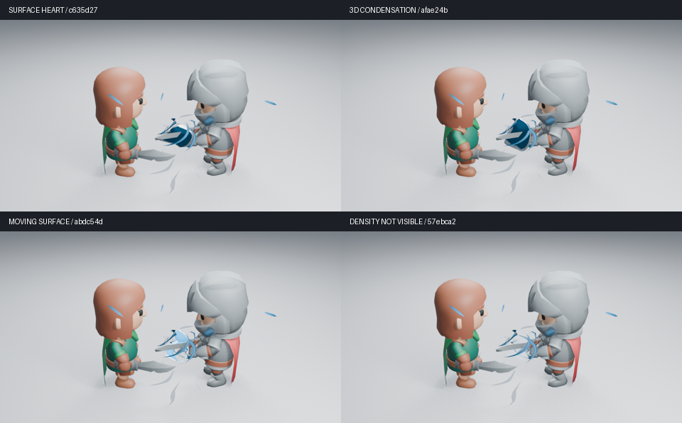

# 充能密度试验：未采用

这份归档记录一次未通过的造型和体积试验，不是主线可用功能。main 保持 `c1a234c` 的原生曲面资产；充能主体品质仍由 #137 跟踪。



## 画面结论

已实际查看三维收紧和流动曲面各第 36／45 帧的高清图。三维收紧让形体更饱满，但仍像包在剑上的硬质护罩；流动曲面把暗块改成分段亮壳，仍没有形成清楚的聚能主体。因此没有用测试成功宣布艺术验收，也没有替换主线默认资产。

密度方案复用了内核的大小、压缩和释放形变，以原生 Mesh to Volume 转换，再为体积设置独立材质。初张高清图未形成可见中心；后续诊断中，直接读取密度的着色路径没有显示体积，常量 Principled Volume 可以显示。普通属性、Volume Info、坐标遮罩等诊断图也实际读取过；它们是小尺寸功能诊断，不计作艺术验收。

## 功能结果与停止原因

三维收紧与流动曲面各通过 25 项完整资产检查，但画面未通过。密度原型的三个控件曾因无效 RNA 路径而为零，已改为从源材质读取；定向检查确认编辑与复制独立性，空尺寸输入也增加了跳过分支。

**当前密度原型的完整检查没有通过。** Cycles 像素检查触发原生进程崩溃。常量体积的独立与混合输出可以正常完成；保留复杂材质、冻结驱动、改用 Object 或几何位置等对照仍复现崩溃。具体节点原因未定位，不能归因于所有体积或某一个 Blender 节点。Eevee 生成图不代表 Cycles 稳定。

在没有明确画面收益的情况下，不再为该原型扩展层级、参数或通用框架。源码与最小复现保留在 `experiment/charge-density`，供后续定位；#186 关闭而不合入。#190 的原生预备姿态仍是独立草稿，不能替代主体重设计。

## 复现范围

使用本归档分支、Blender 5.2.2、CPU 两线程。以下脚本只在全新后台场景中创建试验，不读取用户项目。常量对照：

```sh
LP_NUM_THREADS=2 blender -b -t 2 --factory-startup --disable-autoexec --python-exit-code 1 --python tools/diagnostics/charge_density.py -- --plain
```

移除 `-- --plain` 运行复杂材质案例；当前会复现原生进程崩溃。该失败不是测试通过，也不用于主线 CI。

来源、实际观看帧和摘要见 [机器记录](charge-density.json)。原压力核较早快照的 25 项、原生回放及性能结果只对应其记录的源码，不能代表当前密度原型稳定或更快。未观看实时视频。
