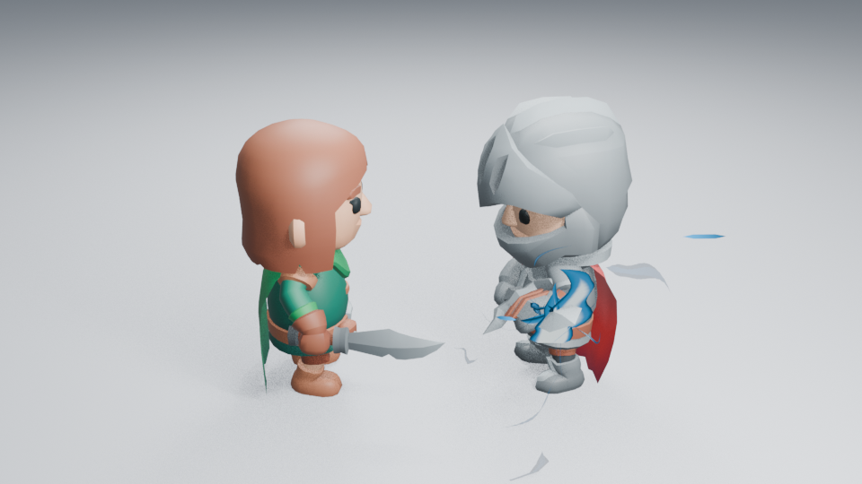
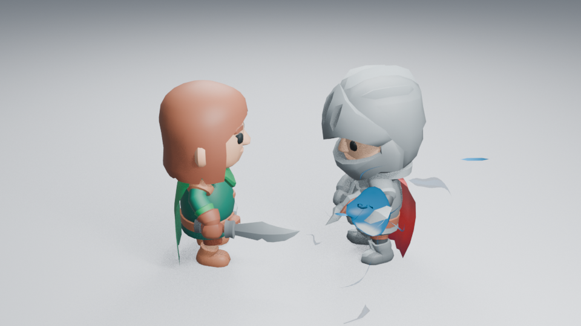

# 充能火瓣与紧凑实体试验：不合入主线

2026-10-30，跟踪 #137。当前主线为 `5db53f9`，本分支只保存未通过的造型试验，不属于已完成资产。

三个卷片改成主焰、侧焰与短热芯后，第 32 帧焦点更集中，但第 43 帧转剑使它们再次贴成胸甲弯片。扩大白热色面、错开深度、向内压缩及调整原生绑定点都没有解决薄片主形的问题。源码 `00218b6`；已实际读取 16、32、43、49、51、55 六张 960×540 Eevee 图。

随后用一个不规则实体替代薄片，并按视线夹角画热芯。它保持了体积，却在同一角色构图中像圆盾，未形成需要的聚能感。源码 `eb0d50d`；16、32、43、49 四张高清图均已实际读取。

两批均正常渲染退出。`00218b6` 的 22 项入门资产行为检查及无插件重开通过；这些检查不证明艺术品质。`eb0d50d` 没有运行同一组测试，不沿用前一批结果。未检查这些候选的暗背景、远景、连续播放或完整隔帧，因此没有对应验收结论。已有试验中横穿头部的长蓝片变化很小，下一步回到主线分层渲染，先确认来源，不再把所有长片都归因于内核。

原有三卷片、主形与热芯的早期试验也保留在本分支提交历史；没有替换 main 或完整资产库。必要源码与两张失败实图已版本管理，临时场景和其余诊断图留在 `work/`。两批源文件摘要、实际帧号和保留图片校验值见[记录](images/charge-flare-samples.json)。

复现任一候选：切到对应源码提交，运行 `tools/character_combat.py -- --frames 16 32 43 49`；使用 Blender 后台模式、`-t 2`、`--factory-startup --disable-autoexec --python-exit-code 1`，环境设 `LP_NUM_THREADS=2 MESA_SHADER_CACHE_DISABLE=true`。相机、16 samples、AgX 和发光强度没有用于掩盖问题。
