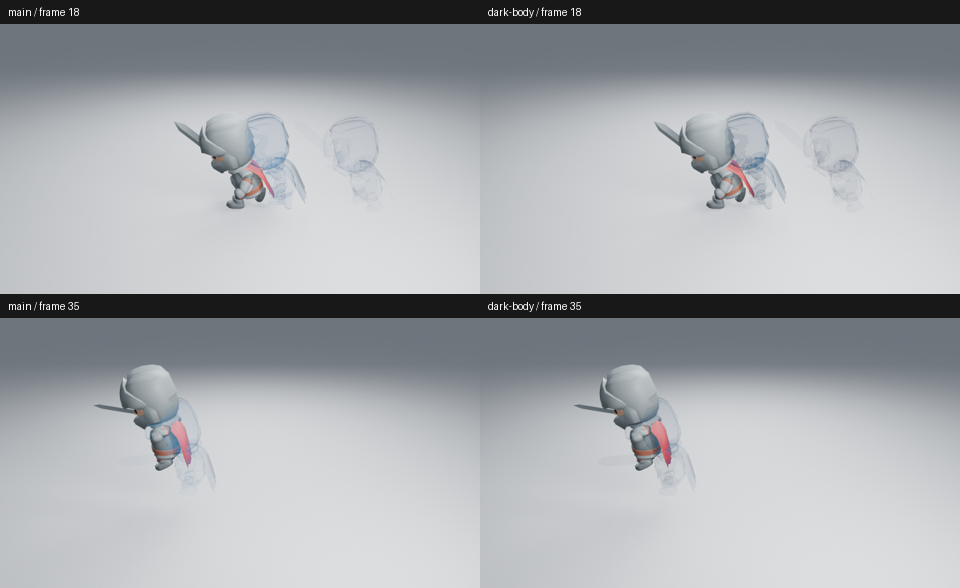

# 未采用：受光残影主体

基线 main `5dd92a5` 的冲刺镜头在浅背景中仍主要依赖轮廓。试验保留原生捕获网格和边缘，把正面发光换为同色 Diffuse BSDF，按原有边缘遮罩混合；另试主体填充 0.4、颜色乘 0.15，使主体更暗。没有增加残影数量、发光或改变镜头。

已实际读取基线两帧、受光主体两帧、填充 0.5 的第 35 帧和较暗主体两帧，均为 960×540、Eevee 32 samples、AgX。身体内部仍不足以清楚支撑姿态，旧影仍偏线描；改善不足以支持增加着色复杂度。因此没有修改实际生成器，没有提交合并 PR，也没有把候选当作艺术验收通过。

未做连续播放、明暗与远景完整检查；临时原生节点场景正常保存、进程正常退出，仅证明候选能够运行，不是功能验收。全局艺术问题仍由 #89 跟踪。先转向落地接触的密度采样，不继续围绕此材质做小幅调参。

源码基线、图像和试验脚本摘要见[清单](dash-shaded-body-samples.json)。
