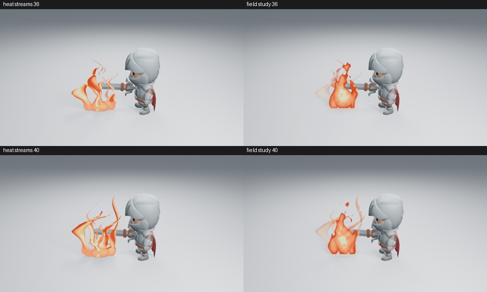

# 火团遮罩试验：中心主体与外侧火丝

**这是独立试验，不是内置火焰的替代资产，也没有通过艺术验收。** 它在生成的角色镜头副本中添加原生节点火团，原有安装包和完整资产不受影响。

## 为什么尝试不同的造型方式

分色图确认，左侧宽面来自一条没有分叉的辅助火舌。只收拢分叉没有明显收益；缩小辅助火舌虽能集中画面，却仍留下大光滑火片和鼓起的底部。两种几何候选均未进入正式生成器。

本试验用三个不等高的水滴形区域合成主体，在随上升时钟移动的噪声中扭曲边界，并让冷区从主体破开。热色带随这些区域变化。承载面通过 Geometry Nodes 朝向场景相机，原有三维火流降低视觉权重，作为外侧火丝。颜色和形状都由可编辑的 Shader Nodes 产生，没有使用第三方贴图或流体缓存。

低样本下，Dithered 混合令这些半透明面出现明显颗粒；改用原生 Blended 后消失。这修复了试验的显示问题，不能当成艺术品质已经合格。

## 参考与观察范围

已阅读 [Cyanilux 的火焰材质拆解](https://www.cyanilux.com/tutorials/fire-shader-breakdown/)，并查看其材质图。可借鉴的原则是让流动形变参与轮廓生成，而不只是改变表面颜色；没有使用文中的 Kenney 纹理或复制节点图。

另阅读 [Jordan Jaminet 的 Campfire 拆解](https://realtimevfx.com/t/sketch-10-jordanov/4273)，查看两张灰度遮罩示例，以及作者最终 GIF 的 12 个有序样本。火团的出现、上升和破开值得参考。它是作者的个人练习，有灯光、辉光和烟雾，不能把其完成度或渲染成本直接当成本项目的游戏标准，也没有观看实时视频。所有参考图片只保存在忽略版本管理的工作目录，未放进插件或这条分支。

## 从全新 Clone 复现

先在这条试验分支运行原有生成器，再处理它输出的角色镜头。不要以用户项目作为试验输入。

```sh
LP_NUM_THREADS=2 MESA_SHADER_CACHE_DISABLE=true blender -b -t 2 --factory-startup --disable-autoexec --python-exit-code 1 --python tools/fire_preview.py -- --frames 36 40 45
LP_NUM_THREADS=2 MESA_SHADER_CACHE_DISABLE=true blender -b work/fire-review/light-near/fire.blend -t 2 --disable-autoexec --python-exit-code 1 --python tools/experiments/fire_field_study.py
LP_NUM_THREADS=2 MESA_SHADER_CACHE_DISABLE=true blender -b work/fire-field-study/fire.blend -t 2 --disable-autoexec --python-exit-code 1 --python tools/experiments/fire_field_reopen.py
```

结果位于 `work/fire-field-study/`。最后一个进程不导入插件，检查生命周期、重渲染第 40 帧，再生成有序运动样本。

## 实际渲染与原生检查



[第 40 帧高清图](fire-field-40.png)为 960×540 Eevee 16 samples、AgX，无额外辉光。36／40／45 帧已实际查看。保存后新进程没有导入插件，第 40 帧重渲染 RGBA 一致，1／70 帧的新增承载面没有可见几何，进程退出 0。

另渲染并查看全部 16 个 480×270 原生样本：[1–31](fire-field-motion-01.jpg) · [35–55](fire-field-motion-02.jpg) · [59–71](fire-field-motion-03.jpg)。这里只覆盖每隔四帧的状态，不替代实时播放。源码和图像摘要见[清单](fire-field-samples.json)。

中心比原来的空心带状结构更完整，但出现时接近全高，仍像平面火焰标志在变化；旧辅助面残留淡色宽片。**这轮没有达到足以替换内置资产的品质，保留为试验。**

## 尚未完成的工作

主体仍偏平面，原有辅助面有淡色残留，火团上升与交接尚需按完整动画判断。配色暂时复制已有色带，尚未接入统一艺术控制；场景相机依赖、无相机视口、质量选择、完整资产保存和实际成本均未验收。试验对象没有接入正式资产的资源管理，不能作为可分发功能使用。

这些限制解决、完整角色镜头明显改善之前，不改默认内置资产。当前内置火焰的局部冷热流改进仍由 [PR #213](https://github.com/mumu-lhl/blender-vfx-studio/pull/213) 跟进。

## 原创纹理对照脚本

`tools/experiments/fire_mask_study.py` 在上述数学火团文件上测试原创灰度纹理、流动采样和独立色带，输出 `work/fire-mask-flow-study/`。原图与来源位于 `assets/experiments/`。它仍有独立材质、相机完整旋转和锚点偏移等试验限制；不能把这里的结果当成正式生成器。真实单层生成器、共用色带与轴向修复由 [PR #214](https://github.com/mumu-lhl/blender-vfx-studio/pull/214) 实现并继续验证。
