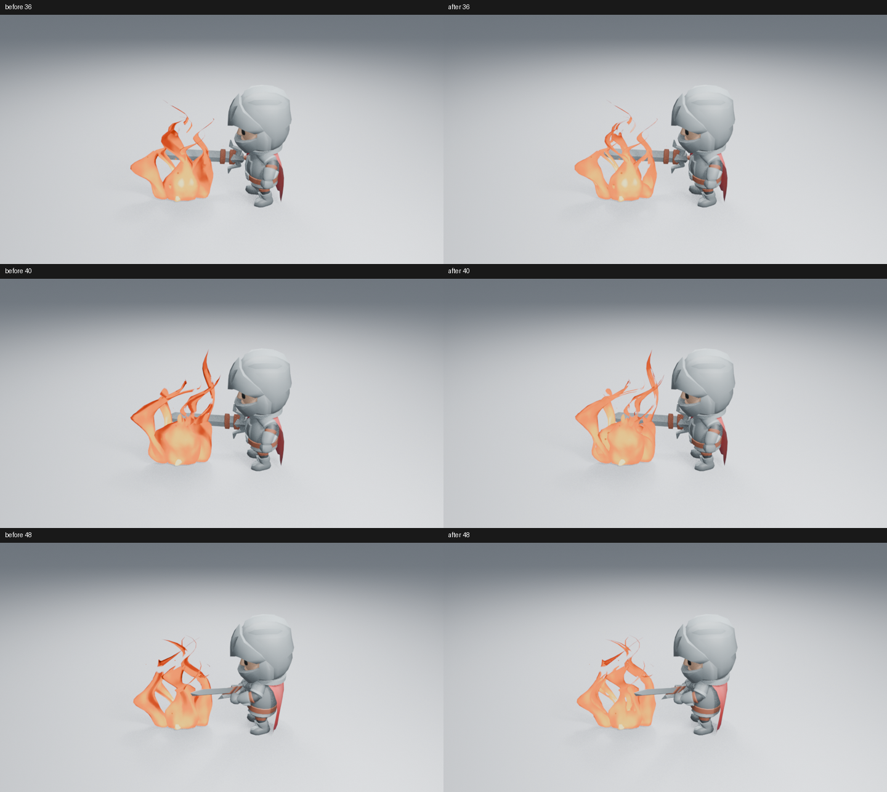
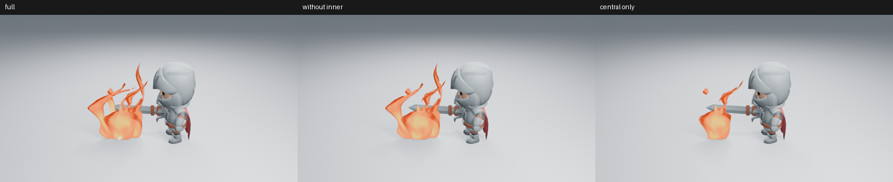

# 火焰冷缝开口候选：未采用

源码 `e21f774` 让现有上升冷缝同时参与透明裁切，没有改变角色、相机、发光或粒子。实际查看第 36、40、48 帧的三组同帧对照：上部变碎，下部团块基本不变，整体收益不足，不创建功能 PR，也不进入 main。

随后在未加载插件的进程中，用原生几何节点仅在诊断场景隐藏内焰，或只保留主火舌，读取两张第 40 帧渲染。隐藏内焰后仍有大团块；单独主火舌本身也有鼓起的底部和硬边。因此不能把问题全部归因于内焰重叠，也不应继续仅增加材质侵蚀。

节点原因是主火舌的下部仍使用饱满闭合截面，上部才分叉并错相生长；材质冷缝原本只降热度。此次开口没有改变下部主要轮廓。下一步应重新设计主火舌从根部向上生长、收颈与分离的形态，并在完整施法镜头判断收益，保留有用的上部分叉。

共八张实际 Eevee 960×540、16 samples、AgX 图；两个进程均正常退出。没有运行完整回归、重建资产库、宣称动画验收或将候选作为默认效果。原始设置、源码及图像摘要见[清单](../images/fire-open-flow-samples.json)。工作由 [#198](https://github.com/mumu-lhl/blender-vfx-studio/issues/198) 跟踪。
