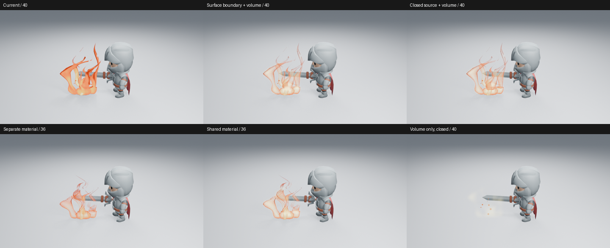

# 未采用：用体积补充火流内部

main 的火流生长与消散已有改善，但部分宽面仍像薄片。原型把现有表面收为边缘，用原生 Mesh to Volume 与 Principled Volume 提供内部热量；角色、相机和几何运动保持一致。先试独立材质，再试与表面共享同一热色色带的材质，没有把原型当成可创建的正式资产。

已实际读取八张 960×540、Eevee 16 samples、AgX PNG，覆盖第 36／40 帧、单独体积与完整组合。候选没有得到清晰的内部热流，主体反而接近透明薄壳，根部较亮不能补足上部轮廓。

为区分网格开口与着色问题，又检查了体积单独输出，并临时封住休止网格的 156 条边界边，新增 13 个面；封口后边界数为零，画面仍没有形成所需主体。因此不能把失败仅归因于开口，也不能据此声称 Blender 不支持该体积方案。这个原型没有足够艺术收益，不合入 main。

原型构建和渲染修正 API 菜单取值后正常退出。没有完成换色联动、全部参数、完整动画、明暗／远景、质量档位或成本验收；未观看实时视频。保留 main 已验证的真实生成器，不增加材质分组、控制项或新的体积架构。后续仍需从整体轮廓、内部温度分布与运动关系出发，而不是继续叠加节点或亮度。

源码基线、进程结果、分层与封口数据、图像摘要见[清单](fire-radiant-volume-samples.json)。整体火焰艺术问题继续由 #198／#89 跟踪。
