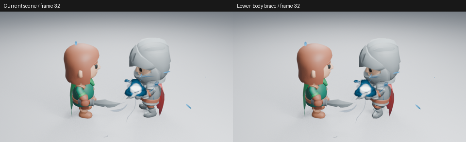

# 未采用：拼接下半身站姿作为蓄力预备

当前完整战斗镜头的身体预备仍轻。这次检查已有 KayKit 动作，尝试只使用格挡中的下半身站姿，保留当前上身挥剑与第 49 帧接触。没有扩展插件绑定或骨架能力。

动作包没有专门的蓄力下沉片段。Slice、Chop、Block、Blocking、Block_Hit 各采五个动作时刻，格挡主要增加站姿宽度，髋部只下降约 1.5 cm。候选复制 Blocking 的髋部位置和腿部通道，使用原生 NLA 叠加：第 16 帧影响 0.6、第 32 帧为 1、第 41 帧归零；动作时间固定在格挡中段，不加入手臂或武器通道。

已实际读取基线第 32 帧及候选第 32／37 帧，均为 960×540、Eevee 16 samples、AgX。整体蓄力姿态的收益很小，没有因此形成清晰的压低、反向蓄势和释放。无插件原生取样还发现，候选第 37 帧脚部最低点为 -0.03296，基线约 -0.00029；按当前 1.8 m 角色比例，候选穿地约 3.3 cm。第 43／47／49／57 帧剑矩阵与基线相同，保留命中不代表站姿就合格。

因此不采用该候选，不更改正式镜头，也不创建合并 PR。身体力量感需要脚步、重心和上身一起编排，不能用未经验证的局部动作拼接代替。没有继续增加复杂 IK 或插件骨架功能。

构建、渲染与新进程测量正常退出；这不是功能或艺术验收。没有查看完整连续、明暗和远景对照，也没有观看实时视频。源码基线、逐帧脚部测量和图像摘要见[清单](grounded-preparation-samples.json)。原始角色与动作许可见[KayKit 说明](../../assets/character-review/README.md)。
