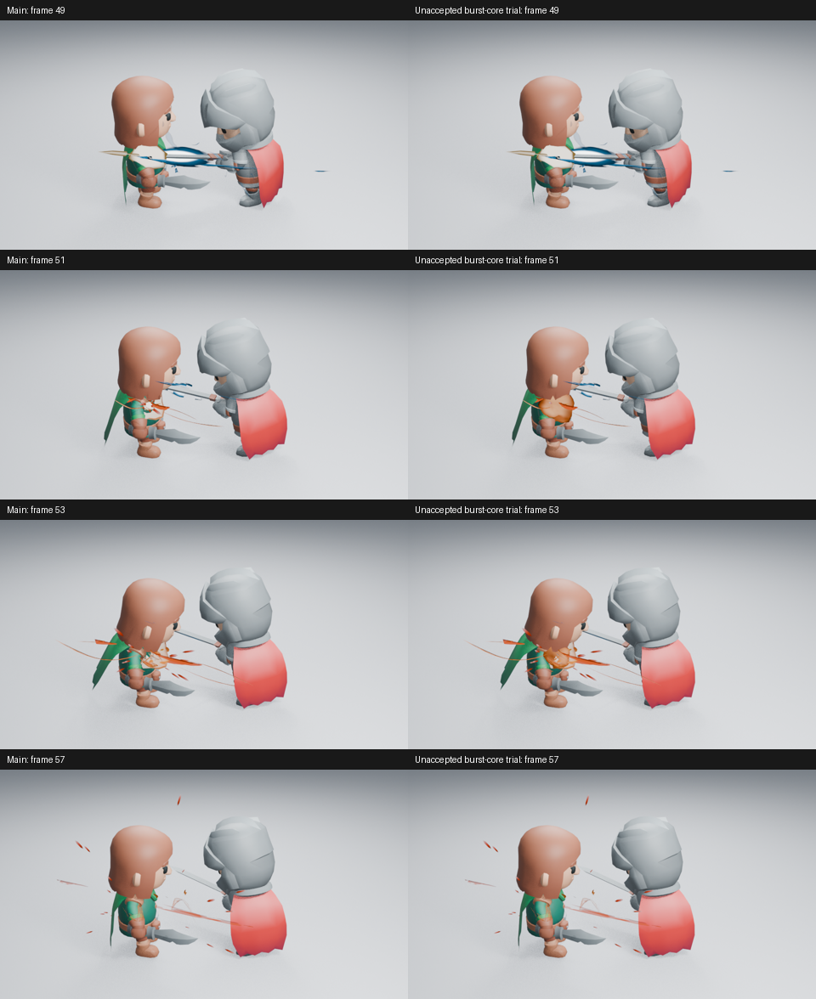
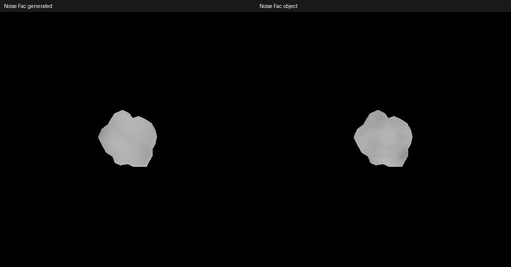

# 命中短闪之后的爆发主体

这项试作检查 Impact Burst 的阶段衔接，不继续修改三片压力曲面的截面。功能源码为 `5d7bfea`，没有进入 main；本轮未通过艺术判断，原生功能检查已单独完成。

## 实际查看的第三方参考

参考为 M. Atif 的 [Stylized Frag Launcher Explosion](https://realtimevfx.com/t/stylized-frag-launcher-explosion-overwatch-inspiration-breakdown-posted/1894)，以及[第 21 帖的拆解](https://realtimevfx.com/t/stylized-frag-launcher-explosion-overwatch-inspiration-breakdown-posted/1894/21)。原帖也展示了 Overwatch 游戏录像，两者均为第三方作品，不是本插件效果。

已实际读取原帖两张 GIF、第 13 帖较快版本和第 21 帖的分层 GIF，各取八张带帧号的样本；另读取 Burst Core 的 1920×1039 原始截图。没有实时观看这些动画，也没有将 GIF 的播放间隔当成本插件的 24 fps 时序。

作者将 Instant Flash、Burst Core、Burst Ring、Shockwave、Smoke 和 Sparks 分开：短闪只持续两三帧；Burst Core 向外运动并减速，在完全停下前淡出。截图和抽帧中，短闪后仍有不规则热块维持焦点，外圈扩大，主体逐渐变暗，火花随后离开。作者使用火焰纹理；本项目不复制其纹理、模型或完整层数。

这提供的原则是**区分短闪与持续爆发的主体，让外圈和点缀围绕主体交接**。它不是“需要 18 层”或“增加发光就有效”的依据，也不能证明原帖每一项技术说明在 Blender 中可直接复现。

## 当前生成器的缺口与试作

现有 Core Flash 的网格只有三帧，并随进度收缩；随后主要由三个开放压力片、细喷射、压力弧和余烬承担画面。正常、取消压力裁切及隐藏压力片的诊断已经实际查看：提高覆盖率会暴露大片折面，较紧曲面的试作也没有明显改善整体画面，已单独保存为未采用实验。

新试作保留原四层，复用现有粒子控制器加入一个八帧的 Burst Core。它采用不规则原生网格、快速压缩展开、随时间改变的表面形变、局部热色和加速侵蚀，再交给既有压力层及余烬。Low／Medium／High 改变网格采样；只有 Size、Fade、Strength 和原有颜色入口，没有新通用框架、模拟缓存或逐帧 Python。

该实现没有使用体积网格或外部贴图；所有数据均能保存在原生文件中。是否真正改善命中焦点、遮挡与消散，仍需以真实角色的同帧对照、多个阶段和原生回放判断。不能因为增加一层就视为完成。

## 实图与决定

已实际读取出现、主体与衰减的第 49／51／53／57 帧高清，960×540、Eevee 16 samples、AgX。短闪之后的焦点更连续，但主体仍像暖色团块，内部热区和外冲形态不足，未采用，也没有构建示例资产或宣称整体品质通过。

两张 512×512 原生灰度诊断也已读取。Generated 与 Object 均有变化；不透明区的灰度标准差分别约 5.37／6.07，因此“Generated 是常量”的假设不成立。下轮应改进主体向外运动、减速和分离的形态交接，避免继续只改变颜色或局部噪声。

19 项 Impact 行为检查通过；无插件重开再次验证形状、像素、驱动和清场。检查曾发现热色的非整数幂驱动不满足简单表达式要求，已将幂运算移入 Shader Math 节点，保持原生安全播放；关闭零发光检查中的 PNG 抖动后，精确黑色比较通过。没有为未采用试作运行完整库、资产与性能验收。原始摘要见[检查清单](../images/impact-core-trial.json)。
