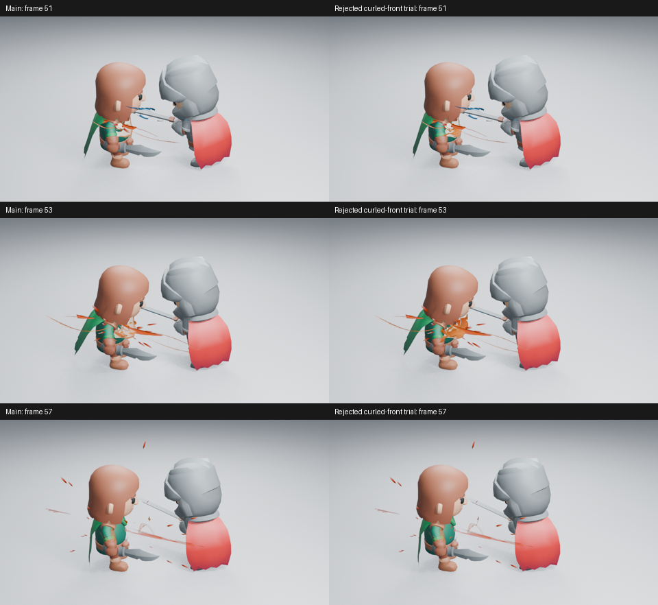
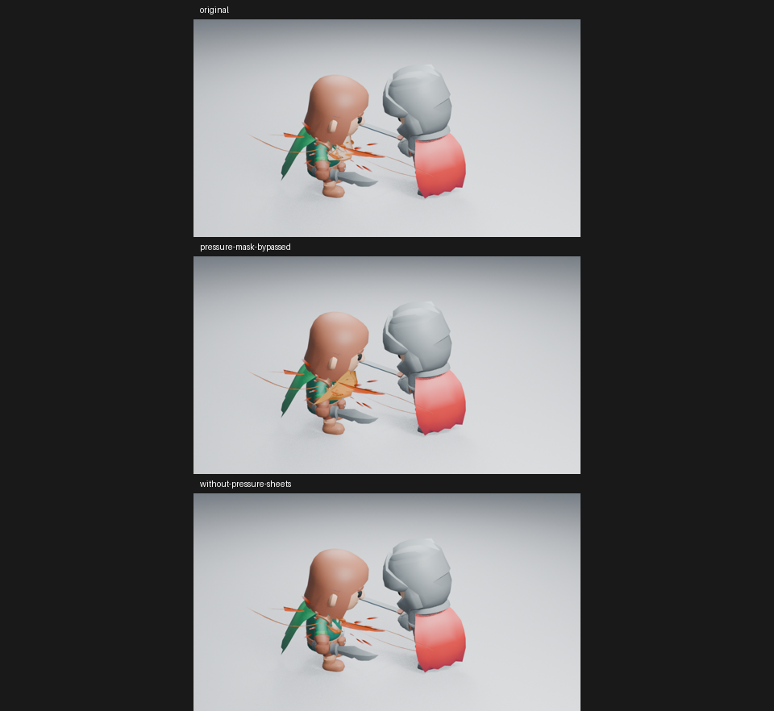

# 未采用：更紧的压力曲面与边缘破碎

本试作没有进入 main，也没有计作艺术改进。它检查 Impact Burst 为什么在角色命中处显得薄、碎，避免继续只调整原曲面的局部形状。

真实生成器将三个压力体的路径卷得更紧，根部收窄、前沿展开；材质让早期破碎集中在侧边，保留中部流动。没有改变发光强度、粒子数量、机位、细喷射或余烬。已实际读取第 51／53／57 帧的 960×540、Eevee 16 samples、AgX 图。

第 51 帧的暖色略集中，但第 53 帧更像橙色折片，没有明显增加命中的力量或体积感；第 57 帧也没有更丰富的消散。**收益不足，不采用。** 没有为未采用的试作运行完整回归、重新构建资产或宣称动画验收。

## 材质与造型的分层检查

三张第 53 帧高清诊断图均已实际读取。取消压力片裁切后，大片折面暴露；隐藏压力片后，细喷射、压力弧和余烬仍在。说明提高主体覆盖率可以减少碎屑，却不能把现有曲面变成有体积的压力爆发。诊断只修改内存中的原生材质连接，没有保存为最终效果。

下一轮应先试验具有不同轮廓与体积表现的主体，让接触后的短闪、扩张和剥离有清楚的形态交接，再决定如何配合现有细线与余烬；不继续靠这三片曲面的截面、亮度或节点数量证明进展。

原始源码与图像摘要见[检查清单](../images/impact-coherence-rejected.json)。源码试作 `e133879` 已推送，继续跟踪 [#178](https://github.com/mumu-lhl/blender-vfx-studio/issues/178)。本轮没有观看实时播放。
