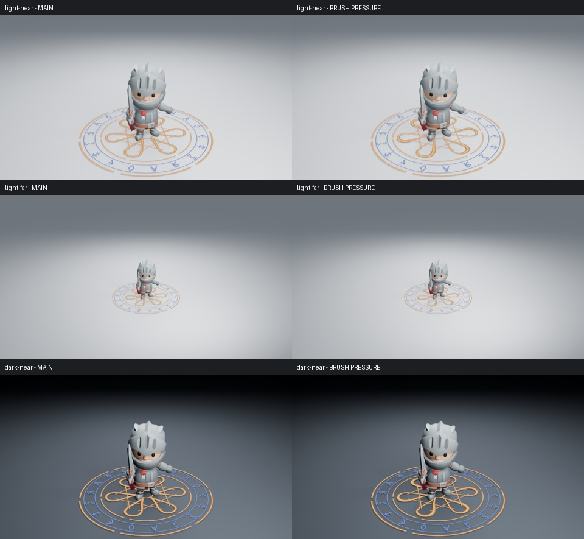

# 魔法阵笔画粗细试验：未采用

**结论：不合入主线，不增加参数。** 对当前主线的真实角色镜头做了三组第 40 帧同机位比较，分别为浅背景近景、浅背景远景、暗背景近景。六张 960×540、Eevee 16 samples、AgX 原图均已实际读取。近景笔画的粗细变化可辨认，远景整体辨识度没有明显提升，不值得为此再展开节点或 UI 修改。



现有材质已经通过笔画横向属性形成暗边，不能把缺少暗边当作问题。试验只沿六条主印花瓣的路径改变 `sigil_weight`：一侧较粗、另一侧较细，两端收窄。原有 Geometry Nodes 用它乘 Width 形成实际笔画宽度；图案位置、符文、颜色、发光、逐笔时序和节点保持不变。没有修改展示场景或后期。

原始场景来自主线相关源码一致的实际 CI 附件，源码摘要已核对。三次原生渲染均正常退出，脚本没有加载插件。这个试验只查看静态保持阶段，**没有检查动画、性能或完整施法，不作为任何艺术验收通过的证据**。来源、图像摘要和原生记录见[清单](magic-brush-pressure.json)。对照页只缩放、排列和标注，未调色或重绘。

在该实验分支复现远景：

```sh
LP_NUM_THREADS=2 MESA_SHADER_CACHE_DISABLE=true blender -b --factory-startup -t 2 --disable-autoexec --python-exit-code 1 --python tools/magic_preview.py -- --far --frames 40
LP_NUM_THREADS=2 MESA_SHADER_CACHE_DISABLE=true blender -b work/magic-review/light-far/magic.blend -t 2 --disable-autoexec --python-exit-code 1 --python tools/experiments/magic_brush_pressure.py
```

输出在 `work/magic-contrast/probe/light-far/`。主线生成器保持不变，后续优先检查完整施法的能量衔接与整体力量，避免重复收益很小的局部笔画调整。
