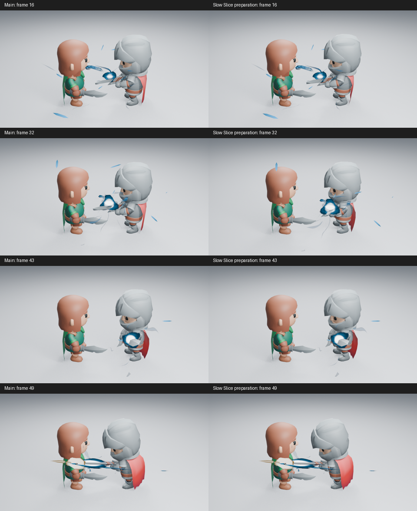

# 挥斩中的慢速蓄势

角色镜头原先在充能时保持待机，第 37 帧才开始出刀。这次只调整测试镜头的原生动作时间，让同一段 Slice 挥斩的开头缓慢收剑，再接回原有的快速切入。没有切换另一段下劈动作，也没有增加骨架系统、逐帧 Python 或新的特效参数。

图中左侧为 main 的原动作，右侧为慢速预备；相机、角色位置、充能生成器和特效强度相同。排列页只缩小原始 PNG 并加标签，没有调色或重绘。

## 实现与已确认的行为

Blender 的 NLA 可以用一条时间曲线控制动画片段的播放进度。Slice 片段从第 1 帧开始，前 18% 动作延长到第 42.76 帧；之后沿用原来第 37–69 帧的时间映射。起步用 12 帧混合到待机，收招保留原有 4 帧混合。

实际求值对照表明，第 16／32 帧的剑姿态有变化；第 43／47／49／51／57／65／69 帧与原挥斩的世界矩阵最大误差小于 0.000001，真实接触仍在第 49 帧。充能回刃、刀光轨迹和命中设置保留。矩阵误差限验证运动轨迹，不代表两次图像逐像素相同。

已实际查看第 16／32／37／43／49 帧的 960×540、Eevee 16 samples、AgX 图。中段剑与核心逐渐收向持剑侧，随后进入原挥斩；白热焦点仍能辨认。身体张力的提升有限，不能把更早开始移动等同于有力的攻击。

保存场景后，在关闭自动执行、未加载插件的新进程中按 49→16→32 重渲染，三张高清 PNG 与保存前 RGBA 完全一致；角色姿态改变，第 96 帧效果几何清场。原有接触与刀光方向检查也通过。

## 尚待检查

35 张第 1–69 帧的原生奇数帧正在生成，目前只实际读取 1–11 帧。暗背景、远景和新增原动作对照回归尚未完成。未观看实时播放，不宣布速度感或整体艺术验收通过。

方案保留为 [PR #202](https://github.com/mumu-lhl/blender-vfx-studio/pull/202) 草稿，跟踪 [#189](https://github.com/mumu-lhl/blender-vfx-studio/issues/189)。充能进流和外围粒子的整体艺术问题继续由原问题跟踪，本实验不代替真实生成器的改进。
