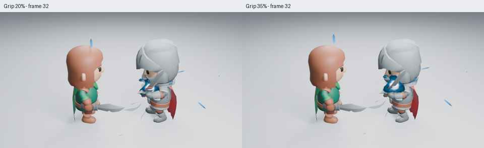
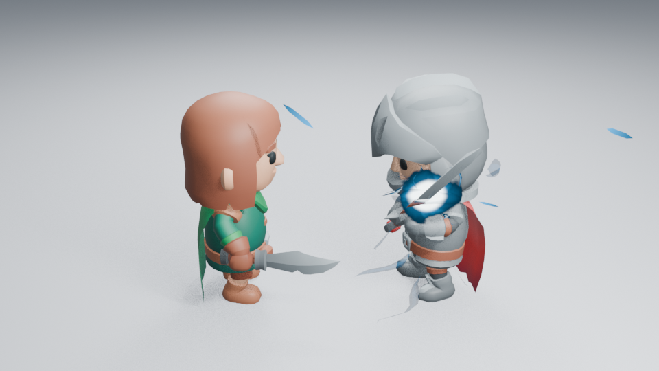

# 能量场与预备动作复查：继续保持草稿

2026-10-30，跟踪 #189，延续 PR #190。本分支把新能量场放进已试过的原生下劈开头，再比较剑柄附近 20% 和稍靠前 35% 的绑定点。两种各四张 960×540 Eevee 图均已实际读取：32、37、39、49 帧。没有改变镜头、灯光或发光参数。

35% 位置让白热区少受手部遮挡，眼部保持清楚，但能量仍贴近下巴。第 37–43 帧从抬剑回到近水平，再进入原挥斩后摆；姿态变化更明显，尚不能证明力量感与连续性更好。因此没有把它合入 main，也没有更新为已完成的角色演出。

还从保存场景未加载插件，渲染并实际读取第 29–49 帧全部奇数帧，共 11 张 480×270：

[29–39](images/windup-field-motion-01.png) · [41–49](images/windup-field-motion-02.png)。未观看实时播放，未验收本候选的暗背景或远景。

接触时序与实际刀光前缘检查通过；无插件新进程确认准备姿态有变化，第 1 帧保持原姿态，第 41–56 帧武器轨迹不受预备层影响，倒序跳帧可复现，35% 绑定在第 43 帧回到原 50% 位置。进程正常退出。可先运行 `tests/test_character_timing.py` 保存检查场景，再打开 `work/character-timing-test.blend`，关闭自动执行并运行 `tests/character_preparation_reopen.py`。

源码 `530660c`；图像与实际读取范围见[记录](images/windup-field-samples.json)。本轮只保留草稿，不用功能测试代替动作艺术验收。
